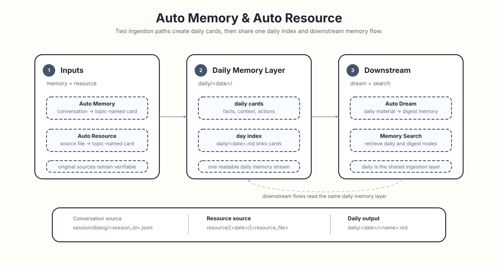

# Auto Resource `Beta`

Auto Resource is ReMe's entry point for interpreting resources and is currently in **Beta**. Resource files first enter
`resource/`, preferably under a date directory, and are then interpreted into daily resource cards. Each card's filename
comes from the LLM-generated frontmatter `name`, and `source_resource` links the card back to its original file.

<p align="center">
  
</p>

For the general file semantics of workspace layers, `resource/`, and `daily/`, see
[Memory as File](./memory_as_file.md). For the flow that writes conversations to daily, see
[Auto Memory](./auto_memory.md).

```text
resource/[YYYY-MM-DD/]<resource_file>
  ├─ step 1: daily/YYYY-MM-DD/<generated_name>.md # interpreted resource card
  ├─ step 2: source_resource points to the original resource
  └─ step 3: daily/YYYY-MM-DD.md                  # daily index linking the cards
```

## What It Records

Auto Resource does more than copy file content. It extracts information that will make the resource easier to retrieve
and understand later:

- Core content: what the resource is mainly about.
- Structure: its sections, tables, fields, and data organization.
- Key details: important numbers, names, dates, and conclusions.
- Context and purpose: why the resource exists and how it relates to current work.
- Actionable items: tasks, deadlines, and follow-up work.

In short, it turns "a file was archived" into "the resource is usable."

## Original Resource Entry Point

Auto Resource uses `resource/` as the entry point for source material. Date directories are recommended, and their date
determines which daily memory layer receives the interpreted card. A file directly under `resource/` is also supported
and uses today in the application timezone when it is first processed. On later days, an exact `source_resource` match
keeps updates and deletion tied to that original daily card instead of creating a new card or leaving an orphan.

Example directory:

```text
workspace/
  resource/
    quick-note.txt             # enters today's daily layer
    2026-06-20/
      market-report.md
      meeting-notes.csv
```

Text resources such as `md`, `txt`, `json`, `jsonl`, `csv`, `yaml`, and `html` are the primary fit. Image resources
(`png`, `jpg`, `jpeg`, `webp`, `gif`, `bmp`, `tiff`, `heic`) produce caption cards as described in
[Image Resources](#image-resources).

Internally, one `AutoResourceStep` receives each change batch and sends every item to the first configured processor
whose class-level matcher accepts it. `AutoImageResourceStep` handles image suffixes and `AutoTextResourceStep` is the
final fallback. A new modality can therefore add a registered processor, its prompt, and one `dispatch_steps` entry
without changing the router.

## Resource Retention and TTL

The default and `proactive` configurations retain source files. A custom file catalog can use `ttl_days` and
`cleanup_catalog_step` for dated temporary directories, but cleanup must preserve material referenced by pending
Proactive events. The named-agent flow uses durable event acknowledgements rather than catalog processing flags.
Permanent material should remain in user-controlled workspace paths.

## Scheduled Screen Capture

`config=proactive` enables `screen_capture_cron` every five minutes in the application timezone, without a startup capture.
It publishes screenshots to the `work` task, independently of Codex dialogue collection. Set
`jobs.screen_capture_cron.enabled=false` to disable it. To change recipients, set `task_names` on
`screen_capture_step` and name the event-driven tasks that should receive screenshots.

`ScreenCaptureStep` saves one original-size PNG per display and records the recipients before publishing
`metadata.json`. The observation lists the workspace-relative PNG paths. If delivery is interrupted, the collector
resumes with the saved recipients and event ID.

```text
resource/screenshot/YYYY-MM-DD/hhmmss_<uuid4-first-6>/
  1.png
  2.png
  metadata.json
```

Directories use the collector source, application-local date and time plus the first six UUID4 hex characters. Screenshots use `screenshot`.
`metadata.json` lists the collected files using package-relative paths. Event IDs
are derived from the workspace-relative package path. Existing packages stay in place and retain their saved references.

The manifest uses `ResourceMetadata`: timezone-aware creation/update timestamps, source, description, connector class
and package-relative file entries. Any failed display removes the incomplete package without sending an event.
Cancellation waits for synchronous capture cleanup. macOS requires Screen Recording permission for the host process;
headless or unavailable displays fail the round. Collection does not call an LLM; the receiving Proactive Agent interprets
the event separately.

Screenshots compare each display with the latest saved group, measuring similarity as the fraction of pixels with
identical RGB values. A screenshot package and event are skipped when layouts and image sizes match and every display
has more than 99% identical pixels. Otherwise, every display is retained for context. Exactly 99% is retained;
skipped captures do not update the comparison baseline. Configure the Step's `similarity_threshold`, which defaults to
`0.99`. Set it to `1` to skip only identical images. Local changes affecting less than 1% of pixels, including small text
changes, may be filtered.
Filtering screenshots does not prevent delivery of new Codex dialogue.

## Scheduled Codex Dialogue Collection

`codex_dialogue_cron` first runs `codex_dialogue_init_step` to establish the reading baseline at startup. It then reads
new user messages, visible progress messages and final answers from `${CODEX_HOME:-~/.codex}/sessions` every five
minutes and delivers them as `codex_dialogue` events. Reasoning, tool calls and results, subagent sessions and ReMe's
own sessions are excluded.

Dialogue packages live under `resource/codex_dialogue/YYYY-MM-DD/HHMMSS_<suffix>/`. Events give agents `dialogue.md`
and paths to its image attachments. The Markdown shows the project, session, turn and message IDs, and lists each
user message, progress update and final answer in order. A follow-up in an active turn has its own message ID under
the same turn. Images are linked next to their messages. The notebook runtime includes the dialogue in its prompt
and checks existing records by project and ID through `todo` and `idea`.
`resource/codex_dialogue/progress.jsonl` retains committed reading offsets and message IDs.
`pending.json` freezes an unfinished batch so delivery can be retried before reading further changes. These collector
files are not included in event paths. Restarting resumes the saved progress without replaying delivered dialogue.
An idle scan writes no new progress record; tool-only changes still advance offsets without producing dialogue events.

## Scheduled Finance Collection

`config=proactive` enables three collection jobs: `finance_news_cron` fetches new CLS news every five minutes, and
`stock_quotes_cron` collects Xiaomi (01810.HK), Alibaba (09988.HK), Tencent (00700.HK), Apple (AAPL), Amazon (AMZN)
and Meta (META) every five minutes during their market sessions. Install `reme-ai[finance]` for the trading calendars;
this extra is included in `[core]`. Calendars account for holidays, half-days, lunch breaks and US daylight saving time.
Quotes may be delayed; records retain quote and collection times. Collection stops at market close. Pending batches
wait until all markets represented in the batch reopen. Only changed symbols are saved, comparing trading date,
price and previous close with each symbol's latest saved quote; older quote timestamps are ignored.

`btc_quotes_cron` independently collects BTC/USDT spot statistics every five minutes, 24/7, from Binance's public
[market-data-only API](https://developers.binance.com/en/docs/products/spot/faqs/market_data_only), without an API key.
BTC uses the rolling 24-hour percentage change, with the statistics window and collection time saved explicitly;
its USDT prices and percentage basis are distinct from stock quotes. Stock holidays and collection failures do not stop BTC.
Unchanged prices and 24-hour opening prices produce no new resource or event; advancing collection or window times
alone does not count as new information. Older statistics windows are ignored.

Under `resource/<source>/YYYY-MM-DD/hhmmss_<suffix>/`, every news batch saves new items in `news.md` and retains
`news.jsonl` for ID deduplication. `news.md` shows titles, publication times, source links and full text. If the title
equals the body, it appears once. Stock and BTC batches save `quotes.jsonl` and `btc.jsonl`, respectively. The `finance`
agent prompt lists `news.md` or the quote file. Collection does not use an LLM. Empty batches produce no files or events.
News uses a rolling 24-hour lookback and retained news IDs for deduplication; outages longer than
the lookback can leave gaps. After a successful fetch, a source-owned progress file narrows subsequent requests to
the last checked time with a ten-minute overlap, bounded by the 24-hour lookback. Removing this progress file restores
the full lookback; retained news IDs still prevent duplicates. Saved batches without a delivery receipt are retried
before collecting new inputs, subject to stock trading hours.
Per-package `delivery-finance.json` receipts prevent replaying successful deliveries; resources are retained.

Start the service in one terminal with `reme start config=proactive`. The default `finance` task runs on incoming
observations. Check the task in another terminal:

```bash
reme manage_proactive_agent action=status agent_name=finance
```

Use the returned `task_path` to edit the task description and AI-news preferences in `TASK.md`. Edits persist across restarts.
Disable a collector with `jobs.finance_news_cron.enabled=false`, `jobs.stock_quotes_cron.enabled=false` or
`jobs.btc_quotes_cron.enabled=false` at startup.

## Image Resources

Text and image resources share the same agent-wrapper and note-writing tools. Image inputs add a native AgentScope
image block alongside the interpretation instructions; the agent writes a caption card linked to the original image.
The card body starts with an `![[resource/...]]` embed link and the frontmatter carries `kind: image` and `media_type`,
so text search reaches image content through the caption.

Image processing is enabled by default (`include_images=true`) and requires an AgentScope wrapper bound to a compatible
model and formatter. Configure the model through `components.agent_wrapper.<name>.as_llm`, selecting the wrapper with
`agent_wrapper` on the resource Step. The Agent interprets the image through its configured model and tools;
a workflow can make multiple model requests.

Each image interpretation starts a new session. Use the returned `agent_session_id` to find its processing record;
reprocessing the same image still updates the original card. The body should contain the image embed followed by a
description or transcription under `## Caption`, not an empty caption or a JSON response. Leave `status` to later
processing steps and keep its existing value when updating the card.

Customize image instructions with `prompt_dict.resource_instructions` (`resource_instructions_zh` for Chinese).
Shared create/update templates insert these instructions at `{resource_instructions}`;
when the placeholder is omitted, the instructions are appended.

Set `include_images=false` on an `auto_resource` call or as a Job default to skip **all** image events, including
deletions. Call-time values override Job defaults; when neither is set, image processing is enabled. For the watcher, use
`jobs.resource_watch_loop.include_images=false`; for manual calls, use `jobs.auto_resource.include_images=false`.
The image processor reports each skip in the existing result and warning log; text processing is unchanged. Existing
image cards are left untouched, even if their source image is deleted. Re-enabling images does not replay skipped
events; explicitly submit the affected paths to `auto_resource` when compensation is needed. The wrapper's configured
image-count limit is respected and must allow at least one image per resource call; it is not increased automatically.

Configure the wrapper when starting the persistent service. For example, to allow one image per agent context:

```bash
reme start components.agent_wrapper.default.context_config.max_image_num=1
```

The watcher processes resource changes automatically. To explicitly reprocess an existing `resource/photo.png`, run
the client in another terminal using the same workspace:

```bash
reme auto_resource include_images=true changes='[{"path":"resource/photo.png","change":"modified"}]'
```

Images wider or taller than 2048px are downscaled,
and provider-unfriendly formats are re-encoded, in memory for the request only; the original file under
`resource/` is never modified. Before a full decode, image dimensions are checked against a default limit of 40,000,000
pixels; images over the limit and Pillow decompression-bomb warnings fail only that resource. EXIF orientation is
applied to the in-memory request copy before resizing or conversion. Oversized JPEGs first use decoder-level
downsampling, followed by a final thumbnail pass when needed. The VLM request MIME and the card's frontmatter
`media_type` use the format Pillow detects from the image bytes, rather than trusting the filename extension. When an
image changes, its card is updated in place; when the image is deleted, the card is removed with it, provided image
processing is enabled.

Image preprocessing uses Pillow from the `core` extra. HEIC resources additionally require the optional
`image-heif` extra: `pip install "reme-ai[image-heif]"`. Other supported image formats do not load or require the HEIF
plugin.

## Resource Cards

Each resource file produces one daily resource card. The system initially uses the resource file's stem as a temporary
path. After the matching processor writes the card, the file is renamed according to its frontmatter `name`:

```text
resource/2026-06-20/market-report.md
        ↓
daily/2026-06-20/market-report-highlights.md
```

The resource card links to the original file through frontmatter:

```yaml
source_resource: "[[resource/2026-06-20/market-report.md]]"
```

When a resource changes, Auto Resource finds and updates the corresponding card through an exact `source_resource`
match. When an enabled resource is deleted, only the explicitly linked daily note is removed. A same-stem note without that
provenance marker is treated as user-owned and left untouched; new resource cards use a collision-free path instead.

A failed call may still have changed a card; `modified` records whether the file changed. If the agent writes the card
and then fails or is cancelled, the written content stays on disk. ReMe tries to complete metadata and update the day's
index for the card linked through `source_resource`, while preserving the original error or cancellation. A failed
image-note format check also leaves the written content in place. Failed calls are not retried automatically.

## Daily Index

Resource cards enter the same daily memory layer as Auto Memory cards. The day's `YYYY-MM-DD.md` page acts as an index
and organizes those resource cards:

```text
daily/
  2026-06-20.md
  2026-06-20/
    market-report-highlights.md
    meeting-notes-summary.md
```

To review which resources were processed on a day, start with `YYYY-MM-DD.md`. To inspect what was distilled from one
resource, open its corresponding resource card.

## Preserving the Original Resource

The interpreted daily note is optimized for readability; the original resource is retained for trust and verification.

Auto Resource does not move the original file. It remains at its original path under `resource/`. Resources can
therefore enter the daily memory flow while their source files stay in their original location.

## What Happens Next

Auto Resource only creates resource interpretations in the daily layer. To distill long-term knowledge from resources
into `digest/`, use [Auto Dream](./auto_dream.md). The default live index covers daily cards and digest nodes. Manual
`reindex` only rebuilds search indexes from chunks already accepted by an ingestion path; it does not add the original
resource files to search. See [Memory Search](./memory_search.md).
