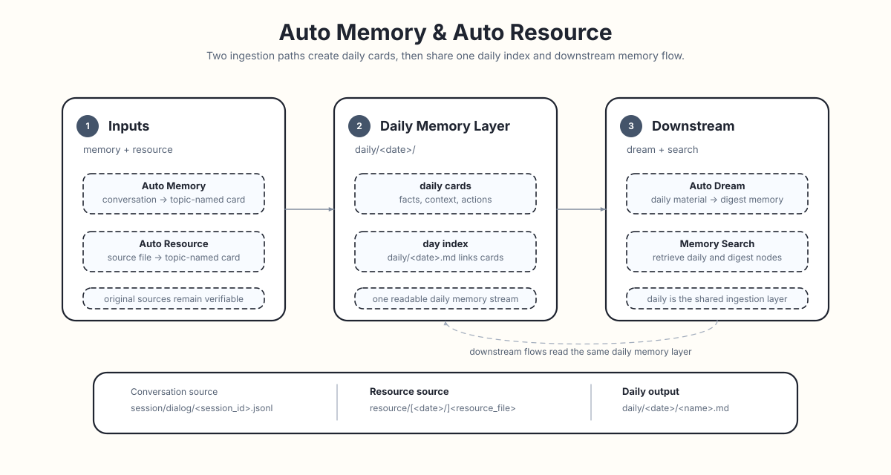

# Auto Resource `Beta`

Auto Resource is ReMe's entry point for interpreting resources and is currently in **Beta**. Resource files first enter
`resource/`, preferably under a date directory, and are then interpreted into daily resource cards. Each card's filename
comes from the LLM-generated frontmatter `name`, and `source_resource` links the card back to its original file.

<p align="center">
  
</p>

For the general file semantics of workspace layers, `resource/`, and `daily/`, see
[Memory as File](./memory_as_file.md). For the flow that writes conversations to daily, see
[Auto Memory](./auto_memory.md).

```text
resource/[YYYY-MM-DD/]<resource_file>
  ├─ step 1: daily/YYYY-MM-DD/<generated_name>.md # interpreted resource card
  ├─ step 2: source_resource points to the original resource
  └─ step 3: daily/YYYY-MM-DD.md                  # daily index linking the cards
```

## What It Records

Auto Resource does more than copy file content. It extracts information that will make the resource easier to retrieve
and understand later:

- Core content: what the resource is mainly about.
- Structure: its sections, tables, fields, and data organization.
- Key details: important numbers, names, dates, and conclusions.
- Context and purpose: why the resource exists and how it relates to current work.
- Actionable items: tasks, deadlines, and follow-up work.

In short, it turns "a file was archived" into "the resource is usable."

## Original Resource Entry Point

Auto Resource uses `resource/` as the entry point for source material. Date directories are recommended, and their date
determines which daily memory layer receives the interpreted card. A file directly under `resource/` is also supported
and uses today in the application timezone when it is first processed. On later days, an exact `source_resource` match
keeps updates and deletion tied to that original daily card instead of creating a new card or leaving an orphan.

Example directory:

```text
workspace/
  resource/
    quick-note.txt             # enters today's daily layer
    2026-06-20/
      market-report.md
      meeting-notes.csv
```

Text resources such as `md`, `txt`, `json`, `jsonl`, `csv`, `yaml`, and `html` are the primary fit. Image resources
(`png`, `jpg`, `jpeg`, `webp`, `gif`, `bmp`, `tiff`, `heic`) produce caption cards as described in
[Image Resources](#image-resources).

Internally, one `AutoResourceStep` receives each change batch and sends every item to the first configured processor
whose class-level matcher accepts it. `AutoImageResourceStep` handles image suffixes and `AutoTextResourceStep` is the
final fallback. A new modality can therefore add a registered processor, its prompt, and one `dispatch_steps` entry
without changing the router.

## Resource Retention and TTL

The default configuration does not automatically delete source resources. `config=proactive` uses one catalog to track
**successfully confirmed file state** and explicitly enables this retention convention:

- Store temporary resources as packages under `resource/YYYY-MM-DD/{uuid_hex}/`, discovered through `metadata.json`.
- Keep permanent material elsewhere in the workspace, for example under `archive/`.
- Loose root files, non-date directories, invalid dates, and date-directory symlinks are preserved by physical cleanup.

Configure directories, filename filtering, and retention once on the catalog:
Move the previous `jobs.resource_cleanup_cron.ttl_days` setting to `components.file_catalog.resource.ttl_days`.

```yaml
components:
  file_catalog:
    resource:
      backend: local
      watch_dirs: [resource_dir]
      watch_suffixes: []
      watch_filenames: [metadata.json]
      ttl_days: 7
```

`watch_dirs` accepts existing application directory fields or workspace directories, such as `resource_dir`,
`resource_dir/inbox`, and `inbox`. Scan and cleanup roots must stay inside the workspace and contain no symlinks.
`watch_filenames` matches exact filenames. When suffix and filename filters are both configured, both must match;
empty filters accept every file. Physical cleanup ignores file filters and deletes the entire expired date directory,
including uncataloged images and empty directories.

`resource_watch_loop` selects this scope with `file_catalog: resource`. It only watches and logs live events; it does not
advance the catalog, call an LLM, or create daily cards. `resource_changes` scans source files on
each call, returning existing, unexpired `metadata.json` paths added or modified since acknowledgement.
It works without a running watcher, does not advance the catalog, and repeats unacknowledged paths. Deleted files are omitted.

Start the service in one terminal:

```bash
reme start config=proactive components.file_catalog.resource.ttl_days=7
```

Query pending resources from another terminal:

```bash
reme resource_changes
reme resource_changes limit=40
```

`answer` is a sorted list of workspace-relative path strings, capped by `limit` (a positive integer, default `20`).
Unreturned resources remain pending. Read each manifest's `description` and `files`, process the
whole package, then pass only successfully processed manifest paths to `resource_processed`:

```bash
reme resource_processed paths='["resource/2026-11-05/7bf0379a0c0d4bc6a436508052727dae/metadata.json"]'
```

After acknowledging a batch, call `resource_changes` again to retrieve the next batch.

Both `answer` and `success` are booleans: `true` confirms the whole batch; out-of-scope, missing, non-regular, or expired
paths and I/O failures return `false` without advancing any checkpoint in the batch. `paths` is required; an empty list
succeeds, and repeated acknowledgement is allowed. Unselected resources remain pending.
Both Jobs bind `file_catalog: resource` in their Step configuration and expose no catalog selector.

The proactive watcher and `resource_changes` discover only files named exactly `metadata.json`; images, other JSON files,
and loose payloads are not discovered independently. Published packages are immutable snapshots; publish updates in a new
UUID directory. Acknowledgement records each file's current mtime without checking the version consumed, so packages must
remain unchanged during processing. Editing or deleting a payload alone does not make its package pending again.
Consumers must still check that listed files exist and stay inside the package. Catalog confirmation state is never
written into resource metadata. Existing Auto Resource processing and its defaults stay unchanged.

Processing state is stored in `metadata/file_catalog/resource.jsonl.zst`. To process all existing resources again,
stop the service, back up and move aside this derived catalog, then restart. Retain the original resource files.

TTL takes precedence over consumption. Calendar age in the application `timezone` determines expiry, independent of file
mtime. On 2026-11-05 with `ttl_days: 7`, directories dated 2026-10-29 or earlier expire; 2026-10-30 and later remain.
Expired resources immediately leave pending results and cannot be acknowledged. Every hour, `resource_cleanup_cron` asks the
catalog to delete expired directories and matching catalog entries without waiting for processing. An in-flight consumer
cannot restore expired entries through a late acknowledgement. `ttl_days` must be a positive integer.

Cron first runs at the next hour after startup; physical deletion does not run while the service is stopped.
`jobs.resource_cleanup_cron.enabled=false` only disables physical cleanup; `resource_changes` and `resource_processed`
still apply the configured TTL.
Failed deletions retain entries for directories that still exist and fail that execution; later runs retry.
Cleanup requires descriptor-relative safe directory deletion (Linux and macOS); unsupported platforms fail without deleting files.
See [`LocalFileCatalog`](https://github.com/agentscope-ai/ReMe/blob/main/reme/components/file_catalog/local_file_catalog.py).
The existing `file_catalog.delete()` still removes catalog entries only.

Cleanup does not rewrite other directories or references. If another configuration also enables Auto Resource, its existing
deletion handlers still remove associated daily cards.

## Scheduled Screen Capture

With `config=proactive`, `screen_capture_cron` runs at minutes 00, 15, 30, and 45 in the application timezone.
It does not capture immediately on startup or replay missed intervals. Install `pip install "reme-ai[core]"`,
then start with the preceding `reme start config=proactive` command.
Set `jobs.screen_capture_cron.enabled=false` to disable capture.

Capture observes the desktop of the host running ReMe. On macOS, grant Screen Recording permission to the actual
running process. Missing dependencies, permissions, displays, or a graphical session fail that run without publishing
a resource package; the next scheduled run retries. Availability depends on the local MSS backend.

Under `reme/steps/proactive/data_connectors/`, `BaseConnectorStep` stages, validates, and atomically publishes a package.
`ScreenCaptureStep` saves a separate PNG at the size returned by MSS for each display, without merging or resizing:

```text
resource/YYYY-MM-DD/{uuid_hex}/
  1.png
  2.png
  metadata.json
```

`metadata.json` follows the `ResourceMetadata` schema:

```json
{
  "schema_version": 1,
  "dataclass": "ScreenCaptureStep",
  "source": "screen",
  "created_at": "2026-11-05T15:00:00+08:00",
  "modified_at": "2026-11-05T15:00:01+08:00",
  "description": "All display screenshots from one collection; read every image to understand the activity at that time.",
  "files": [{"path": "1.png"}, {"path": "2.png"}]
}
```

`dataclass` names the actual Step class; `source` identifies the channel. Timestamps carry timezone offsets, and the
date directory follows the collection start time. `files` is a nonempty object list: only `path` is required, with optional
`description` or connector-specific fields. Paths are relative to the package and cannot escape it or reference symlinks.
Image filenames use display enumeration numbers for that collection, without promising stability across restarts.
Displays are captured sequentially, not at an identical instant. Any display failure discards the entire staged batch;
the directory appears in `resource/` only after all images and the manifest are ready. Cancellation waits for native I/O
to finish and cleans staged files. There are 96 scheduled collections per day; failed runs save nothing. Packages use
the seven-day TTL described above. Capture does not call an LLM or generate daily cards.

## Image Resources

Text and image resources share the same agent-wrapper and note-writing tools. Image inputs add a native AgentScope
image block alongside the interpretation instructions; the agent writes a caption card linked to the original image.
The card body starts with an `![[resource/...]]` embed link and the frontmatter carries `kind: image` and `media_type`,
so text search reaches image content through the caption.

Image processing is enabled by default (`include_images=true`) and requires an AgentScope wrapper bound to a compatible
model and formatter. Configure the model through `components.agent_wrapper.<name>.as_llm`, selecting the wrapper with
`agent_wrapper` on the resource Step. The former image-Step `as_llm` override and automatic `as_llm.vision` selection
are replaced by that binding. There is no separate caption model, schema-extraction call, or text-only retry after an
agent failure. An agent workflow can make multiple model requests while using its tools.

Each image interpretation starts a new session. Use the returned `agent_session_id` to find its processing record;
reprocessing the same image still updates the original card. The body should contain the image embed followed by a
description or transcription under `## Caption`, not an empty caption or a JSON response. Leave `status` to later
processing steps and keep its existing value when updating the card.

Customize image instructions with `prompt_dict.resource_instructions` (`resource_instructions_zh` for Chinese).
Rename existing `user_message` / `user_message_zh` settings accordingly.
Shared create/update templates insert these instructions at `{resource_instructions}`; older templates
without the placeholder receive them at the end.

Set `include_images=false` on an `auto_resource` call or as a Job default to skip **all** image events, including
deletions. Call-time values override Job defaults; when neither is set, image processing is enabled. For the watcher, use
`jobs.resource_watch_loop.include_images=false`; for manual calls, use `jobs.auto_resource.include_images=false`.
The image processor reports each skip in the existing result and warning log; text processing is unchanged. Existing
image cards are left untouched, even if their source image is deleted. Re-enabling images does not replay skipped
events; explicitly submit the affected paths to `auto_resource` when compensation is needed. The wrapper's configured
image-count limit is respected and must allow at least one image per resource call; it is not increased automatically.

Configure the wrapper when starting the persistent service. For example, to allow one image per agent context:

```bash
reme start components.agent_wrapper.default.context_config.max_image_num=1
```

The watcher processes resource changes automatically. To explicitly reprocess an existing `resource/photo.png`, run
the client in another terminal using the same workspace:

```bash
reme auto_resource include_images=true changes='[{"path":"resource/photo.png","change":"modified"}]'
```

Images wider or taller than 2048px are downscaled,
and provider-unfriendly formats are re-encoded, in memory for the request only; the original file under
`resource/` is never modified. Before a full decode, image dimensions are checked against a default limit of 40,000,000
pixels; images over the limit and Pillow decompression-bomb warnings fail only that resource. EXIF orientation is
applied to the in-memory request copy before resizing or conversion. Oversized JPEGs first use decoder-level
downsampling, followed by a final thumbnail pass when needed. The VLM request MIME and the card's frontmatter
`media_type` use the format Pillow detects from the image bytes, rather than trusting the filename extension. When an
image changes, its card is updated in place; when the image is deleted, the card is removed with it, provided image
processing is enabled.

Image preprocessing uses Pillow from the `core` extra. HEIC resources additionally require the optional
`image-heif` extra: `pip install "reme-ai[image-heif]"`. Other supported image formats do not load or require the HEIF
plugin.

## Resource Cards

Each resource file produces one daily resource card. The system initially uses the resource file's stem as a temporary
path. After the matching processor writes the card, the file is renamed according to its frontmatter `name`:

```text
resource/2026-06-20/market-report.md
        ↓
daily/2026-06-20/market-report-highlights.md
```

The resource card links to the original file through frontmatter:

```yaml
source_resource: "[[resource/2026-06-20/market-report.md]]"
```

When a resource changes, Auto Resource finds and updates the corresponding card through an exact `source_resource`
match. When an enabled resource is deleted, only the explicitly linked daily note is removed. A same-stem note without that
provenance marker is treated as user-owned and left untouched; new resource cards use a collision-free path instead.

A failed call may still have changed a card; `modified` records whether the file changed. If the agent writes the card
and then fails or is cancelled, the written content stays on disk. ReMe tries to complete metadata and update the day's
index for the card linked through `source_resource`, while preserving the original error or cancellation. A failed
image-note format check also leaves the written content in place. Failed calls are not retried automatically.

## Daily Index

Resource cards enter the same daily memory layer as Auto Memory cards. The day's `YYYY-MM-DD.md` page acts as an index
and organizes those resource cards:

```text
daily/
  2026-06-20.md
  2026-06-20/
    market-report-highlights.md
    meeting-notes-summary.md
```

To review which resources were processed on a day, start with `YYYY-MM-DD.md`. To inspect what was distilled from one
resource, open its corresponding resource card.

## Preserving the Original Resource

The interpreted daily note is optimized for readability; the original resource is retained for trust and verification.

Auto Resource does not move the original file. It remains at its original path under `resource/`. Resources can
therefore enter the daily memory flow while their source files stay in their original location.

## What Happens Next

Auto Resource only creates resource interpretations in the daily layer. To distill long-term knowledge from resources
into `digest/`, use [Auto Dream](./auto_dream.md). The default live index covers daily cards and digest nodes. Manual
`reindex` only rebuilds search indexes from chunks already accepted by an ingestion path; it does not add the original
resource files to search. See [Memory Search](./memory_search.md).
