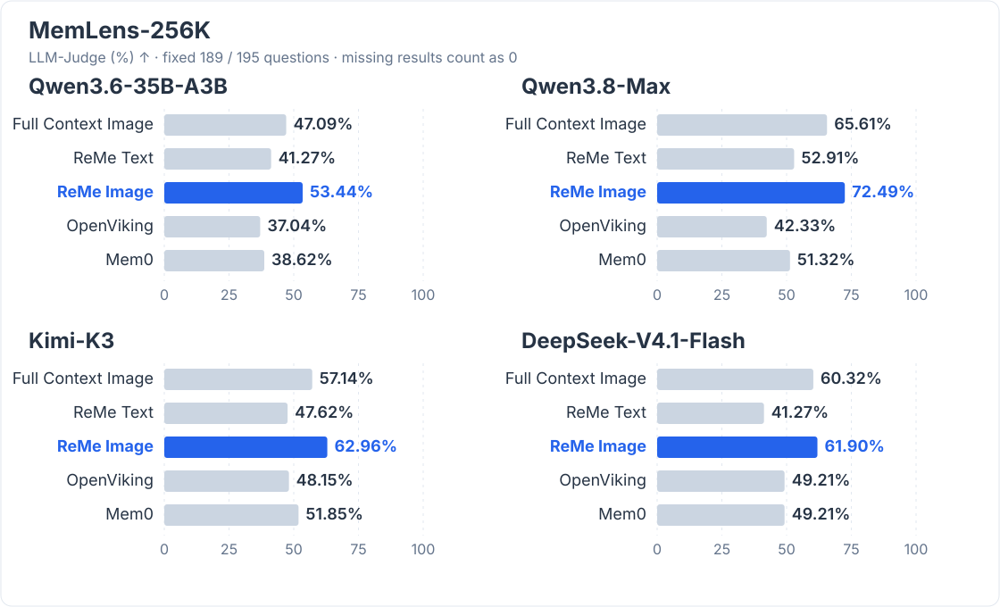

# Bringing Images into Memory

When discussing a system design with an agent, we might send an architecture diagram and use it to decide which modules to change and which designs to keep.

When we later ask, "Why did we keep the task queue last time?", the agent needs to find the earlier discussion and revisit the relationships shown in the diagram.

**This multimodal memory update lets Auto Memory and Auto Resource extract information from images and preserve their sources.**

Images in a conversation can become memories together with the surrounding discussion, while images in the resource directory can become standalone caption cards. Both paths write to the existing `daily/` memory layer.

## Auto Memory: Remember the Image and the Discussion

Suppose you send an agent an architecture diagram and add:

> "Only change the Gateway this time. Leave the Worker and PostgreSQL as they are. Keep the task queue so that traffic spikes do not hit the database directly."

With image input enabled, Auto Memory sends the diagram and the discussion to a vision model together. Text and images stay in their original conversation order, with the speaker and timestamp included. The agent can use the relationships shown in the diagram to record the scope of the change, the reason for keeping the queue, and the constraints on later work.

Auto Memory reads images directly from the conversation. The host application supplies them as message content blocks and passes `include_images=true` when calling `auto_memory` to include them in that round of memory generation.

### Visual Facts Have Sources Too

Conversation images can be uploaded as Base64 data or supplied as HTTP(S) URLs. ReMe preserves their sources as follows:

- The original bytes of Base64 images are saved under `session/images/<session_id>/` by default for later viewing; the directory follows the `session_dir` configuration.
- URL images keep their original addresses. The model service reads them; ReMe does not download them locally.

Auto Memory passes each image's exact source to the agent alongside the image. Its prompt asks the agent to cite the source next to relevant visual facts, and the daily memory's `source_images` frontmatter records these links as well. Later updates merge new sources while preserving existing links. A reader can follow a fact back to the image it came from.

Here is an illustrative memory after uploading a Base64 architecture diagram:

```markdown
Only the Gateway will change this time. The Worker and PostgreSQL remain unchanged.
The architecture diagram shows the Gateway connected to the Worker through a task queue.
See [[session/images/design-review/msg-61-image-1.png]].

The task queue is retained to prevent traffic spikes from hitting the database directly.
```

This records both a relationship visible in the diagram and a decision made explicitly in the discussion. `source_conversation` continues to point to the conversation record under `session/dialog/`, while image sources are preserved separately.

These conversation attachments stay under `session/`. They do not enter resource watching or produce a separate image caption card.

## Auto Resource: Turn Image Resources into Searchable Cards

Some images have no accompanying conversation: a whiteboard photo, a saved report screenshot, or a flowchart you want to consult later. You can place them directly in the workspace's `resource/` directory.

Auto Resource can now use a vision model to read these images and write their visible content into daily cards. Image inputs use the same agent memory-writing tools as text resources, and the original images stay in the resource directory.

For example, place a flowchart at:

```text
resource/2026-10-09/system-overview.png
```

Here is an illustrative image resource card:

```markdown
---
name: System request processing flow
description: The Gateway connects to the Worker through a task queue, and the Worker writes results to PostgreSQL.
kind: image
media_type: image/png
source_resource: "[[resource/2026-10-09/system-overview.png]]"
---

![[resource/2026-10-09/system-overview.png]]

## Caption

The diagram contains a Gateway, a task queue, a Worker, and PostgreSQL.
Requests enter the task queue through the Gateway. The Worker consumes them
and writes the results to PostgreSQL.
```

The card brings the embedded image, its description, and its source link together. Text in screenshots, numbers in charts, and relationships between modules can all become part of the caption. The content depends on the image and the vision model used.

Image resources then participate in the existing retrieval workflow. A later search for "Which modules does the task queue connect?" can find the relevant image through the card's text and follow `source_resource` back to the original file. When a resource image changes, its card is updated. With image processing enabled, deleting the original image removes its resource card.

Auto Resource supports PNG, JPG/JPEG, WebP, GIF, BMP, TIFF, and HEIC. Larger images may be resized or converted for the model request; the original resource files remain unchanged. HEIC requires the optional `reme-ai[image-heif]` package.

## Performance: Multimodal Long-History QA on MemLens-256K {#memlens-256k-results}

On MemLens-256K, ReMe Image achieved LLM-Judge scores of **53.44%**, **72.49%**, **62.96%** and **61.90%** with Qwen3.6-35B-A3B, Qwen3.8-Max, Kimi-K3 and DeepSeek-V4.1-Flash, respectively. These exceed Full Context Image with the same candidate model by **6.35**, **6.88**, **5.82** and **1.59** percentage points.



Six questions triggered provider content moderation in at least one method's Qwen model requests. All four models and all methods exclude these six questions and compare the same **189/195** questions. Missing results count as zero in the aggregate. Scoring follows the official binary LLM-Judge protocol.

Each method keeps its own memory and answering workflow: ReMe uses multi-round search and reading, while OpenViking and Mem0 retrieve memories before a single reader completion. ReMe can search original conversations, and Image can reopen source images; OpenViking retrieval is restricted to memory. See the [MemLens evaluation notes](../../benchmark/memlens/docs/en/evaluation.md) for all five methods' settings, results and the separate reproduction comparison.

## Performance: Personal Visual Memory on MobileMem {#mobilemem-results}

MobileMem-Omni tests visual reasoning over a user's dialogue history. We evaluate **1,333** published `visual_reasoning` questions across 20 users, using the official MemBase-default Judge protocol.

| Candidate model | Full Context Image | ReMe Text | ReMe Image |
| --- | ---: | ---: | ---: |
| Qwen3.8-Max | 46.81% | 38.33% | **60.69%** |
| Kimi-K3 | N/A | 35.86% | **51.16%**† |
| DeepSeek-V4.1-Flash | N/A | 39.38% | **56.19%** |

With Qwen3.8-Max, ReMe Image exceeds Full Context Image by **13.88** percentage points. Image also scores above Text with each of the three models.

† Kimi Image retains the original 1,203 results and uses a history variant for the final 130 questions, omitting two sessions whose memory ingestion was blocked by content moderation. Kimi and DeepSeek Full Context were skipped because their histories exceeded the API's maximum of 256 images per request. See the [MobileMem evaluation notes](../../benchmark/mobilemem/docs/en/evaluation.md) for settings, exact coverage and overlap metrics.

## Getting Started

Both paths require a vision model that supports image input and tool calling, along with a compatible AgentScope wrapper and formatter. The selected wrapper's `as_llm` binding determines which model is used. See [Configuration](./configuration.md) for credential setup.

Using ReMe's default configuration with an OpenAI-compatible service, replace `YOUR_VISION_MODEL` with the model name provided by the service and start ReMe:

```bash
reme start \
  components.as_llm.default.backend=openai \
  components.as_llm.default.model=YOUR_VISION_MODEL \
  components.as_llm.default.parameters.max_tokens=4096
```

Each path has its own image setting:

| Path | Default | How to enable images |
|---|---|---|
| Auto Memory | `include_images=false` | Pass `include_images=true` when calling `auto_memory` |
| Auto Resource | `include_images=true` | Resource watching processes images by default; manual calls can also pass the parameter explicitly |

In another terminal, call the service for the same workspace. The following example shows the message format for a conversation image. Replace the URL with a PNG image address that the model service can access:

```bash
reme auto_memory session_id=design-review include_images=true messages='[
  {
    "id": "a",
    "name": "user",
    "role": "user",
    "content": [
      {"type": "text", "text": "Only change the Gateway this time. Keep the task queue so that traffic spikes do not hit the database directly."},
      {"type": "data", "source": {
        "type": "url",
        "media_type": "image/png",
        "url": "https://example.com/system-overview.png"
      }}
    ]
  }
]'
```

Submit local images as Base64 message content blocks. When resubmitting Base64 images, keep the session ID, message IDs, and image positions within each message stable. Existing attachments are reused without being overwritten. Use a new message ID when replacing an image. See [Auto Memory](./auto_memory.md) for the full input and attachment rules.

For images already in the resource directory, wait for resource watching to process them or submit the change manually:

```bash
reme auto_resource include_images=true \
  changes='[{"path":"resource/2026-10-09/system-overview.png","change":"added"}]'
```

Image-count limits imposed by the model and wrapper still apply. See [Auto Resource](./auto_resource.md) for detailed configuration, format requirements, and processing rules.
