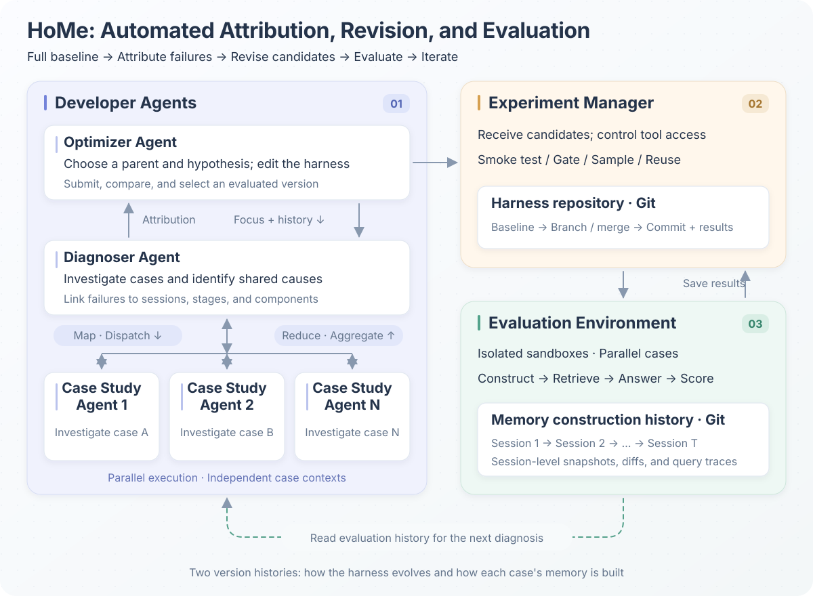
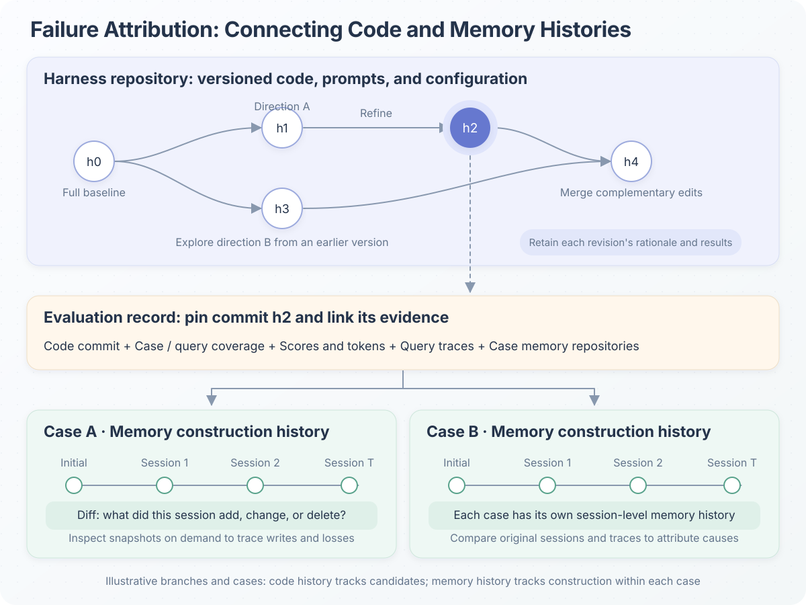
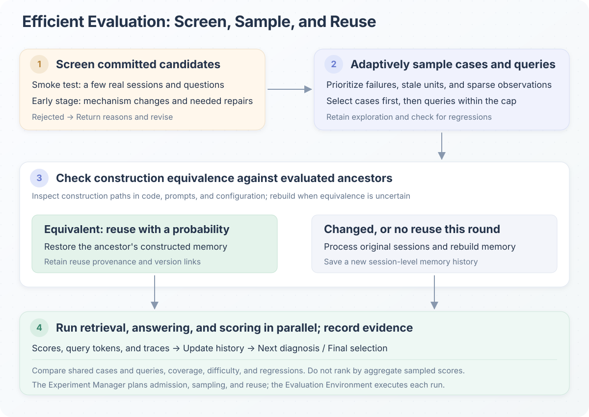

# HoMe: Automatically Optimizing Memory Systems Through Failure Attribution

You have been working with an AI assistant for months. It saves conversations and organizes notes, yet when you ask, “What problems came up across our project retrospectives?”, it misses two important discussions. Where did things go wrong? Was the information never recorded, overwritten during later maintenance, or stored correctly but never retrieved?

A wrong answer is only the outcome. Improving a memory system requires tracing the cause through a long history, then deciding which code, memory structure, or retrieval step to change. Developers usually do this through repeated analysis and experiments. HoMe connects failure attribution, code revision, and evaluation in an automated loop, allowing agents to improve a memory system using experimental feedback.

> **HoMe is an evaluation-driven framework for automatically optimizing memory systems. Its Developer Agents use answers, execution traces, and memory changes to attribute failures to specific mechanisms and components, automatically revise code, prompts, and configuration, and evaluate the revisions.**

In experiments on ReMe, HoMe found systems with higher answer scores and lower query-time token consumption using just six formal candidate evaluations per benchmark after a full baseline evaluation. On the LongMemEval-S test set, the score rose from **88.8% to 91.6%**, with **59.2% fewer query-time tokens**. On BEAM-1M, it rose from **65.0% to 70.4%**, with **40.7% fewer query-time tokens**.

## What Determines a Memory System's Performance?

Giving an agent long-term memory involves many connected decisions: what to retain from each session, how new information updates old notes, how to build indexes, where to search first, and how much evidence is enough to answer. Together, the code, prompts, and configuration implementing these decisions form the memory system's **harness**. Even with the same underlying model, different harnesses expose an agent to different evidence, producing different answers and costs.

For example, suppose six of ten search results come from the same long conversation. The agent appears to read a lot, but may be seeing several fragments of a single event. Changing how result slots are allocated could be more useful than retrieving even more results.

HoMe includes these system design choices in its optimization scope. It can revise memory organization, indexing and retrieval logic, and the context presented to the answering agent. The underlying models stay fixed in the experiments; improvements come from changes to the harness.

## How Does the Automated Optimization Loop Work?

  

HoMe consists of **Developer Agents, an Experiment Manager, and an Evaluation Environment**. Given an initial system, evaluation data, and an optimization objective, they automatically evaluate the baseline, attribute failures, revise candidates, and compare experiments. Developers do not need to plan each revision or manually launch every evaluation. The process begins with a full baseline evaluation to establish the initial failures and query costs.

### Developer Agents: From Individual Cases to System Changes

The Developer Agents divide the work as follows:

- The **Optimizer Agent** selects an optimization hypothesis and parent version, edits code, prompts, and configuration, and submits a candidate. Using diagnoses and evaluation history, it decides whether to continue a direction, explore another, or merge complementary changes, and ultimately selects an evaluated version.
- The **Diagnoser Agent** organizes failure investigation and attribution. It reads the optimization history, delegates case analysis, and combines evidence across cases to identify shared causes and the responsible lifecycle stages and harness components.
- **Case Study Agents** investigate different cases in parallel under the Diagnoser Agent's coordination. Each works in an independent context, tracing one case backward from answers and retrieval traces through memory changes, original sessions, and the corresponding code, then returns a compact diagnosis.

Their collaboration follows **assign cases → investigate in parallel → identify shared causes → revise the system**. Detailed investigations stay in separate contexts. The Diagnoser Agent checks reports for corroborating or conflicting evidence, while the Optimizer Agent focuses on the mechanisms most worth changing. If several differently worded questions all miss discussions from other dates, for example, diagnosis determines whether a common retrieval defect explains the omissions and supplies the evidence needed to target a revision.

### Experiment Manager: Managing Candidates and Experiments

The Experiment Manager maintains the candidate code repository, evaluation records, and tool access boundaries. It receives committed candidates, applies admission checks, plans sampling and memory reuse, and associates results with exact code versions. Candidates that fail a check are returned with a reason so the Optimizer Agent can revise them.

All candidates and their results remain in the optimization history. The Optimizer Agent can continue the current branch, return to an earlier evaluated version to test a different hypothesis, or merge complementary changes from two branches. Each attempt can build on evidence from earlier experiments.

### Evaluation Environment: Producing Inspectable Evidence

The Evaluation Environment runs candidates in isolated Docker sandboxes, performing memory construction, retrieval, answering, and scoring, with cases running in parallel. Alongside scores and token consumption, it saves query execution traces and session-level memory versions for subsequent diagnosis. These records connect two histories: **how the system changed, and how a particular system version built memory over time.**

## Failure Attribution: Locating Causes with Two Version Histories

Automated optimization must answer a crucial question: **which mechanism caused this failure, and what should change?** The same missing fact could result from extraction failing to retain it, maintenance overwriting it, retrieval failing to return it, or answering failing to use it. Each cause calls for a different revision. Adjusting prompts or expanding retrieval based only on a low score or final answer can leave the actual defect unresolved, increase costs, or damage behavior that previously worked. Failure attribution turns evaluation feedback into a concrete basis for edits and gives automated optimization its direction.

In long-term memory, the cause may lie in a session processed long before the question was asked. HoMe connects query traces, session-level memory changes, and the corresponding code to determine where evidence was lost or misused. It then checks whether the same mechanism explains failures across cases. Two version histories make the necessary evidence available on demand.

  

**Code versioning answers “Which system actually ran?”** The initial harness is the root commit of the code repository. Each candidate commit fixes its code, prompts, and configuration. Branches represent optimization hypotheses, and evaluation records link commits to results and diagnostic evidence. Even after the working tree moves to another candidate, older results can still be inspected against the code that produced them.

**Memory construction history answers “How was this information retained or lost?”** While building memory for a case, the Evaluation Environment commits the memory files after every session. Each checkpoint captures an intermediate memory state; the diff between adjacent checkpoints shows what that session added, changed, or deleted.

For the missing project retrospectives in our opening example, HoMe traces backward from the failed answer:

| Evidence to inspect | Observation | Where to investigate |
| --- | --- | --- |
| Evidence actually received by the answering agent | The evidence was present but omitted from the answer | Answering and reasoning |
| Final memory at query time | The evidence remained in memory but never reached the answering context | Retrieval, ranking, and context selection |
| Original sessions and corresponding memory diffs | The source contained the evidence, but final memory did not | Whether it was written, then overwritten or deleted |

If a source session contains the information, HoMe compares memory before and after that session. If it was never written, extraction or persistence may be responsible. If it was written, subsequent file versions reveal when maintenance corrupted or removed it. The investigation then checks the code pinned to that evaluation to identify the responsible component.

Case Study Agents can inspect relevant sessions and versions on demand without loading hundreds of sessions and every memory snapshot into one context. Their diagnoses include the failure stage, implicated sessions, responsible components, and supporting evidence. The Diagnoser Agent compares cases to distinguish recurring system defects from case-specific effects; explanations without sufficient evidence remain hypotheses.

The two histories support both optimization and attribution. Code history enables rollback, branching, and comparison; memory history reveals the effects of individual writes and maintenance operations. Evaluation records connect them, allowing the Optimizer Agent to target an established cause, then check whether the relevant failures improve and other questions regress. This forms an automated **attribute → revise → evaluate** loop.

## How Does HoMe Improve Optimization and Evaluation Efficiency?

  

Much of the cost of long-term memory evaluation occurs before answering: the system must process many sessions to construct searchable memory. HoMe improves efficiency by screening out unsuitable candidates early, reducing each evaluation's workload through adaptive sampling, and reusing existing memory when appropriate.

### Explore Mechanisms Before Refining Prompts and Parameters

Each candidate first passes a smoke test using a small number of sessions and questions to expose execution errors. During the first half of optimization, HoMe also inspects the candidate diff and affected runtime paths, requiring actual changes to information flow or control flow, such as memory structures, retrieval, routing, or context selection. Necessary execution repairs are also admitted. This prioritizes exploration of system mechanisms over repeated wording or parameter tweaks. The restriction is lifted in the second half, allowing prompt and parameter refinement as well as further code changes.

### Prioritize Failures While Checking for Regressions

The full baseline evaluation establishes initial performance for every case and question. Subsequent sampling considers historical errors, recent performance, time since the last evaluation, and observation counts. It prioritizes samples likely to expose current limitations while retaining random exploration. Sampling operates at two levels: select cases first, then select questions if those cases contain too many queries. This reduces the workload while revisiting older or previously successful samples to detect regressions.

These samples primarily provide leads for improvement. Because coverage and difficulty differ between candidates, their aggregate sampled scores cannot be ranked directly. The Experiment Manager provides comparisons on shared cases and questions so the Optimizer Agent can consider coverage, difficulty, regressions, and query cost.

### Reuse Memory to Avoid Repeated Construction

When only retrieval or answering changes, processing the entire history again often repeats the same construction work. HoMe checks evaluated ancestors to determine whether changes to code, prompts, or configuration affect construction and its outputs. Once construction equivalence is confirmed, it **reuses the ancestor's saved memory with a probability**, rerunning only retrieval, answering, and scoring. Otherwise, it constructs memory again to retain opportunities for fresh case coverage and construction outcomes.

HoMe selects its final system from formally evaluated versions, prioritizing answer quality while weighing stability, query cost, and implementation complexity. The selected version comes with its code revision and evaluation records.

## Main Results: Better Answers with Fewer Query-Time Tokens

The experiments start from a ReMe harness that has already been manually tuned. HoMe searches on training data, then evaluates the selected candidate on independent test data:

- **LongMemEval-S:** the 500 questions are split equally into training and test sets. Results below cover the 250 test questions excluded from optimization.
- **BEAM:** optimization uses 100K-scale histories, while testing uses independent 1M-scale histories, comprising 35 cases and 700 questions. Test histories are about eight times longer on average than optimization histories.

| Test set | ReMe score | Score after HoMe optimization | Average query-time tokens | Token reduction |
| --- | ---: | ---: | ---: | ---: |
| LongMemEval-S | 88.8% | **91.6%** (+2.8 percentage points) | 43.9K → **17.9K** | **59.2%** |
| BEAM-1M | 65.0% | **70.4%** (+5.4 percentage points) | 101.8K → **60.4K** | **40.7%** |

An LLM judge scores answers according to each benchmark's official protocol. Token counts include input and output tokens for query-stage retrieval and answering, without deducting cache hits. They exclude memory construction and HoMe's own optimization overhead, measuring how many tokens the resulting system uses to answer a question.

HoMe improves overall scores while reducing query-time tokens on both test sets. On BEAM, improvements discovered with shorter histories carry over to substantially longer, independent test histories. Gains do not extend to every question category, however: LongMemEval-S multi-session questions and BEAM knowledge update and information extraction show regressions.

## Case Study: What Changes Did HoMe Discover?

The candidates in the paper change how evidence is found, allocated, and presented. Representative revisions include:

- **Topic directories across dates:** compile daily summaries into a compact directory grouped by date, guiding the agent to relevant sessions and reducing omissions across dates.
- **Source diversity constraints:** limit result slots per file, with stricter limits on raw transcripts, so the same retrieval window covers more sources.
- **More targeted access to evidence:** on BEAM, select lines using question keywords while retaining paths and line numbers for follow-up reads; on LongMemEval-S, separately index user-action summary lines to help locate specific actions.

The first two mechanisms emerged independently on both benchmarks. These changes show how diagnosis can drive revisions to memory organization and retrieval, improving the evidence that actually reaches the answering agent.

## From Manual Tuning to Automated Iteration

Optimizing long-term memory usually requires developers to inspect failures, identify responsible components, revise implementations, and evaluate the changes. As histories grow, the interactions between construction and retrieval become more complex, making this work increasingly time-consuming. HoMe automates the connected process: attribution identifies the mechanism to change, Developer Agents implement the revision, and evaluation tests its effects and supplies evidence for the next iteration.

Given an initial system, evaluation data, and an objective, HoMe can automatically investigate shared defects across cases, explore code branches, plan evaluations, and select a final system from evaluated candidates. The ReMe experiments show that this automation can discover new memory organization and retrieval mechanisms while improving overall answer scores and reducing query-time tokens. We hope to reduce reliance on manual tuning at every iteration and make application-specific memory optimization easier to repeat.

For usage, see the [HoMe documentation](https://reme.agentscope.io/en/plugins/home). Benchmark introductions and full results are available in the [LongMemEval evaluation](https://reme.agentscope.io/en/benchmarks/longmemeval) and [BEAM evaluation](https://reme.agentscope.io/en/benchmarks/beam).
