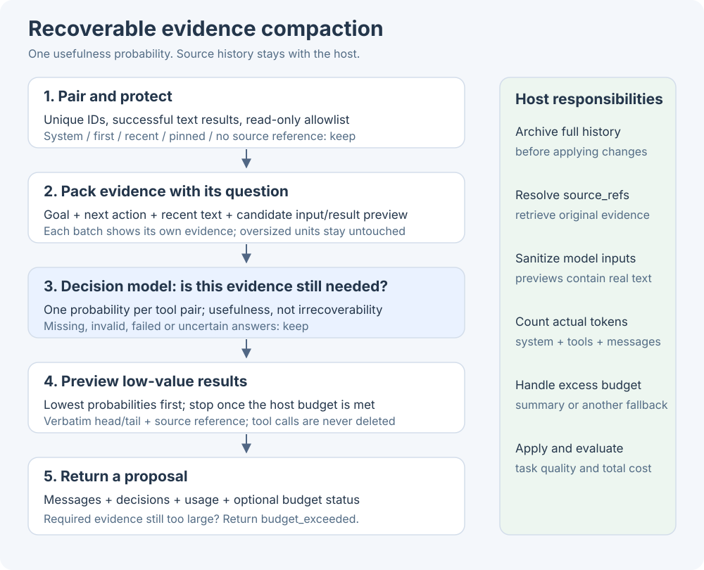
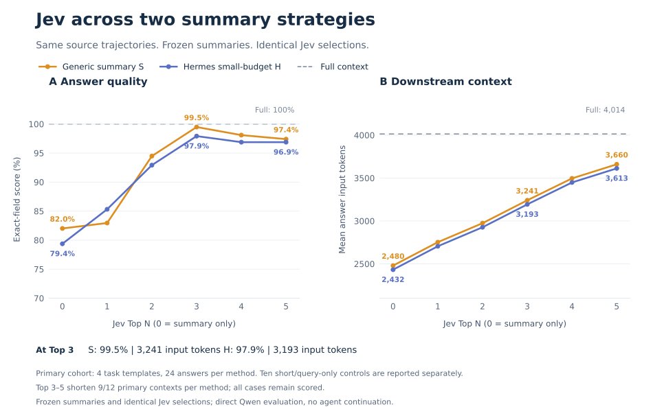

# Context compaction with decision models

`compact_context` proposes recoverable previews of old tool results. It scores evidence for the current task,
keeps tool calls and uncertain evidence, and leaves source history under the host's control. The provider-independent
`as_decision_model` interface currently supports AgentScope's TypeSafe/Jev adapter.



## How it works

1. **Archive first.** Supply an AgentScope 2.x JSON message snapshot, `goal`, optional `next_action`, a read-only tool
   allowlist, and `source_refs` mapping original call IDs to recoverable archive locations. References are opaque host
   identifiers: ReMe does not open, verify, or create them. The host must archive before applying a proposal and provide
   a retrieval tool that resolves them. No reference means no compaction for that pair.
2. **Protect structure and indispensable evidence.** Pair unique `tool_call` / `tool_result` IDs. First, system, recent,
   explicitly protected messages and calls stay intact. Failed/unfinished calls, non-text results, invalid inputs,
   mismatched tool names, and ambiguous pairs stay intact. `eligible_tool_names` defaults to empty.
3. **Show bounded evidence.** Each request contains its own candidate units: tool name, input, result head/tail preview,
   character count and completeness flags. It also carries the goal, next action and bounded first/system/protected/recent text. Thinking is
   not sent. Hosts must sanitize inputs and outputs before inference; previews may contain source data.
4. **Ask one question per pair.** Does this evidence contain information needed to continue correctly? The question
   measures usefulness, not irrecoverability. Missing or truncated context expresses uncertainty. Oversized units are
   left unobserved and retained; they are never scored after their evidence has been removed.
5. **Replace only clearly unnecessary results.** At probability `<= drop_threshold` (default `0.1`), a result can become
   a verbatim head/tail excerpt plus its source reference. Higher, invalid, or missing probabilities retain the result.
   Provider errors and timeouts retain the affected evidence; external cancellation propagates after requests drain.

No tool call or message is deleted. Replacements occur only when shorter. User/assistant text, thinking, metadata and
source inputs remain unchanged. Explicitly protect constraints, audit receipts and unique evidence; probabilities are
not substitutes for host protection rules. The threshold is a conservative starting point, not a calibrated guarantee.

## Configure and call

```bash
pip install "reme-ai[core,decision]"
export DECISION_MODEL_API_KEY=your-typesafe-api-key
export DECISION_MODEL_BACKEND=agentscope
# Optional: DECISION_MODEL_NAME and DECISION_MODEL_BASE_URL
```

The CLI also loads `DECISION_MODEL_*` from `.env`. See [configuration](./configuration.md#decision-model-configuration).
An omitted or `null` model uses the SDK default.

Start the service in one terminal:

```bash
reme start config=decision_compaction
```

Call from another terminal, using references the host has already archived and can resolve:

```bash
reme compact_context \
  goal='Fix payment retries' next_action='Review the retry implementation' \
  eligible_tool_names='["search_code"]' source_refs='{"c1":"archive/demo/c1"}' \
  options='{"preserve_recent_messages":1}' \
  messages='[{"role":"user","content":[{"type":"text","text":"Fix retries"}]},{"role":"assistant","content":[{"type":"tool_call","id":"c1","name":"search_code","input":"{\"path\":\"icons\"}","state":"finished"},{"type":"tool_result","id":"c1","name":"search_code","output":"Old icon search results","state":"success"}]},{"role":"user","content":[{"type":"text","text":"Inspect payment code next"}]}]'
```

A short result may remain unchanged when adding the recovery marker would make it larger.
The preset inherits the default service and background jobs. For embedding, assemble only the compaction job/component
as shown in [integration tests](https://github.com/agentscope-ai/ReMe/blob/main/tests/integration/test_decision_compaction.py).

## Host token budget

Decision request estimates and downstream input budgets are separate. To enforce `max_output_tokens`, embed the Step
with a synchronous `token_counter(messages)` that counts the host's actual serialized model input, including system
instructions, tool schemas and framing. The counter must return a non-negative integer; configuration without a counter
fails before inference. ReMe's search tokenizers are not model token counters.

```python
step = CompactContextStep(as_decision_model=decision_model, token_counter=count_model_input)
response = await step(
    messages=snapshot,
    goal="Fix retries",
    next_action="Review the patch",
    source_refs=archive_refs,
    eligible_tool_names=["read_file"],
    options={"max_output_tokens": 32000},
)
```

Already within budget means no model requests. Otherwise eligible low-probability results are previewed in increasing
probability order until the budget is met. A replacement must reduce both size and the host count. Required/uncertain
content is never removed to force a fit. If it still does not fit, `reason="budget_exceeded"` and `budget_met=false`:
use host summarization or another fallback before applying. Without a requested budget, all eligible low-probability
results may be previewed and `budget_met` is `null`; the host must check the final input itself.

## Contract and defaults

The standard Response `answer` has `schema_version=2`, proposed `messages`, `changed`, `reason`, `budget_met`, `decisions`
and `stats`. Each decision has the original `call_id`, internal `id`, `action` (`keep` / `preview`), `probability`, `reason`
and `source_ref`. Reasons distinguish protection, uncertainty, unobserved evidence, invalid answers, provider errors,
timeout and no savings. Statistics include before/after sizes and host token counts, candidate/protection counts,
maximum estimated batch-state tokens, request count, usage and elapsed time. Statistics also appear in response metadata.

| Option | Default | Meaning |
| --- | --- | --- |
| `drop_threshold` | `0.1` | Preview only results at or below this probability |
| `preserve_recent_messages` | `6` | Protect this many recent messages |
| `evidence_chars` | `2000` | Maximum characters per input/result preview or recent text |
| `preview_chars` | `300` | Maximum head/tail excerpt in the proposed result, excluding recovery marker |
| `max_state_tokens` | `25000` | Estimated decision-state ceiling |
| `max_request_tokens` | `30000` | Estimated state/questions ceiling, including 256 tokens of overhead |
| `max_output_tokens` | `null` | Optional host-counted input budget |
| `max_concurrency` | `4` | Maximum concurrent decision requests |
| `total_timeout_seconds` | `30` | Overall request and queueing deadline |

The integration suite contains two synthetic scenarios: payment retry debugging and replica-lag investigation, with
important source/log evidence competing against completed unrelated tasks. Run explicitly with configured credentials:

```bash
REME_RUN_DECISION_INTEGRATION=1 pytest tests/integration/test_decision_compaction.py -v -s
```

Only model requests run externally; fixture tool calls are not executed. These cases test behavior, not general task
success. Evaluate real trajectories against recency and rule-based previews, measuring recovery, continuation quality,
latency alongside token reduction. ReMe does not automatically summarize or write persistent memory.

## Jev across two summary strategies

### Background

Summaries shorten history but can omit exact identifiers, configuration values or log details needed for a later answer.
This experiment asks: **can a few Jev-selected original evidence blocks recover information missing from a fixed summary,
and does that benefit occur with both a generic summary and a Hermes summary?** Exact-field score and Qwen answer input show the
tradeoff between retained information and context length.

### Experimental setup

| Item | Recorded setting |
| --- | --- |
| Data | 14 synthetic task templates with predefined queries/answers: one existing payment trajectory and 13 actual read-only Hermes executions. Four primary tasks were selected by source length before collection: payment retries, checkout 504, server-error localization and build-log token lookup. Ten short/query-only controls are reported separately. |
| Framework and models | Hermes Agent `AIAgent`, pinned to `30463589eb54`; **`qwen3.8-max`** for collection, both summary mechanisms and answering. **`jev-1.13.0`** through AgentScope **2.0.10** ranks evidence. Hermes collects trajectories; evaluation calls Qwen directly. |
| Summary mechanisms | **S** uses a generic handoff-summary prompt. **H** is Hermes compaction summary under a small-budget setting: its `legacy` generation pipeline with adjusted budget/length constraints. Summary generation is invoked directly, bypassing automatic triggering and head/tail selection. |
| 13 methods | **Full context** retains all pre-evaluation history. **S + Top 0–5** and **H + Top 0–5** each contribute six methods. Top 0 is summary only; Top N appends N whole evidence blocks. Both curves share identical Jev selections; each generation freezes S/H byte-for-byte. |
| Budget | Forced small-budget simulation: summary-body allowance **64–256 tokens**, derived from evidence length; complete answer-input ceilings are task-specific. Larger N retains more evidence, so lengths differ. Full is an uncompressed reference; it need not exceed every case ceiling. |
| Evaluation | Summarization/ranking receives the original task and evidence, never the held-out questions or gold. Final collection reports are excluded. Answers return JSON and are scored with predefined type-strict field rules, **without an LLM judge**. Average within tasks, then weight tasks equally. |
| Repeats and size | Three summary/ranking generations per task, two answers per context: **546 contexts / 1,092 answers**. The figure shows four primary tasks, 24 answers per method; repeated answers are not additional tasks. Summary/answer temperature is 0, with thinking disabled. |

Jev scores all available evidence against the original task once; N changes the number retained, not ranking-call count.
This is a gold-answer **information-retention evaluation**, without resuming Hermes' tool loop to complete the task.

### Reading the figure and conclusions



- **A: selected originals help both summary mechanisms on this panel.** Full scores 100%; Top 3 improves S from
  **82.0% to 99.5%**, and H from **79.4% to 97.9%**. This supports supplementing these summaries with original evidence;
  it does not establish general superiority or statistical equivalence to Full.
- **B: higher retention consumes more context than summary alone.** Top 3 uses **3,241 / 3,193** mean answer-input tokens
  for S/H, versus Full's **4,014**, reductions of **19.3% / 20.4%**. Both exceed their summary-only input. Top 4–5 do not
  improve the scores: more original text does not guarantee better answers.

**Scope:** the primary result covers four synthetic task templates; ten controls are separate. All 42 H-only contexts
shorten Full, but Top 3–5 shorten only **9/12 primary contexts per method**, with every case still scored. Strict field scoring includes format compliance; semantically equivalent wording can still lose credit.
The result shows an information/length tradeoff. Without equal-length longer-summary or alternative-selector controls,
the entire gain cannot be attributed to Jev ranking itself. Agent continuation success remains unmeasured.

<!-- Payment has 10 units (maximum Top 10); actual N is min(N, available units). -->
[Complete experiment: design, results, expected answers and reproduction](https://github.com/jinliyl/ReMe/blob/74e1251ddcd212205788f21ccd6b5ebd82ade7c3/benchmark/compaction/README.md)

## Host-owned decision models

Embedded hosts can reuse their existing AgentScope JEV instance, just as they inject an LLM:

```python
# app contains an as_decision_model.compaction component with backend: agentscope.
await app.update_component("as_decision_model", "compaction", model=host_jev)
```

The YAML `model` value remains the provider model name. The runtime `model` property accepts a callable instance
and does not construct a client on access. Inject before the first request; ReMe validates and converts JSON
questions normally, but does not require separate ReMe credentials or close the borrowed client. The host must
keep the instance alive until ReMe has finished its calls, then close it itself. Close the component before
replacing an internally constructed model or any model with active requests. Shutdown waits for active calls and
owned-client cleanup even when cancelled, then propagates cancellation. Component shutdown detaches the instance;
inject again before restarting a borrowed-model component. Standalone credential-based behavior is unchanged.

Owned clients initialize in a worker thread so certificate loading does not block the event loop. Cancelling a request
during construction waits for initialization to finish and leaves the client owned by the component until shutdown;
the cancelled request is not sent.

Hosts can import `CompactContextStep`, `ToolPair`, `collect_pairs`, and `preview_result` from `reme.steps.compaction`.
The pairing and preview helpers share the Step's rules for validating proposals. Archiving, resolving references,
and committing proposals remain host responsibilities.
