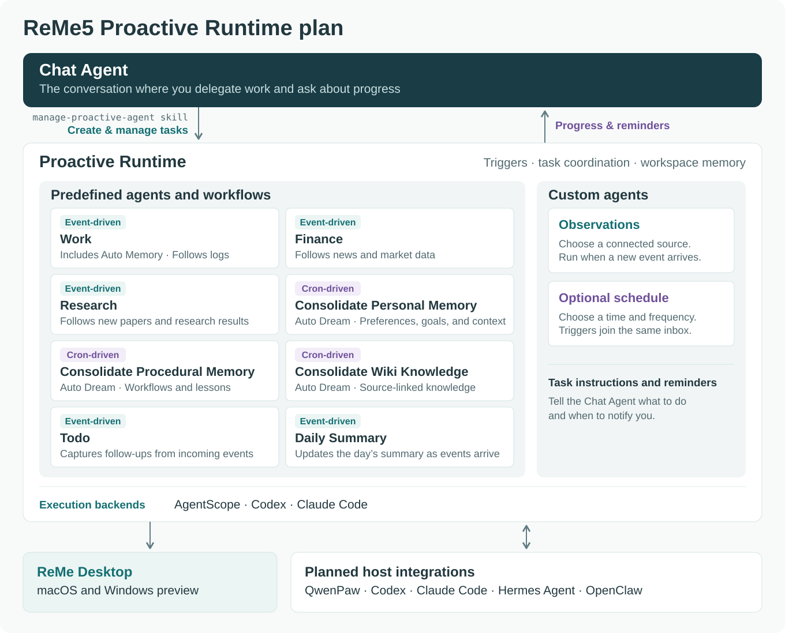
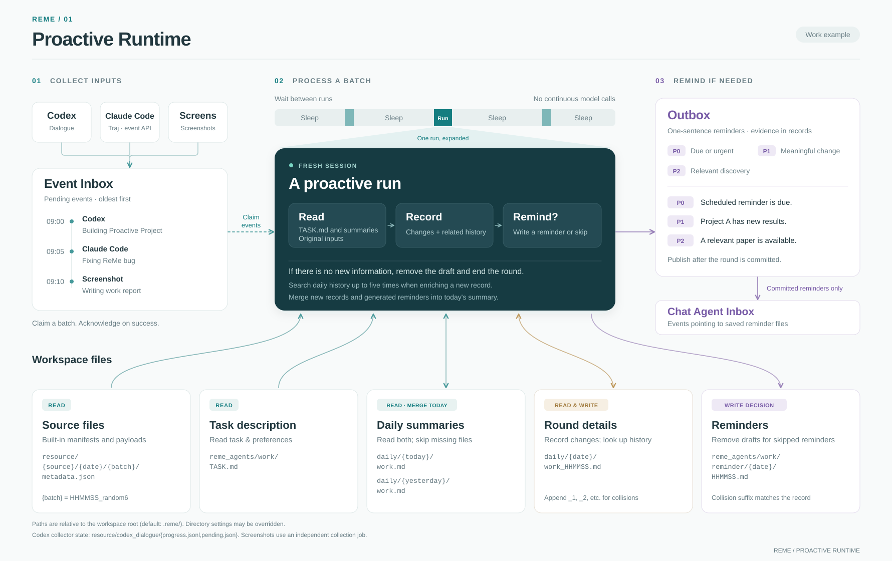
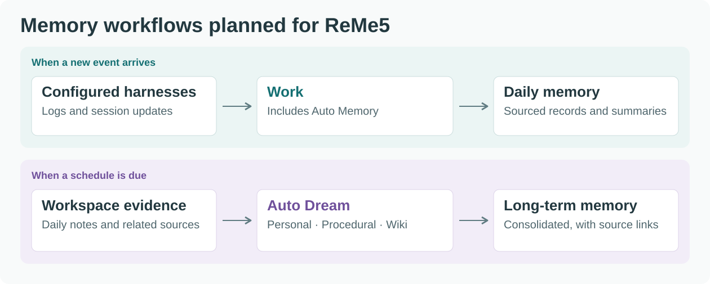

# ReMe5 Preview — Proactive Runtime

ReMe started as a Memory Kit for agents. With **ReMe5**, our upcoming `0.5` release, ReMe is growing into a **local-first
Proactive Runtime** built on file-native long-term memory. ReMe coordinates ongoing work and delegates model execution and native sessions to an agent runtime. You can give an agent an ongoing responsibility, let new information or a
schedule start its next run, and return later to ask what happened. The task can remember its instructions, build on
previous work, and bring important changes back to your conversation.

We aim to release ReMe5 **by the end of 2026**. An early Proactive Runtime and ReMe Desktop prototype on `main` connects
the Chat Agent to event-triggered and time-triggered agents. We are exercising it in real workflows and refining what
agents record, when they notify, and how reliably tasks continue across runs.
[Prototype PR](https://github.com/agentscope-ai/ReMe/pull/743) ·
[Current configuration](https://github.com/agentscope-ai/ReMe/blob/main/reme/config/proactive.yaml) ·
[简体中文](../zh/reme5_preview.md)

## Why a Proactive Runtime

Many useful tasks start with a conversation and continue long after it ends. A coding agent finishes an experiment while
you are working elsewhere. A project decision gets made across several sessions. A paper appears that changes what you
want to investigate next. Following up takes more than recalling a past conversation. An agent needs to know what to
watch, which developments matter, what it already recorded, and when you want to hear about them.

ReMe’s existing memory workflows provide the foundation. Auto Memory distills conversations into daily notes with
source links. Auto Dream consolidates useful daily material into long-term knowledge. In ReMe5, an agent can use that same
file-native memory while following a task from one event or scheduled run to the next.
[Memory as File](./memory_as_file.md) · [Auto Memory](./auto_memory.md) · [Auto Dream](./auto_dream.md)

For example, you could ask the Chat Agent to follow a project across your configured coding tools and let you know when
a blocker needs a decision. One session might record a failed test and its probable cause. A later session might show
that the test passed. The Work agent can record both developments with source links, update the project’s status, and
notify you if a decision is still needed. You can follow the links to check the evidence or change the reminder
instructions for future runs.

## What we plan to build

Use the **Chat Agent** to delegate an ongoing task and change what it should watch or when it should report back.
**Proactive Runtime** runs the task when an event arrives or a schedule is due. It keeps progress and evidence in your
workspace so the Chat Agent can answer follow-up questions and bring back relevant reminders.

Presets cover common tasks. From Chat, you can connect an observation source to an event-triggered task or set a cron
schedule for a time-triggered task. The roadmap includes a standalone desktop preview and host integrations.

## How the runtime works

The Proactive Manager coordinates named runtimes. An event-triggered task receives observations such as new dialogue or
logs. A time-triggered task receives cron triggers, for example for a daily briefing or nightly memory consolidation.
Each task has its own inbox and calls the model when it has work.

The diagram shows the current Work prototype. Codex dialogue and screen capture are built-in sources in the prototype
configuration. Claude Code traces illustrate how another source can publish through the event interface.
[Runtime guide](./proactive_runtime.md#current-work-observations)

1. **Collect and queue.** A connector gathers an observation and submits an event with its source and associated files.
   A cron trigger submits a scheduled event when due. Each task has its own inbox and processes one batch at a time.
2. **Run with context.** The agent reads its task instructions and the original inputs, then searches recent records. It
   compares incoming information with what it already knows so it can identify a meaningful change.
3. **Save results and deliver selectively.** The agent writes new findings, source links, and its reminder decision
   in one daily record. The runtime validates and saves the result before acknowledging the input. If the run
   fails, the input remains eligible for retry. Committed reminders can be delivered independently of the run.

Task instructions and daily records live in the user’s workspace. A task reads the latest instructions
when it runs, and a user can open the files to check or correct the context that carries forward. Connected sources are
defined by configuration. Source links let users trace an agent’s conclusions back to the relevant conversation,
document, or observation. [Execution and storage details](./proactive_runtime.md#how-a-task-keeps-running)

## How memory evolves in ReMe5

### Auto Memory becomes part of Work

The event-triggered **Work** agent will take on Auto Memory’s role of extracting durable context from conversations. It
will watch for new log and session records across every agent harness you configure and connect. Work will combine
updates across those sources to track project progress, decisions, blockers, and next steps. It can retain what will
matter in later sessions and surface a development when it matches your instructions. The current Work prototype uses
new Codex dialogue and screenshots to test that workflow.

### Auto Dream becomes three time-triggered agents

Auto Dream currently consolidates daily memory into personal, procedural, and wiki knowledge. The plan is to give each
of the three agents its own cron schedule and instructions about which evidence to use.

The time-triggered agents can draw context from `daily/` and `digest/` notes.
[Current Auto Dream inputs and outputs](./auto_dream.md#inputs-and-outputs)

### Predefined agents and workflows

ReMe5 will include presets for following ongoing work, consolidating memory, and keeping track of what needs follow-up.

| Preset | Trigger | What it does |
| --- | --- | --- |
| **Work** | Event-triggered | Includes Auto Memory. Follows logs and sessions from connected agent harnesses to track progress, decisions, and blockers. |
| **Finance** | Event-triggered | Follows news and market data for the topics or assets you choose. |
| **Research** | Event-triggered | Follows new papers and project results that matter to your research questions. |
| **Consolidate Personal Memory** | Time-triggered | Auto Dream preset for durable preferences, goals, and personal or project context. |
| **Consolidate Procedural Memory** | Time-triggered | Auto Dream preset for reusable workflows, troubleshooting steps, and lessons from completed work. |
| **Consolidate Wiki Knowledge** | Time-triggered | Auto Dream preset for maintaining topic knowledge with links to its underlying sources. |
| **Todo** | Event-triggered | Captures an explicit follow-up and links it back to the source event or decision. |
| **Daily Summary** | Event-triggered | Updates the day’s summary when meaningful changes arrive and carries forward open items. |

The prototype already includes an event-triggered Finance example and a time-triggered technology briefing. We use these
examples to test whether to keep a record, send a notification, or do both. The desktop prototype also has a Todo
interface and background task summaries that we can build on.
[Prototype agent definitions](https://github.com/agentscope-ai/ReMe/blob/main/reme/config/proactive.yaml) ·
[Desktop prototype](https://github.com/agentscope-ai/ReMe/tree/main/reme_studio/desktop)

## Create and manage agents from chat

The Chat Agent uses the `manage-proactive-agent` skill to create custom agents and manage both predefined and custom
tasks. From chat, you can check a task’s status or progress, revise its instructions and runtime settings, or pause
and resume it.
[Task management skill](https://github.com/agentscope-ai/ReMe/blob/main/reme/skills/manage-proactive-agent/SKILL.md)

For a time-triggered task, you might say, “Every Friday, summarize the week’s experiment results and link to the
reports.” For an event-triggered task, you might ask the Chat Agent to follow an experiment’s log feed and tell you
when it finishes or fails. Event-triggered tasks need a connected source that can provide the observations.

A background agent can propose a reminder based on its task instructions. The Chat Agent considers the current
conversation when deciding whether to deliver it. [Chat and task management guide](./proactive_runtime.md#chat-and-reminders)

## Desktop preview, execution backends, and integrations

- **ReMe Desktop.** We plan to publish a proof-of-concept preview for **macOS and Windows**. It will provide a place to
  try the whole workflow, from delegating a task in chat to inspecting its inputs, progress, knowledge, and reminders.
  The Electron prototype on `main` connects to the ReMe service and already has the main chat and named background task
  views. [Desktop source and setup](https://github.com/agentscope-ai/ReMe/tree/main/reme_studio/desktop)
- **Execution backends.** The planned options for running ReMe agents are **AgentScope, Codex, and Claude Code**. The
  main prototype configuration uses Codex and there is a separate Claude Code configuration. We will validate task
  execution, session handling, and notification behavior on each supported backend before documenting its preview support.
  [Codex configuration](https://github.com/agentscope-ai/ReMe/blob/main/reme/config/proactive.yaml) ·
  [Claude Code configuration](https://github.com/agentscope-ai/ReMe/blob/main/reme/config/proactive_cc.yaml)
- **Host integrations.** We plan to bring Proactive Runtime to **QwenPaw, Codex, Claude Code, Hermes Agent, and
  OpenClaw**. A host can supply events or expose results and reminders in its own workflow. These integrations will
  build on ReMe’s existing memory integrations and follow each host’s capabilities and development schedule.
  [Current agent integrations](./integrations.md)

Codex and Claude Code can appear in both roles. A backend executes a ReMe agent. A host integration lets ReMe follow
work in an existing Codex or Claude Code session and bring results back into that workflow.

## Milestones

| Milestone | Status | What it covers |
| --- | --- | --- |
| **Runtime and desktop prototype** | On `main` | Chat Agent, event-triggered and time-triggered background agents, workspace-backed task state, and reminder delivery. |
| **Real-workflow testing** | In progress | Exercise Work, Finance, and time-triggered tasks. Check whether records capture real changes, source links hold up, and reminders remain useful across retries and repeated events. |
| **Memory workflows and presets** | Planned for ReMe5 | Bring Auto Memory into Work, build the three scheduled Auto Dream agents, and develop initial Research, Todo, and Daily Summary workflows. |
| **ReMe5 and desktop preview** | Targeting release by the end of 2026 | Publish the runtime and the macOS and Windows proof of concept. Document setup, available execution backends, and the supported preview workflows. |
| **Host integrations** | Planned in stages | Connect supported host event sources, then validate task follow-up and result delivery within each host. |

## Try the prototype and share feedback

The source checkout already contains the desktop prototype and its companion service configuration. The desktop README
walks through starting the ReMe service in one terminal and the desktop client in another.
[Run the prototype from source](https://github.com/agentscope-ai/ReMe/tree/main/reme_studio/desktop#reme-studio-for-desktop)

If you try it, tell us which Harness you want ReMe to follow, what useful changes it should record, and what would make
an update worth interrupting you. If you already use Auto Memory or Auto Dream, we would like to hear which sources,
memory files, and schedules matter most to your workflow.
