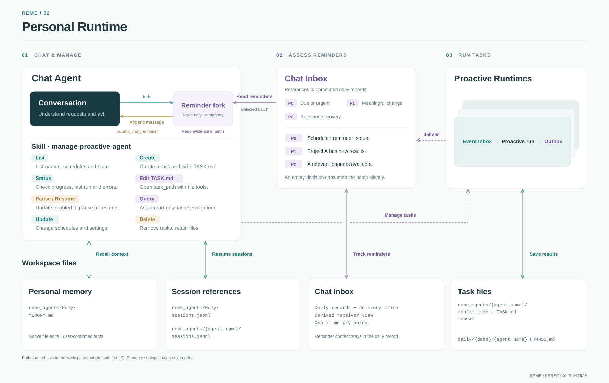
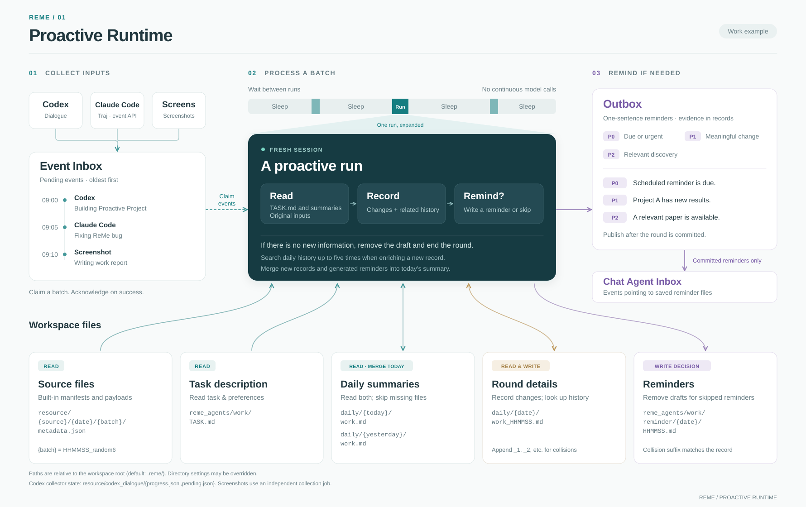

# Services and Deployment

ReMe can run as a local HTTP service, a standalone MCP server, or a one-shot CLI Job. By default HTTP binds to
`127.0.0.1:2333`; one process serves JSON, SSE, streamable HTTP MCP, and optional ReMe Studio.

## HTTP API

Start the service in one terminal and leave it running. Choose one of these startup commands:

```bash
reme start
reme start service.host=127.0.0.1 service.port=8181
```

IPv6 literals such as `::1` can be used as the host; ReMe formats them correctly when HTTP or MCP clients connect.
If a service binds to the IPv6 wildcard `::`, in-process clients use the connectable loopback address `::1`.

From another terminal, call a Job through the CLI client:

```bash
reme search query="user preferences" limit=5
```

Regular Jobs also become `POST /<job-name>`; this HTTP example uses the default port `2333`:

```bash
curl -s http://127.0.0.1:2333/search \
  -H 'Content-Type: application/json' \
  -d '{"query":"user preferences","limit":5}'
```

Job arguments live at the request body's top level. A regular response follows the `Response` schema:

```json
{"success": true, "answer": "...", "metadata": {}}
```

Unhandled Step failures become unsuccessful responses.

## Streaming and SSE

Jobs with `backend: stream` also use `POST /<job-name>`, returning `text/event-stream`. Error paths emit an error chunk and always terminate the stream. The default `chat` Job is streaming:

```bash
curl -N http://127.0.0.1:2333/chat \
  -H 'Content-Type: application/json' \
  -d '{"query":"Summarize my long-term preferences"}'
```

The `proactive` configuration exposes `chat(query)` for the fixed `chat` Agent. It resumes the current
native session; `new_chat_session` selects a fresh session and retains the history exposed by `list_chat_sessions`.
MCP does not expose Stream Jobs. Studio integration is separate from this backend.

## Agent Runtime

The `agent_runtime` Component coordinates sessions, the shared Agent Inbox, outputs and scheduling. `ChatAgentStep` and
`ProactiveAgentStep` define the two Agent behaviors under `reme/steps/proactive/agent/`.
Configure the Component through `components.agent_runtime.default` and the workspace-relative `reme_agent_dir`
(default `reme_agents`). Each Agent owns `config.json`, `MEMORY.md`, `sessions.jsonl` and `inbox/`. Event and cron Agents also own
`reminder/YYYY-MM-DD/HHMMSS.md`; temporary Agents use `reme_agents/tmp/<agent_id>/`.
There is no global definition index or checkpoint file: startup rebuilds runtime state from source files.
Session registries preserve complete records across an interrupted append; an incomplete tail is ignored on read
and removed by the next append. Corrupt complete records fail explicitly.
Validated reminders are saved before input consumption is committed; the outbox retries delivery independently.
An interrupted, uncommitted round may run again. Consumption receipts retain reminder references until handoff.

Personal Runtime connects Chat, its temporary Reminder fork, a shared Inbox and background tasks through workspace files.
The Life task is an illustrative integration.

<p align="center">
  
</p>

Start the backend in one terminal, with `LLM_API_KEY`, `LLM_BASE_URL` and optional `CODEX_MODEL_NAME`:

```bash
reme start config=proactive
```

From another terminal:

```bash
reme manage_proactive_agent action=list
reme manage_proactive_agent action=create name=experiment trigger_type=event \
  'instructions=Monitor experiment logs and report failures or completion.'
reme agent_inbox
```

`manage_proactive_agent` supports `list/create/status/update/delete/query` with top-level parameters and a task `name`.
Names may be Chinese or English; `chat` and `tmp` are reserved. Creation requires `instructions` and `trigger_type`,
plus `cron` for a scheduled task. Update accepts only changed execution settings; query takes a `question` and answers
from a temporary read-only fork of a completed run. See `skills/manage-proactive-agent/SKILL.md` for all six actions.

Creation writes `instructions` verbatim to `MEMORY.md`. Create and status return its workspace-relative `memory_path`,
without repeating the memory contents. Use native file tools to read the latest file, replace superseded requirements,
retain valid background and verify the saved result. Update does not edit task memory; time changes also need to be
reflected in the memory's instructions. Changes apply to subsequent rounds; an already-running round may have read
the previous task. Deletion stops owned work and retains history; stop external collectors separately. Recreating a
deleted name returns `restored=true` and preserves the existing memory, which must be checked against the new request.
`reme_agent_dir` now defaults to `reme_agents`; set it explicitly to `agents` to keep using an existing directory.
Changing `reme_agent_dir` itself does not move workspace files or rewrite embedded references.

Chat's initial memory is configured through `components.agent_runtime.default.chat.description`. Runtime startup
initializes its `MEMORY.md` using the same mechanism as task Agents; existing memory survives restarts and session
changes. Chat's `job_tools` are selected in its Step configuration.

The fixed Chat Agent uses `agent_id=chat`. Rename the former `components.agent_runtime.default.main` configuration
key to `chat`. Before upgrading an existing workspace, move its fixed Chat directory from `reme_agents/main/` to
`reme_agents/chat/` and set `config.json`'s `name` to `chat`, preserving memory, session IDs and inbox receipts.
The runtime accepts the current layout only and does not migrate workspace files automatically.

Initial tasks can be declared in `components.agent_runtime.default.agents` in `proactive.yaml`, using the same creation
fields including `description`. Startup creates missing identities only; restarting does not overwrite edited memory
or settings, or restore deleted tasks. Two event tasks are enabled by default: `finance` analyzes collected news and quotes,
and the event-driven `work` tracks the user's current projects, progress, difficulties and discussion points from
incoming observations. Work observations capture screens and new Codex dialogue every five minutes. The separate
standalone screen-capture collector is disabled by default.
The default scheduled task `科技早报` also runs daily at 08:00 in the application timezone, summarizes important
technology news from the past 24 hours and sends a reminder when ready.

An individual Proactive Runtime consumes events, reconstructs context from workspace files and delivers saved reminders
through the Outbox to the Chat Inbox. The work example below illustrates possible issues and TODOs;
Claude Code trajectories can be submitted through the event API.

<p align="center">
  
</p>

Task configuration uses `trigger_type` (`cron` or `event`). Rename the old `type` key to `trigger_type` in existing
Agent `config.json` files and API calls; the old key is no longer accepted.

An `event` Agent accepts observations through `append_event(agent_id, events)`, with `event_ts`, `source`, `description`
and optional workspace-relative `paths`, `id` and `metadata`. A `cron` Agent requires a cron expression and executes
its full task at the scheduled time. Both use the application timezone and a serial executor per Agent.
`source=cron` is reserved. Event tasks may set `min_trigger_interval_seconds`, measured from the previous successful
completion. Inputs remain queued during this cooldown. The built-in finance task waits 10 seconds and claims at most
20 events per run.

Chat and cron Agents enable native `web_search`, `web_extract` and command network access; event Agents stay offline.
Remove the obsolete `enable_web` field from existing task configurations and creation calls. `web_extract` saves complete
text or PDF files under `resource_dir` and returns paths plus a bounded text preview; it does not execute JavaScript
or extract PDF text. Temporary `query` forks remain read-only and offline.
`notify_window={start,end}` limits automatic inbox wakeups; messages can still be processed and saved outside it.
`temporary=true` is independent of trigger type. Temporary Agents become eligible for collection after seven days
without new accepted inputs; cron triggers count as inputs, while duplicates and retries do not. Collection waits for
running work, pending events, undelivered messages and retained Inbox references. Daily records and resources remain.
Successful input receipts retain the greatest accepted reception time, preserving idle lifetime across priority processing
and restarts. On restart cron schedules the next future trigger; queued events still run, but missed offline triggers are not backfilled.
Chat idle and retry timers restart in memory. Daily handoffs use `daily/YYYY-MM-DD/<agent_id>.md`; round details use
`<agent_id>_HHMMSS.md`, with numeric suffixes for same-second collisions. The framework keeps each reminder body in Markdown and
updates delivery and read timestamps in its frontmatter under the Agent's `reminder/YYYY-MM-DD/HHMMSS.md`.
Round details and reminders share the same time and collision suffix. Existing reminder files keep their original paths.

`components.agent_inbox.default` uses the `event` backend (`AgentEventInbox`), inheriting the generic local
inbox implementation. `components.agent_runtime.default.inbox` selects that component. Each Agent stores pending
inputs in `inbox/inbox_unread.jsonl` and processed batches in `inbox/inbox_read.jsonl`; each batch contains `items`,
`consume_ts` and `metadata`. Claims reserve selected IDs without consuming them; successful execution commits a receipt.
All Agents receive `Event` records. Observations and cron triggers target task Agents; Chat events use the sender as
`source` and reference the reminder Markdown in `paths`, without copying its body. At most 1,000 processed inputs are
retained by default. Reminder Markdown remains the source for content and acknowledgement
timestamps; Chat reference views are rebuildable. Change reminder frontmatter to acknowledge messages externally.
One lifecycle-owned watcher and periodic rescans reconcile those source edits and interrupted handoffs.

Missing or corrupt individual reminders
retain their source files and event receipts, report their paths, and are isolated without blocking other reminders
or application startup. Restoring the original file automatically restores processing.

P0 forks Chat as soon as its session is available, after `components.agent_runtime.default.notifications.p0_delay_seconds`
(default 0). P1 waits for 10 continuous idle seconds, P2 for 1800, controlled by `notifications.p1_idle_seconds` and
`notifications.p2_idle_seconds`. Notification windows still apply. Only foreground Chat turns reset the idle clock.
The temporary fork inherits the current conversation, runs read-only and offline, and is disposed of after execution,
including failure or cancellation. Its hint and tool traces never enter the main conversation.

Only the reminder fork receives `read_inbox()` and `send_chat_msg(content=...)`.
The framework selects the priority and batch; `read_inbox` accepts no arguments.
Reminder evaluation has a 120-second timeout and proactive execution a 1200-second timeout, configured with each
Step's `timeout_seconds`. Transient inbox failures retry with exponential backoff capped at 300 seconds; SDK type
or import errors stop retries until the environment is repaired and restarted. Chat status exposes inbox failures,
and cron logs unsuccessful partial collection results.

Reading is limited to the selected batch. Nonempty content is appended as an assistant message marked
`source="proactive"`; empty content commits a silent decision without inserting a message. Successful decisions
automatically consume the messages read, independently of user-read state. Failures remain retryable, and a switched
Chat session or a new foreground turn rejects the old fork's decision. The ordinary fork reply is never sent to the user.
Desktop derives its reminder list from these marked messages. `agent_inbox agent_id=<name>` pages any Agent's pending,
processing and processed events without claiming them; omitted `agent_id` selects Chat. `agent_outbox agent_id=<name>`
pages a task's committed reminders. `agent_reminder message_id=<id>` reads a canonical reminder; `mark_read=true`
acknowledges user reading without consuming its Inbox event.
Chat Inbox entries include a resolved `reminder` view from the canonical Markdown for display.

`agent_session` and `agent_events` expose full Chat history, but only the latest native turn for event/cron Agents,
including its input and all partial/final assistant messages. Task subscriptions replace the whole view with each
`snapshot`; `heartbeat` carries no messages. Each automatic event or cron run starts a fresh native session and rebuilds
context from task memory and daily summaries. Earlier sessions remain available as history; user conversations continue
their current session.

Event tasks accept `max_batch_events` (default 20); retries within the same process keep the original batch and leave new inputs for later rounds. `proactive_agent_step` defaults to a 1200-second total timeout; native automatic compaction inherits the global Codex App Server settings. Daily summaries carry current state; per-round details retain chronology and evidence.

`agent_reminder agent_id=chat` also accepts a combined Chat message ID and returns `{id,items}`. `mark_read=true` acknowledges all retained source reminders, linked through their `chat_message_ids` frontmatter. Acknowledgement remains successful with an empty list after the sources have been removed. Only explicit user reading is synchronized; historical initialization, suppression and bubble presentation do not imply reading.

One background `agent_loop` schedules task execution and Chat reminder decisions with independent workers and retries.
It replaces `proactive_loop` and `inbox_loop`; the old query Jobs `agent_mailbox` and `agent_event_list` are removed.
Existing Chat Inbox logs are rebuilt from reminder Markdown on startup; task input logs retain their Event format.

`proactive_run`, `proactive_query` and `inbox_chat` are service-private Jobs. Collectors remain opt-in; configure `jobs.screen_capture_cron.agent_id` and enable the job to publish
complete resource packages as observations. No resource watcher or automatic TTL deletion participates in this flow.

This is a breaking replacement of the previous inbox and PA APIs. Existing workspace files are retained without
automatic conversion. The backend uses CodexAgentWrapper; other wrappers need equivalent session capabilities.

## MCP

ReMe 0.4.2.2 uses FastMCP 4 and MCP Python SDK 2. Upgrade ReMe and host-side MCP bridges together;
standalone bridge environments require `fastmcp>=4.1.4,<5`. CLI tool catalogs use SDK 2 snake_case fields,
including `input_schema`, `output_schema`, and annotation hints. Update consumers that read the old camelCase fields.

The default HTTP service mounts streamable HTTP MCP at `/mcp`:

```yaml
service:
  backend: http
  mcp_enabled: true
  mcp_path: /mcp
  mcp_stateless_http: false
```

For a standalone MCP service:

```bash
reme start service.backend=mcp service.transport=stdio
reme start service.backend=mcp service.transport=sse service.port=2333
reme start service.backend=mcp service.transport=streamable-http service.port=2333
```

MCP tools come from non-stream Jobs with `enable_serve: true`. Use `service.jobs` as an allowlist. `injected_job_kwargs` adds server-managed values that callers cannot override.

```yaml
service:
  backend: http
  jobs: [search, read, traverse, auto_memory]
  injected_job_kwargs:
    tenant_id: local-user
  tool_error_on_failure: true
```

## ReMe Studio

After installing `reme-ai[web]` or `reme-ai[core]`, the default HTTP origin also serves Studio:

```text
http://127.0.0.1:2333/
```

Disable it with `service.web_enabled=false` or select a build with `service.web_static_dir`. Missing static assets do not prevent the Job API from starting.

## One-shot Jobs

```bash
reme start job=search query="user preferences" limit=5
```

This selects the one-shot CLI Service while retaining the normal Application, Component, and Job lifecycle.

## Service discovery

```bash
reme find_reme
```

Ordinary `reme <action>` commands prefer the running service's actual backend, host, port, and transport. They fall back to local configuration only when no service is discovered.

## Security boundary

ReMe is local-first:

- the default binds to `127.0.0.1`;
- HTTP CORS allows any origin;
- Jobs may write, move, or delete files;
- the service layer has no general-purpose user authentication.

Remote access must be enabled explicitly with `reme start service.host=0.0.0.0`. Do not expose the service directly to
the public internet. Place it on a controlled network or behind an authenticated TLS reverse proxy, apply access
controls and request-size limits, and expose only necessary Jobs.

## OpenAPI

FastAPI exposes the active endpoints through `/docs`, `/redoc`, and `/openapi.json`. The Studio SPA fallback preserves these reserved paths.
