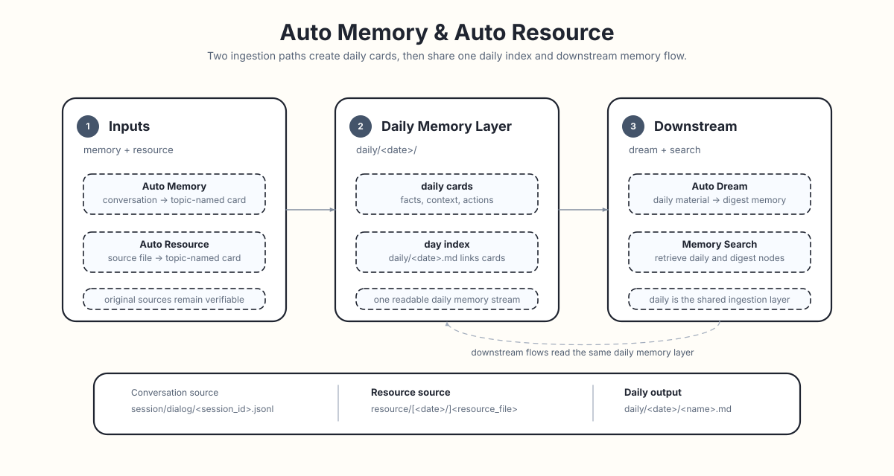

# Auto Resource `Beta`

Auto Resource 是 ReMe 的资源解读入口，目前处于 **Beta**。资源文件先进入 `resource/`（推荐按日期放置），再被解读成 daily
资源卡片；卡片文件名由 LLM 生成的 frontmatter `name` 决定，并通过 `source_resource`
追溯原始文件。

<p align="center">
  
</p>

关于 workspace 分层、`resource/` 和 `daily/` 的通用文件语义，见 [Memory as File](./memory_as_file.md)。对话进入 daily 的流程见
[Auto Memory](./auto_memory.md)。

```text
resource/[YYYY-MM-DD/]<resource_file>
  ├─ step 1: daily/YYYY-MM-DD/<generated_name>.md # 资源解读卡片
  ├─ step 2: source_resource 指回原始资源
  └─ step 3: daily/YYYY-MM-DD.md                  # 当天索引再串起来
```

## 它记录什么

它不只是搬运文件内容，而是把资料里以后方便检索和理解的信息提炼出来：

- 核心内容：这份资料主要讲什么。
- 结构脉络：章节、表格、字段、数据组织方式。
- 关键细节：重要数字、名称、日期、结论。
- 背景用途：这份资料为什么存在，和当前工作有什么关系。
- 可行动项：任务、截止时间、后续跟进。

简单说，它负责把“文件存档”变成“资料可用”。

## 原始资料入口

Auto Resource 以 `resource/` 作为原始资料入口。推荐按日期放置，目录日期会决定它进入哪一天的 daily 记忆层；也支持直接放在
`resource/` 根目录，首次处理时使用应用时区中的今天。之后即使跨天更新或删除，也会通过精确匹配
`source_resource` 继续操作原 daily 卡片，不会重复新建卡片或留下孤立链接。

示例目录：

```text
workspace/
  resource/
    quick-note.txt             # 进入今天的 daily
    2026-06-20/
      market-report.md
      meeting-notes.csv
```

当前 Beta 版本以文本类资源为主，例如 `md`、`txt`、`json`、`jsonl`、`csv`、`yaml`、`html`；图像资源（`png`、`jpg`、`jpeg`、`webp`、`gif`、`bmp`、`tiff`、`heic`）会生成 caption 卡片，见下文[图像资源](#图像资源)一节。

内部由统一的 `AutoResourceStep` 接收每批变更，并将每一项交给配置中第一个匹配它的 processor。
`AutoImageResourceStep` 声明图像后缀匹配规则，`AutoTextResourceStep` 作为最后的 fallback。后续新增模态时，
只需注册新的 processor、提供独立 prompt 并在 `dispatch_steps` 中增加一项，无需修改 router。

## 资源保留与 TTL

默认配置保留原始资源。`config=proactive` 使用每日清理 Job，不依赖 catalog、资源 watcher 或处理确认。
永久资料请放在 `resource/` 之外。

```yaml
jobs:
  resource_cleanup_cron:
    backend: cron
    cron: "0 3 * * *"
    steps:
      - backend: cleanup_resources_step
        ttl_days: 7
```

每天应用时区 03:00 递归扫描 `resource_dir`，删除修改时间距今至少七天的普通文件，再移除空目录，保留根目录。
所有文件类型和目录名都适用，文件名中的日期不参与过期判断。每日扫描意味着过期后最多再保留约 24 小时。
跳过符号链接，资源根目录必须位于工作区内且不含符号链接别名。清理依赖安全的描述符相对文件操作，不支持的平台
会在删除前报错。结果 `answer` 包含 `deleted_files`、`deleted_dirs`、`freed_bytes` 和 `errors`；部分删除失败会让
该次 Job 失败，后续可重试。设置 `jobs.resource_cleanup_cron.enabled=false` 可关闭物理清理。

这替代 proactive 的 catalog、`resource_watch_loop`、`resource_changes`、`resource_processed` 和日期目录 TTL。
已有文件无需转换，按实际 mtime 清理。默认 Auto Resource 索引流程仍使用自己的 catalog。

## Connector 工具与屏幕采集

先在一个终端启动服务：

```bash
reme start config=proactive
```

在另一个终端调用工具：

```bash
reme screen_capture
reme finance_news
reme check_json path=reme_metadata/pa/proactive.json
```

`BaseConnectorStep` 统一返回 `answer={"context": str, "paths": list[str]}`。`context` 包含结果说明和读取指引；
`paths` 是可按需渐进式展开的工作区相对文件或目录路径。纯文字结果可返回空路径列表。不再生成 `metadata.json`，
调用者保存任务执行结果时应同时保留两个字段。

`screen_capture` 按稳定显示器身份比较，只保存变化屏幕的原始尺寸 PNG：

```text
resource/screen_capture/2026-11-07_10-20-30-123456_display_<身份哈希>.png
```

文件名哈希来自系统显示器身份，不使用枚举序号。macOS 使用显示器 UUID，其他后端使用 MSS 可选的 `unique_id`；
身份缺失或不唯一时继续分析。PNG 元信息保存身份、尺寸和比较排除区域，原始像素保持不变。
基准缺失、无法读取或尺寸变化时继续分析。手动调用与上次成功发布的手动截图比较。
所有屏幕均相似时返回“与上次处理的截图基本一致”和 `paths=[]`，不发布文件。

阈值配置在 `components.screen_capture.default`：比较图最长边1280，RGB 任一通道差值大于20计为变化；
整屏变化比例达到0.0005，或任一32×32分块变化比例达到0.015时继续分析，分块步长16。
macOS 比较时排除标题为 `Remy · ReMe` 的悬浮窗口和已知时钟区域，并考虑窗口前后位置；原图仍保留这些区域。
输入光标闪烁、悬停提示等真实画面变化仍可能触发分析，不代表值得主动提醒。

采集组件受应用生命周期管理，同时最多执行一轮，重叠请求明确失败。原生截图在子进程中执行，默认整轮超时90秒；
超时、取消、停止或服务关闭会终止并回收子进程。比较和发布在服务事件循环之外执行。
采集失败明确报错，不会误报“与之前一致”。

文字说明包含带时区的采集时间、显示器数量和理解图片所需的信息。各显示器依次采集。
文件先暂存再发布；失败或取消时清理本次已发布文件，不覆盖已有截图。多个平铺文件的发布不再是单次原子目录操作。

定时截图解读是 `{metadata_dir}/pa/cron.json` 中的 query，由 ReMe CronJob 独立调度 `cron_agent`，默认每五分钟
执行一次，由 Agent 按需调用截图工具。画面没有明显变化时，Agent 可以不发布新的摘要；
执行和摘要阶段仍正常运行，不再由配置中的预检查字段跳过整轮调用。
将 enabled 改为 false 可关闭，文件修改后自动重新加载。累计摘要保存在
`{metadata_dir}/pa/cron/screen_activity/YYYY-MM-DD/`，供 proactive 消费。需要安装 `reme-ai[core]`，
并为实际运行 ReMe 的进程授予录屏权限；可用性取决于本机 MSS 后端。

`finance_news` 查询最近 24 小时的财联社电报，按保留的 JSONL 文件中的 `news_id` 去重，只将本次新增保存为一个文件：

```text
resource/finance_news/2026-11-07_15-30-00-123456.jsonl
```

每行符合 [`FinanceNewsItem`](../../reme/schema/finance_news.py)，包含 `news_id`、带时区的 `event_time`、`source`、
`title` 和清洗 HTML 后的完整 `content`。`context` 返回新增数量、查询窗口和读取说明，新闻正文需读取 `paths`，可按需分批读取。
首次调用保存窗口内全部有效新闻；后续调用及服务重启后，只保存尚未出现在保留文件中的 ID。同 ID 的修订不作为新增返回。
无新增时返回说明和 `paths=[]`，不创建文件。24 小时是查询窗口，每次调用最多新增一个文件；历史文件按资源清理策略保留。
删除历史文件也会删除相应的去重依据。

采集与清理使用同一把进程内路径锁，防止并发重复发布。接口分页必须覆盖完整窗口；默认每次请求后等待 10 秒、每页最多尝试
3 次，连接超时 5 秒、请求超时 20 秒。可通过 Step 配置 `request_interval` 和 `max_retries` 调整限速与重试，工具仍无参数。
失败或取消不发布部分结果，也不修改已有文件；损坏、超限或符号链接历史文件会明确报错。不能将失败理解为没有新增新闻。

`check_json(path)` 完整解析文件而不修改它。成功直接返回解析值，支持标量和 `null`；失败返回 `success=false` 和
`answer={path, line, column, error}`。非语法错误的行列为 null。超出读取上限直接失败，不截断后解析。
cron 和活动时间等业务字段仍由对应配置加载器校验。

## 图像资源

文本和图像共用 agent-wrapper 与笔记写入工具；图片输入只是在理解提示词旁加入原生 AgentScope 图像块。
Agent 写入一张 caption 卡片并链接原图。卡片正文以 `![[resource/...]]` 嵌入链接开头，frontmatter 携带
`kind: image` 与 `media_type`，文本检索因此可以通过 caption 命中图像内容。

图像处理默认开启（`include_images=true`），需要绑定兼容模型与 formatter 的 AgentScope wrapper。
通过 `components.agent_wrapper.<name>.as_llm` 配置模型，在资源 Step 上用 `agent_wrapper` 选择对应 wrapper。
原图片 Step 的 `as_llm` 覆盖项和自动选择 `as_llm.vision` 的逻辑由此绑定方式替代。
不再单独调用 caption 模型或执行额外的 schema 提取；Agent 失败后也不以纯文本重跑。
这是一次 Agent 工作流，工具调用可能带来多轮模型请求。

每次解读图片都会新建会话，处理记录可通过返回的 `agent_session_id` 查找。更新同一张图片时，仍然修改原来的卡片。
卡片正文应包含原图引用和 `## Caption` 下的描述或文字转录，不能留空或直接写入 JSON。
`status` 留给后续流程填写，更新卡片时保留原值。

自定义图片提示词使用 `prompt_dict.resource_instructions`，中文使用 `resource_instructions_zh`；旧配置中的
`user_message` / `user_message_zh` 需相应改名。公共创建或更新模板通过
`{resource_instructions}` 插入图片要求；旧模板没有该占位符时，图片要求会追加到末尾。

在 `auto_resource` 调用或 Job 默认值中设置 `include_images=false`，会跳过图片的**全部事件，包括删除**。
调用参数优先于 Job 默认值，两者都未设置时默认开启。监听任务可设置 `jobs.resource_watch_loop.include_images=false`，
手动任务默认值可设置 `jobs.auto_resource.include_images=false`。图片子类通过现有逐资源结果和 warning 日志说明跳过原因，
不影响文本处理。已有图片卡片保持不变，即使原图被删除也不清理。重新开启不会自动补处理旧事件，需要显式把相关路径再次提交给
`auto_resource`。尊重 wrapper 配置的图片数量上限，每次资源调用至少需要容纳一张图片，不会自动提高上限。

在启动常驻服务时配置 wrapper，例如将每个 Agent 上下文的图片上限设为一张：

```bash
reme start components.agent_wrapper.default.context_config.max_image_num=1
```

监听任务会自动处理资源变更。如需显式重新处理已存在的 `resource/photo.png`，在另一个终端使用同一 workspace 调用客户端：

```bash
reme auto_resource include_images=true changes='[{"path":"resource/photo.png","change":"modified"}]'
```

宽或高超过 2048px 的图像会降采样，格式不被模型接受的图像会转码；这些处理只发生在请求前的内存副本中，
`resource/` 下的原图文件不会被修改。图像处理开启时，图像变更会原地更新卡片，图像删除会清理关联卡片。

在完整解码前，系统会检查图像尺寸，默认上限为 40,000,000 像素；超限图像或 Pillow
decompression-bomb 警告只会导致当前资源失败。缩放或转码前，会按 EXIF orientation 校正仅用于请求的内存副本。
尺寸过大的 JPEG 会先使用 decoder-level downsampling，并在需要时再完成最终缩放。
VLM 请求的 MIME 和卡片 frontmatter 中的 `media_type` 都使用 Pillow 根据实际图像字节识别的格式，
而不是直接信任文件扩展名。

图像预处理使用 `core` extra 中的 Pillow。HEIC 资源还需要可选的 `image-heif` extra：
`pip install "reme-ai[image-heif]"`。其他受支持图像格式不会加载或依赖 HEIF 插件。

## 资源卡片

每个资源文件会生成一张 daily 资源卡片。创建时先使用资源文件 stem 作为临时路径，对应 processor 写入后，系统会根据 frontmatter `name`
重命名文件：

```text
resource/2026-06-20/market-report.md
        ↓
daily/2026-06-20/市场报告要点.md
```

资源卡片通过 frontmatter 关联原始文件：

```yaml
source_resource: "[[resource/2026-06-20/market-report.md]]"
```

对于已启用处理的资源，文件更新时 Auto Resource 只会通过精确匹配的 `source_resource` 找到对应卡片并更新；文件删除时也只会清理显式关联的
daily note。缺少该来源标记的同 stem 笔记会被视为用户笔记并保留，新资源卡片则会使用无冲突路径。

处理失败时，`modified` 会标明卡片文件有没有变化。Agent 写完文件后再报错或被取消，已写内容仍然保留；
系统会尝试补齐通过 `source_resource` 关联的卡片元数据，并更新当天索引，调用仍按原来的错误或取消结束。
图片笔记未通过格式检查时也会报错，已写内容同样保留。失败的调用不会自动重试。

## 当天索引

资源卡片会进入和 Auto Memory 相同的 daily 记忆层。当天的 `YYYY-MM-DD.md` 会作为索引页，把这些资源卡片组织起来：

```text
daily/
  2026-06-20.md
  2026-06-20/
    市场报告要点.md
    会议纪要整理.md
```

以后想回看这一天处理过哪些资料，先看 `YYYY-MM-DD.md`；想看某份资料沉淀了什么，再进入对应的资源卡片。

## 同时保留原始资料

解读后的 daily note 负责“好读”，原始资源负责“可信”。

Auto Resource 不会把原始文件挪走：它仍然留在 `resource/` 下的原路径。这样，文本与图像资料会进入 daily 记忆流，原始文件也始终保留在它来时的位置。

## 后续流向

Auto Resource 只生成 daily 层的资源解读。要把资源中的长期知识沉淀进 `digest/`，使用 [Auto Dream](./auto_dream.md)；默认实时检索会
索引 daily 卡片和 digest 节点。手动 `reindex` 只基于摄取流程已经接受的 chunks 重建检索索引，不会把原始资源文件加入检索范围。
详见 [Memory Search](./memory_search.md)。
