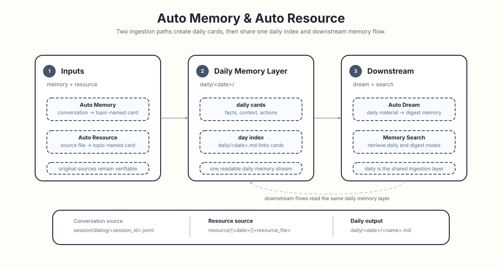

# Auto Resource `Beta`

Auto Resource 是 ReMe 的资源解读入口，目前处于 **Beta**。资源文件先进入 `resource/`（推荐按日期放置），再被解读成 daily
资源卡片；卡片文件名由 LLM 生成的 frontmatter `name` 决定，并通过 `source_resource`
追溯原始文件。

<p align="center">
  
</p>

关于 workspace 分层、`resource/` 和 `daily/` 的通用文件语义，见 [Memory as File](./memory_as_file.md)。对话进入 daily 的流程见
[Auto Memory](./auto_memory.md)。

```text
resource/[YYYY-MM-DD/]<resource_file>
  ├─ step 1: daily/YYYY-MM-DD/<generated_name>.md # 资源解读卡片
  ├─ step 2: source_resource 指回原始资源
  └─ step 3: daily/YYYY-MM-DD.md                  # 当天索引再串起来
```

## 它记录什么

它不只是搬运文件内容，而是把资料里以后方便检索和理解的信息提炼出来：

- 核心内容：这份资料主要讲什么。
- 结构脉络：章节、表格、字段、数据组织方式。
- 关键细节：重要数字、名称、日期、结论。
- 背景用途：这份资料为什么存在，和当前工作有什么关系。
- 可行动项：任务、截止时间、后续跟进。

简单说，它负责把“文件存档”变成“资料可用”。

## 原始资料入口

Auto Resource 以 `resource/` 作为原始资料入口。推荐按日期放置，目录日期会决定它进入哪一天的 daily 记忆层；也支持直接放在
`resource/` 根目录，首次处理时使用应用时区中的今天。之后即使跨天更新或删除，也会通过精确匹配
`source_resource` 继续操作原 daily 卡片，不会重复新建卡片或留下孤立链接。

示例目录：

```text
workspace/
  resource/
    quick-note.txt             # 进入今天的 daily
    2026-06-20/
      market-report.md
      meeting-notes.csv
```

当前 Beta 版本以文本类资源为主，例如 `md`、`txt`、`json`、`jsonl`、`csv`、`yaml`、`html`；图像资源（`png`、`jpg`、`jpeg`、`webp`、`gif`、`bmp`、`tiff`、`heic`）会生成 caption 卡片，见下文[图像资源](#图像资源)一节。

内部由统一的 `AutoResourceStep` 接收每批变更，并将每一项交给配置中第一个匹配它的 processor。
`AutoImageResourceStep` 声明图像后缀匹配规则，`AutoTextResourceStep` 作为最后的 fallback。后续新增模态时，
只需注册新的 processor、提供独立 prompt 并在 `dispatch_steps` 中增加一项，无需修改 router。

## 资源保留与 TTL

默认配置和 `proactive` 配置均保留原始资料。定制 file catalog 可使用 `ttl_days` 和 `cleanup_catalog_step`
清理按日期保存的临时目录，但必须保留待处理 Proactive 事件引用的资料。命名 Agent 使用持久事件回执确认消费，
不使用 catalog 的处理标记。永久资料保留在用户管理的工作区路径中。

## 定时屏幕采集

`config=proactive` 默认启用 `screen_capture_cron`，按应用时区每 5 分钟采集截图，启动时不立即采集。
截图独立投递给 `proactive_memory` 任务，与 Codex 对话采集互不依赖。可用 `jobs.screen_capture_cron.enabled=false` 关闭，
或在 `screen_capture_step` 中设置 `task_names`，指定接收截图的事件触发任务。

截图步骤为每个显示器保存一张原尺寸 PNG，并在发布 `metadata.json` 前保存接收任务。
观察事件列出全部 PNG 的工作区相对路径，投递中断后沿用已保存的目标和事件 ID。

```text
resource/screenshot/YYYY-MM-DD/hhmmss_<uuid4前六位>/
  1.png
  2.png
  metadata.json
```

目录按采集器 `source`、应用时区日期、时分秒和 UUID4 前六位组织。截图的 `source` 为 `screenshot`。
`metadata.json` 是本次采集的资源清单，通过包内相对路径关联原始文件。事件 ID 由包的工作区相对路径生成。
旧资源包不移动，已保存的路径引用仍有效。

manifest 使用 `ResourceMetadata`：带时区的创建/更新时间、source、description、采集 Step 类名和包内文件列表。
任一屏幕失败都会清理未完成的资源包，不投递事件；取消时等待同步采集退出并清理。macOS 需要实际宿主进程的屏幕录制权限，
无图形会话或显示器不可用时该轮失败。采集不调用 LLM，由事件触发的 Proactive Agent 独立解读。

截图逐屏与最近保存的一组比较，以 RGB 完全相同的像素占比作为相似度。显示器布局和图像尺寸不变，且每屏相似度都超过 99% 时，
不生成截图资源包或事件；否则保留全部屏幕供理解上下文。恰好 99% 仍保存，比较基准不会随跳过的截图更新。
截图 Step 通过 `similarity_threshold` 配置阈值，默认为 `0.99`；
设为 `1` 时仅跳过完全相同的图像。局部变化不足 1% 时可能被过滤，包括小范围的文字变化。
截图过滤不影响新增 Codex 对话的投递。

## 定时 Codex 对话采集

`codex_dialogue_cron` 启动时先执行 `codex_dialogue_init_step`，建立初始读取基线。从基线起，每 5 分钟读取
`${CODEX_HOME:-~/.codex}/sessions` 中新增的用户消息、发给用户的进度文字和最终回答，以 `codex_dialogue` 事件投递。
推理、工具调用和结果、子 Agent 会话以及 ReMe 自己的会话均不采集。

每批对话保存在 `resource/codex_dialogue/YYYY-MM-DD/HHMMSS_<suffix>/`。事件提供 `dialogue.md` 和图片附件路径。
Markdown 按项目、会话和轮次列出用户消息、进度文字和最终回答，并保留各条消息的 ID。同一轮插入的用户消息各占一节，
图片链接跟在对应的消息后面。随记和其他 Proactive Runtime 一样，按事件中的路径展开阅读对话和图片，再用 `todo` 和 `idea` 核对项目和条目 ID。
`resource/codex_dialogue/progress.jsonl` 保存已提交的读取位置和消息 ID；`pending.json` 固定未完成的批次，
先重试投递，再读取后续变化。这些采集状态文件不放入事件路径。重启后沿用已保存的进度，不重复投递已完成对话。
空闲扫描不追加进度记录；只有工具记录变化时仍推进偏移，但不产生对话事件。

## 定时财经采集

`config=proactive` 每五分钟独立运行各采集任务。

| 任务 | 数据源和文件 |
| --- | --- |
| `finance_news_cron` | [财联社电报](https://www.cls.cn/telegraph)写入 `news.md`，`news.jsonl` 用于去重 |
| `gold_quotes_cron` | 腾讯现货黄金（XAU/USD），写入 `gold.jsonl`，单位为美元/金衡盎司 |
| `oil_quotes_cron` | 腾讯 WTI 原油期货（CL），写入 `oil.jsonl`，单位为美元/桶 |
| `nasdaq_quotes_cron` | 腾讯纳斯达克综合指数（IXIC），写入 `nasdaq.jsonl`，单位为指数点 |
| `btc_quotes_cron` | [Binance BTC/USDT 现货行情](https://developers.binance.com/en/docs/products/spot/faqs/market_data_only)，写入 `btc.jsonl` |

黄金、原油和纳指按相对昨收的涨跌幅判断，BTC 使用滚动 24 小时涨跌幅。默认 `proactive_fin` 任务在绝对涨跌幅达到 3% 时
提醒，相关财联社电报用于补充背景。

新增电报或行情有变化时，在 `resource/<source>/YYYY-MM-DD/hhmmss_<suffix>/` 发布资源包。行情保留报价时间和采集时间。
电报回看最多 24 小时，按新闻 ID 去重。已发布但投递未完成的事件会重试。

在一个终端运行 `reme start config=proactive`，在另一个终端运行 `reme manage_proactive_agent action=status agent_name=finance`
查看任务的 `TASK.md`。启动时用 `jobs.<任务名>.enabled=false` 关闭对应采集任务。

## 图像资源

文本和图像共用 agent-wrapper 与笔记写入工具；图片输入只是在理解提示词旁加入原生 AgentScope 图像块。
Agent 写入一张 caption 卡片并链接原图。卡片正文以 `![[resource/...]]` 嵌入链接开头，frontmatter 携带
`kind: image` 与 `media_type`，文本检索因此可以通过 caption 命中图像内容。

图像处理默认开启（`include_images=true`），需要绑定兼容模型与 formatter 的 AgentScope wrapper。
通过 `components.agent_wrapper.<name>.as_llm` 配置模型，在资源 Step 上用 `agent_wrapper` 选择对应 wrapper。
原图片 Step 的 `as_llm` 覆盖项和自动选择 `as_llm.vision` 的逻辑由此绑定方式替代。
图片由 Agent 使用配置的模型与工具完成解读，工作流可能包含多轮模型请求。

每次解读图片都会新建会话，处理记录可通过返回的 `agent_session_id` 查找。更新同一张图片时，仍然修改原来的卡片。
卡片正文应包含原图引用和 `## Caption` 下的描述或文字转录，不能留空或直接写入 JSON。
`status` 留给后续流程填写，更新卡片时保留原值。

自定义图片提示词使用 `prompt_dict.resource_instructions`，中文使用 `resource_instructions_zh`。公共创建或更新模板通过
`{resource_instructions}` 插入图片要求；没有该占位符时，图片要求追加到末尾。

在 `auto_resource` 调用或 Job 默认值中设置 `include_images=false`，会跳过图片的**全部事件，包括删除**。
调用参数优先于 Job 默认值，两者都未设置时默认开启。监听任务可设置 `jobs.resource_watch_loop.include_images=false`，
手动任务默认值可设置 `jobs.auto_resource.include_images=false`。图片子类通过现有逐资源结果和 warning 日志说明跳过原因，
不影响文本处理。已有图片卡片保持不变，即使原图被删除也不清理。重新开启不会自动补处理旧事件，需要显式把相关路径再次提交给
`auto_resource`。尊重 wrapper 配置的图片数量上限，每次资源调用至少需要容纳一张图片，不会自动提高上限。

在启动常驻服务时配置 wrapper，例如将每个 Agent 上下文的图片上限设为一张：

```bash
reme start components.agent_wrapper.default.context_config.max_image_num=1
```

监听任务会自动处理资源变更。如需显式重新处理已存在的 `resource/photo.png`，在另一个终端使用同一 workspace 调用客户端：

```bash
reme auto_resource include_images=true changes='[{"path":"resource/photo.png","change":"modified"}]'
```

宽或高超过 2048px 的图像会降采样，格式不被模型接受的图像会转码；这些处理只发生在请求前的内存副本中，
`resource/` 下的原图文件不会被修改。图像处理开启时，图像变更会原地更新卡片，图像删除会清理关联卡片。

在完整解码前，系统会检查图像尺寸，默认上限为 40,000,000 像素；超限图像或 Pillow
decompression-bomb 警告只会导致当前资源失败。缩放或转码前，会按 EXIF orientation 校正仅用于请求的内存副本。
尺寸过大的 JPEG 会先使用 decoder-level downsampling，并在需要时再完成最终缩放。
VLM 请求的 MIME 和卡片 frontmatter 中的 `media_type` 都使用 Pillow 根据实际图像字节识别的格式，
而不是直接信任文件扩展名。

图像预处理使用 `core` extra 中的 Pillow。HEIC 资源还需要可选的 `image-heif` extra：
`pip install "reme-ai[image-heif]"`。其他受支持图像格式不会加载或依赖 HEIF 插件。

## 资源卡片

每个资源文件会生成一张 daily 资源卡片。创建时先使用资源文件 stem 作为临时路径，对应 processor 写入后，系统会根据 frontmatter `name`
重命名文件：

```text
resource/2026-06-20/market-report.md
        ↓
daily/2026-06-20/市场报告要点.md
```

资源卡片通过 frontmatter 关联原始文件：

```yaml
source_resource: "[[resource/2026-06-20/market-report.md]]"
```

对于已启用处理的资源，文件更新时 Auto Resource 只会通过精确匹配的 `source_resource` 找到对应卡片并更新；文件删除时也只会清理显式关联的
daily note。缺少该来源标记的同 stem 笔记会被视为用户笔记并保留，新资源卡片则会使用无冲突路径。

处理失败时，`modified` 会标明卡片文件有没有变化。Agent 写完文件后再报错或被取消，已写内容仍然保留；
系统会尝试补齐通过 `source_resource` 关联的卡片元数据，并更新当天索引，调用仍按原来的错误或取消结束。
图片笔记未通过格式检查时也会报错，已写内容同样保留。失败的调用不会自动重试。

## 当天索引

资源卡片会进入和 Auto Memory 相同的 daily 记忆层。当天的 `YYYY-MM-DD.md` 会作为索引页，把这些资源卡片组织起来：

```text
daily/
  2026-06-20.md
  2026-06-20/
    市场报告要点.md
    会议纪要整理.md
```

以后想回看这一天处理过哪些资料，先看 `YYYY-MM-DD.md`；想看某份资料沉淀了什么，再进入对应的资源卡片。

## 同时保留原始资料

解读后的 daily note 负责“好读”，原始资源负责“可信”。

Auto Resource 不会把原始文件挪走：它仍然留在 `resource/` 下的原路径。这样，文本与图像资料会进入 daily 记忆流，原始文件也始终保留在它来时的位置。

## 后续流向

Auto Resource 只生成 daily 层的资源解读。要把资源中的长期知识沉淀进 `digest/`，使用 [Auto Dream](./auto_dream.md)；默认实时检索会
索引 daily 卡片和 digest 节点。手动 `reindex` 只基于摄取流程已经接受的 chunks 重建检索索引，不会把原始资源文件加入检索范围。
详见 [Memory Search](./memory_search.md)。
