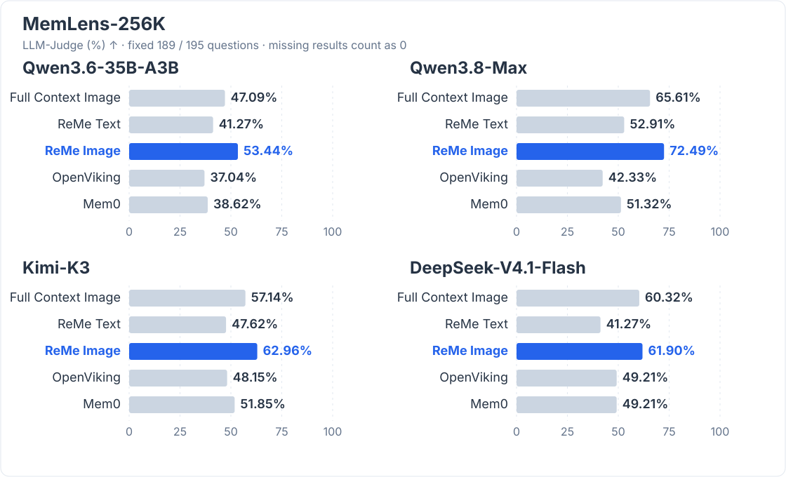

# 让图片进入记忆

和 Agent 讨论系统设计时，我们会发一张架构图，再对照着图确认：哪些模块要改，哪些设计先保留。

以后再问“上次为什么保留任务队列”，Agent 需要找回当时的讨论，也需要回看图中的模块关系。

**ReMe 的这次多模态记忆更新，让 Auto Memory 和 Auto Resource 都能从图片中提取信息，并保留图片来源。**

会话中的图片可以和上下文一起形成记忆，资源目录里的图片可以生成独立的描述卡片。两条路径都写入现有的 `daily/` 记忆层。

## Auto Memory：把图片和当时的讨论一起记住

假设你给 Agent 发了一张系统架构图，并补充：

> “这次只调整 Gateway，Worker 和 PostgreSQL 先不动。任务队列仍然保留，避免流量高峰时直接压到数据库。”

开启图片输入后，Auto Memory 会把图和这段讨论一起交给视觉模型。文字与图片保留在原来的对话顺序中，说话人和时间也会随之传入。这样，Agent 可以结合图中的模块关系，记录本次调整的范围、保留队列的原因和后续约束。

它直接读取会话里的图片。宿主只需把图片作为消息内容块传入，并在调用 `auto_memory` 时设置 `include_images=true`，就能让图片参与这一轮记忆生成。

### 视觉事实也有来源

对话图片既可能是上传的 Base64 数据，也可能是 HTTP(S) URL。ReMe 对它们分别保留来源：

- Base64 图片的原始字节默认保存在 `session/images/<session_id>/`，目录随 `session_dir` 配置，供以后查看；
- URL 图片保留原始地址，由模型服务读取，不下载到本地。

Auto Memory 会把每张图片的准确来源随图片一起传给 Agent，并在提示词中要求它在相关视觉事实旁引用来源。每日记忆的 `source_images` frontmatter 也会记录这些链接，后续更新会保留并合并已有来源。读到一条来自图片的事实时，可以顺着链接回到原图。

上传 Base64 架构图后的记忆内容示意：

```markdown
这次只调整 Gateway，Worker 和 PostgreSQL 保持不变。
架构图中的 Gateway 通过任务队列连接 Worker。
见 [[session/images/design-review/msg-61-image-1.png]]。

保留任务队列的原因是避免高峰流量直接压到数据库。
```

这里既有从图中读出的关系，也有用户在讨论中明确作出的决定。会话来源继续由 `source_conversation` 指向 `session/dialog/` 下的记录，图片来源则单独保留。

这些会话附件留在 `session/` 中，不会进入资源监听流程，也不会再生成一张独立的图片描述卡。

## Auto Resource：把图片资料整理成可检索的卡片

有些图片没有对应的对话：一张白板照片、一份保存下来的报表截图，或者一张以后还要查阅的流程图。它们可以直接放进工作区的 `resource/`。

Auto Resource 现在可以使用视觉模型解读这些图片，把可见内容整理成 daily 卡片。图片输入与文本资源共用 Agent 的记忆写入工具，原图保留在资源目录里。

例如，把一张流程图放在：

```text
resource/2026-10-09/system-overview.png
```

图片资源卡片示意：

```markdown
---
name: 系统请求处理流程
description: Gateway 通过任务队列连接 Worker，Worker 将结果写入 PostgreSQL。
kind: image
media_type: image/png
source_resource: "[[resource/2026-10-09/system-overview.png]]"
---

![[resource/2026-10-09/system-overview.png]]

## Caption

图中包含 Gateway、任务队列、Worker 和 PostgreSQL。
请求从 Gateway 进入任务队列，由 Worker 消费并将结果写入 PostgreSQL。
```

卡片把原图嵌入、内容描述和来源链接放在一起。截图中的文字、图表中的数字和模块之间的关系，都可以成为描述的一部分；内容取决于图片本身和所用视觉模型。

图片资料由此进入现有检索流程。以后搜索“任务队列连接哪些模块”，ReMe 可以通过卡片中的文字找到相关图片，再沿 `source_resource` 回看原文件。资源图片更新时，对应卡片也会更新；开启图片处理时，删除原图会移除对应的资源卡片。

Auto Resource 支持 PNG、JPG/JPEG、WebP、GIF、BMP、TIFF 和 HEIC。较大的图片会在模型请求中按需缩小或转换格式，原始资源文件保持不变。HEIC 需要额外安装 `reme-ai[image-heif]`。

## Performance：MemLens-256K 多模态长历史问答 {#memlens-256k-results}

在 MemLens-256K 上，ReMe Image 使用 Qwen3.6-35B-A3B、Qwen3.8-Max、Kimi-K3 和 DeepSeek-V4.1-Flash 时，LLM-Judge 分别达到 **53.44%**、**72.49%**、**62.96%** 和 **61.90%**，比同一待测模型下的 Full Context Image 高 **6.35**、**6.88**、**5.82** 和 **1.59** 个百分点。



六道题在部分方法的 Qwen 模型请求中触发了服务商的内容审核，因此四个模型、全部方法统一排除这六题，比较相同的 **189/195** 题。未完成的题目在汇总中按 0 计，评分采用官方二元 LLM-Judge 协议。针对部分可能存在的偶发失败的 API 调用，实验中对其重试调用以获得有效结果。

各方法保留自己的记忆与回答流程：ReMe 通过多轮检索、读取来回答，OpenViking、Mem0 则先检索记忆，再由 reader 生成一次回答。ReMe 可以检索原始会话，Image 还可以回看原图；OpenViking 检索限定在 memory。完整方法设置、结果及独立复现对比见 [MemLens 评测说明](../../benchmark/memlens/docs/zh/evaluation.md)。

## Performance：MobileMem 个人视觉记忆 {#mobilemem-results}

MobileMem-Omni 考察模型能否从用户的对话历史中找回视觉信息并完成推理。本次评测包含 20 位用户的 **1,333** 道 `visual_reasoning` 问题，采用官方 MemBase 默认 Judge 协议。

| 待测模型 | Full Context Image | ReMe Text | ReMe Image |
| --- | ---: | ---: | ---: |
| Qwen3.8-Max | 46.81% | 38.33% | **60.69%** |
| Kimi-K3 | N/A | 35.86% | **51.16%**† |
| DeepSeek-V4.1-Flash | N/A | 39.38% | **56.19%** |

Qwen3.8-Max 下，ReMe Image 比 Full Context Image 高 **13.88** 个百分点；三个模型下，Image 的得分也均高于 Text。

† Kimi Image 保留原先 1,203 题的结果，最后 130 题使用由于内容审查跳过两个 session 的历史变体。Kimi、DeepSeek 的 Full Context 因历史超出 API 每次请求最多 256 张图片的上限限制而跳过。完整设置、覆盖范围与文本重合指标见 [MobileMem 评测说明](../../benchmark/mobilemem/docs/zh/evaluation.md)。

## 独立复现 {#independent-reproduction}

我们使用 main 分支（提交 [b784468](https://github.com/agentscope-ai/ReMe/commit/b784468a10d98af1688b7c4ba38492dc1f9bda6f)），通过仓库中的 benchmark 入口重新运行 ReMe Image。

由于 [PR #713](https://github.com/agentscope-ai/ReMe/pull/713) 更新了 Agent 返回值的处理方式，达到轮次上限但未发生实际错误的结果也会被标记为失败，导致记忆摄入中止或回答无法进行评分。因此，我们在 [PR #735](https://github.com/agentscope-ai/ReMe/pull/735)（修复提交 [681a1383](https://github.com/agentscope-ai/ReMe/commit/681a13831426c1a8d4f7227ef835c38d0257003a)）中，仅针对 benchmark 插件重载结果处理，接纳达到 30 轮上限、无原生错误且无结构化输出约束的旧返回值（`exceed_max_iters`）；轮数上限和模型调用保持不变。

下表仅对**已评分题**求平均，未评分题不补 0。MemLens 仍从完整 195 题输入中排除相同六题，主表范围为 189 题；MobileMem 的应测题数为 1,333。

| 基准 | 模型 | 已评分 / 应测 | LLM-Judge (%) |
| --- | --- | ---: | ---: |
| MemLens-256K | Qwen3.6-35B-A3B | 189 / 189 | 55.03 |
| MemLens-256K | Qwen3.8-Max | 189 / 189 | 70.37 |
| MemLens-256K | Kimi-K3 | 189 / 189 | 65.08 |
| MemLens-256K | DeepSeek-V4.1-Flash | 184 / 189 | 64.67 |
| MobileMem | Qwen3.8-Max | 1,329 / 1,333 | 60.42 |
| MobileMem | Kimi-K3 | 1,278 / 1,333 | 52.35 |
| MobileMem | DeepSeek-V4.1-Flash | 1,328 / 1,333 | 53.61 |

Kimi 的 MobileMem 结果包含 **1,148 题完整历史**和 **130 题由于内容审查跳过会话的历史变体**：后者仍省略因内容审查未能摄入的 `8_69`、`14_74_2` 两个 session。另有一位用户的历史在记忆生成阶段触发输出内容审核，其 55 题未进行问答评分。

就 ReMe Image 的 LLM-Judge 表现而言，复现结果与正式实验结果的趋势和结论保持一致。

正式主表对缺题补 0，而上述复现结果只平均已评分题，因此比较时需使用双方共同完成的题目。同题对比、其余未评分原因和辅助指标见 [MemLens 独立复现](../../benchmark/memlens/docs/zh/evaluation.md#independent-reproduction)和 [MobileMem 独立复现](../../benchmark/mobilemem/docs/zh/evaluation.md#independent-reproduction)。

## 如何开始使用

两个入口都需要支持图片和工具调用的视觉模型，以及兼容的 AgentScope wrapper 和 formatter。模型由所选 wrapper 的 `as_llm` 绑定决定。凭证配置见[基础配置](./configuration.md)。

以 ReMe 默认配置和 OpenAI 兼容服务为例，把 `YOUR_VISION_MODEL` 换成服务提供的模型名称后启动 ReMe：

```bash
reme start \
  components.as_llm.default.backend=openai \
  components.as_llm.default.model=YOUR_VISION_MODEL \
  components.as_llm.default.parameters.max_tokens=4096
```

图片开关分别作用于两个入口：

| 入口 | 默认值 | 启用方式 |
|---|---|---|
| Auto Memory | `include_images=false` | 调用 `auto_memory` 时传入 `include_images=true` |
| Auto Resource | `include_images=true` | 资源监听默认处理图片；手动调用也可显式传入该参数 |

在另一个终端中调用同一工作区的服务。下面展示会话图片的消息格式；将 URL 换成模型服务可访问的 PNG 图片地址：

```bash
reme auto_memory session_id=design-review include_images=true messages='[
  {
    "id": "a",
    "name": "user",
    "role": "user",
    "content": [
      {"type": "text", "text": "这次只调整 Gateway。保留任务队列，避免高峰流量直接压到数据库。"},
      {"type": "data", "source": {
        "type": "url",
        "media_type": "image/png",
        "url": "https://example.com/system-overview.png"
      }}
    ]
  }
]'
```

本地图片应使用 Base64 消息内容块提交。重复提交 Base64 图片时，保持会话 ID、消息 ID 和图片在消息中的位置稳定；已有附件会直接复用，不会覆盖。替换图片应使用新的消息 ID。完整输入与附件规则见 [Auto Memory](./auto_memory.md)。

对于已放入资源目录的图片，可以等待资源监听处理，也可以手动提交：

```bash
reme auto_resource include_images=true \
  changes='[{"path":"resource/2026-10-09/system-overview.png","change":"added"}]'
```

模型和 wrapper 的图片数量限制仍然生效。资源图片的详细配置、格式要求与处理规则见 [Auto Resource](./auto_resource.md)。
