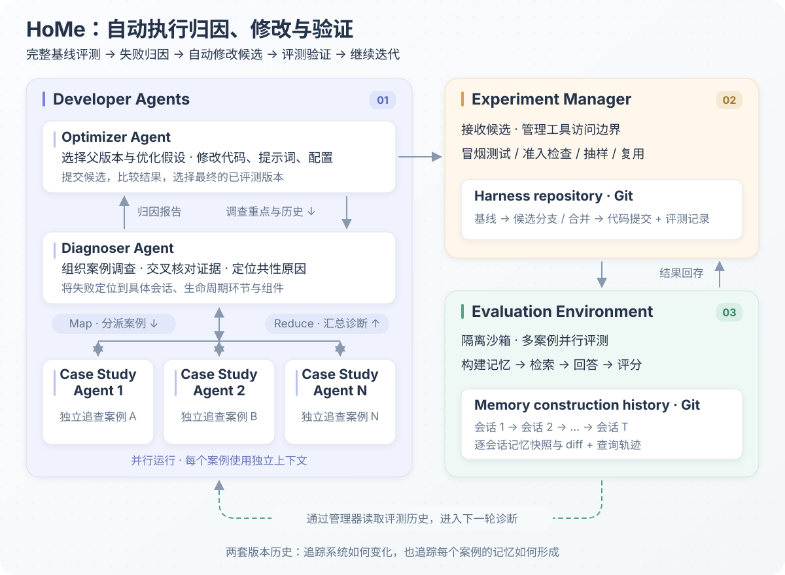
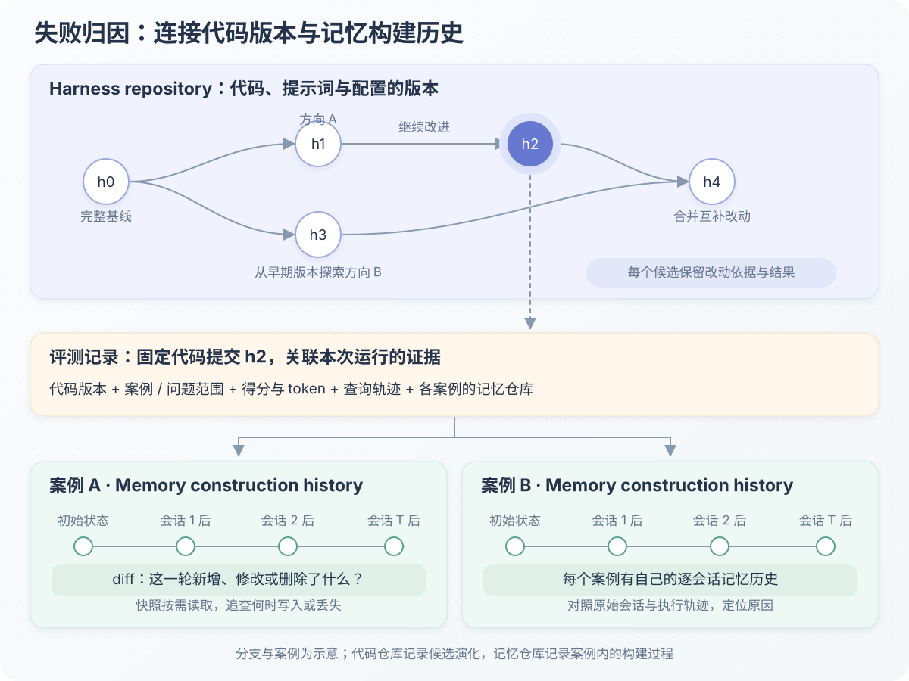
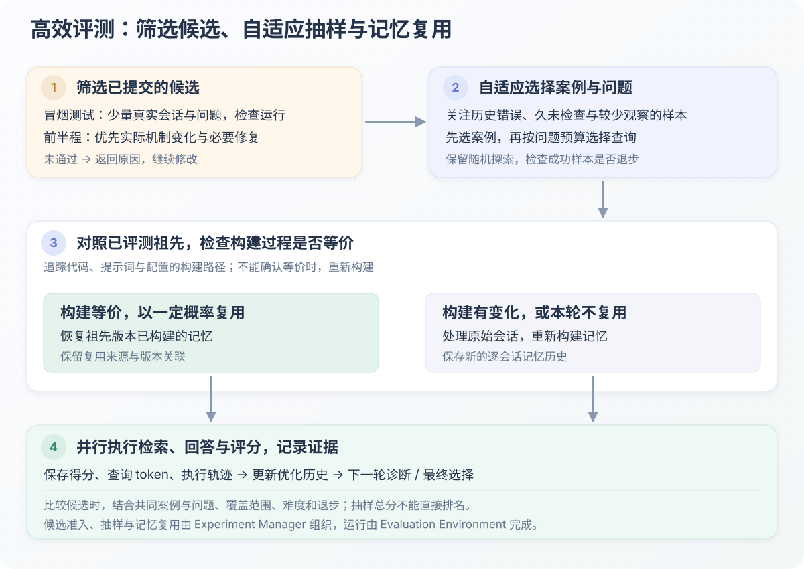

# HoMe：以失败归因驱动记忆系统自动优化

你和 AI 助理聊了几个月。它保存了对话，也整理了笔记，但当你问起“过去几次项目复盘，我们都遇到过哪些问题”，它仍然漏掉了两次重要讨论。问题出在哪里？是当时没有记下来，后来整理时覆盖了，还是内容明明在，却没有被搜出来？

对记忆系统来说，“答错了”只是结果。要改善表现，需要沿着漫长的历史找到原因，再决定该改哪一段代码、哪一种记忆结构、哪一步检索流程。这项工作通常依赖开发者反复分析和试验。HoMe 将失败归因、代码修改和评测验证连接成自动执行的循环，让 Agent 根据实验反馈持续改进记忆系统。

> **HoMe 是一个由评测驱动的记忆系统自动优化框架。它让 Developer Agents 根据回答结果、执行轨迹和记忆变化，将失败归因到具体机制与组件，自动修改代码、提示词与配置，再通过实验验证改动。**

在 ReMe 上的实验中，HoMe 在一次完整基线评测后，每个基准只用了六次正式候选评测，就找到了回答得分更高、查询 token 消耗更低的方案：LongMemEval-S 测试集得分从 **88.8% 提升到 91.6%**，查询 token 减少 **59.2%**；BEAM-1M 得分从 **65.0% 提升到 70.4%**，查询 token 减少 **40.7%**。

## 记忆系统的表现，由什么决定？

让 Agent 拥有长期记忆，需要解决一连串相互关联的问题：每轮对话保留什么，新信息如何更新旧笔记，如何建立索引，提问时先搜索哪里，搜到多少内容才足够回答。这些选择共同组成了记忆系统的 **Harness**，也就是围绕模型运行的代码、提示词和配置。即使底层模型相同，不同的 Harness 也会让 Agent 看到完全不同的证据，产生不同的答案和成本。

例如，搜索结果中有十个位置，如果其中六个都来自同一份长对话，Agent 看起来读了很多，实际却可能只看到了同一件事的不同片段。此时，继续增加搜索数量，未必比改变结果的分配方式更有效。

HoMe 将这类系统设计也纳入了自动优化范围。它可以调整记忆的组织方式、索引与检索逻辑，以及呈现给回答 Agent 的上下文。实验中，底层模型保持固定，改进来自这套运行机制的变化。

## 自动优化如何执行，各部分怎样协作？

  

HoMe 由 **Developer Agents、Experiment Manager 和 Evaluation Environment** 三部分组成。在给定初始系统、评测数据与优化目标后，这三部分自动完成基线评测、失败归因、候选修改和实验比较，无需开发者逐轮编写修改方案或手动启动评测。一次优化从完整的基线评测开始，先确定当前系统的失败问题和查询成本，再据此展开迭代。

### Developer Agents：从单个案例到系统改动

Developer Agents 内部有明确的分工：

- **Optimizer Agent（优化 Agent）** 负责选择改进方向与父版本，修改代码、提示词和配置，并提交候选。它结合已有诊断与评测历史决定继续、换方向或合并改进，最终选择有评测支持的版本。
- **Diagnoser Agent（诊断 Agent）** 负责组织失败调查与归因。它读取优化历史，分派案例分析，再将不同案例的证据归纳为共同原因，指出涉及的记忆环节和 Harness 组件，为自动修改确定目标。
- **Case Study Agents（案例分析 Agent）** 由 Diagnoser Agent 批量调度，并行调查不同案例。每个 Agent 在独立上下文中追查一个案例，从答案和检索轨迹一路回溯到记忆变化、原始会话与对应代码，返回紧凑的案例诊断。

这形成了“**分派案例 → 并行追查 → 汇总共性 → 修改系统**”的协作过程。案例分析的细节留在各自上下文中，Diagnoser Agent 比较这些报告，寻找相互印证或冲突的证据；Optimizer Agent 则集中精力处理最值得优先修改的机制。例如，几个问题虽然问法不同，却都漏掉了其他日期的讨论，诊断就需要判断这些遗漏是否来自同一种检索缺陷，并将支持这一判断的证据交给优化 Agent，为修改提供明确目标。

### Experiment Manager：管理候选与实验

实验管理器维护候选代码仓库、评测记录和工具访问边界。它接收提交后的候选，执行准入检查，安排案例抽样与记忆复用，并将结果关联到准确的代码版本。未通过检查的候选会带着原因返回，供优化 Agent 修正。

所有候选及其结果都保留在优化历史中。优化 Agent 可以沿当前方向继续，也可以回到更早的已评测版本尝试新假设，还可以合并两个分支中互补的改进。每次新尝试都能利用此前积累的证据。

### Evaluation Environment：产生可追查的证据

评测环境在隔离的 Docker 沙箱中运行候选，完成记忆构建、检索、回答与评分；不同案例可以并行执行。除了得分与 token 消耗，它还保存查询执行轨迹和逐会话记忆版本，供后续诊断检查。这些记录连接起两种历史：**系统如何被修改，以及某个系统版本如何一步步构建记忆。**

## 失败归因：用两套版本历史定位问题

自动优化需要先回答一个关键问题：**这次失败究竟由什么机制导致，应该修改哪里？** 同样是漏答一条事实，可能源于抽取时没有保留、维护时被覆盖、检索时没有召回，也可能是回答时没有正确使用证据。这些情况需要不同的修改。如果只根据低分或最终答案调整提示词、扩大检索范围，就可能绕过真正的缺陷，增加成本，甚至破坏原本正常的行为。失败归因将评测反馈转化为具体的修改依据，决定了自动优化能否朝正确方向推进。

长期记忆的难点在于，原因可能发生在提问前很久的一次会话中。HoMe 将查询轨迹、逐会话记忆变化与对应代码连接起来，追查证据在哪一步丢失或被误用；再跨案例检查同一机制是否反复导致失败，为解决共性缺陷提供依据。两套版本历史让这一归因过程能够按需获取证据。

  

**代码版本管理回答“这次到底运行了哪个系统”。** 初始 Harness 是代码仓库的根提交，每个候选由 Git 提交固定代码、提示词和配置。分支对应不同优化假设，评测记录关联具体提交及其诊断依据。即使当前工作区已经切换到新方案，分析旧结果时仍能查看当时执行的代码。

**Memory construction history 回答“这条信息是怎样留下或丢失的”。** 在每个案例构建记忆时，评测环境每处理完一个会话，就将记忆文件保存为一次 Git 提交。每个检查点是一份中间记忆状态，相邻检查点的 diff 则显示这次会话新增、修改或删除了什么。

回到开头漏掉项目复盘的例子，HoMe 会从失败答案向前追查：

| 检查步骤 | 观察到的情况 | 继续追查的方向 |
| --- | --- | --- |
| 看回答 Agent 实际收到的证据 | 证据已经出现，回答却遗漏了 | 回答与推理 |
| 看查询时的最终记忆 | 证据仍在，却没有进入回答上下文 | 检索、排序与上下文选择 |
| 找原始会话和对应记忆 diff | 原文有证据，最终记忆中却没有 | 是否写入、何时被覆盖或删除 |

如果来源会话中有这条信息，HoMe 就检查处理该会话前后的记忆差异：当时没有写入，问题可能出在抽取或持久化；当时写入过，就沿相关文件的后续版本，定位它在哪一次维护中被改坏。然后再对照该次评测固定的代码，找到负责这一行为的组件。

因此，案例分析 Agent 可以按需检查相关会话和版本，无需把几百轮历史与所有记忆快照同时塞入上下文。它返回的诊断包含失败环节、相关会话、责任组件与证据。Diagnoser Agent 再跨案例比较，区分反复出现的系统缺陷与个别问题的特殊情况；证据不足的原因则保留为待验证的假设。

两套版本历史分别支撑了优化与归因：代码历史允许回退、分叉和比较方案，记忆历史允许定位某一次写入或维护的影响。评测记录将它们连接起来，帮助优化 Agent 根据已定位的原因提出修改，再检查相关失败是否得到改善、其他问题是否退步，形成“归因—修改—验证”的自动迭代。

## 如何提高优化与评测效率？

  

长期记忆评测的主要成本，往往发生在回答之前：系统必须先处理大量会话，构建出可以查询的记忆。为提高整个优化过程的效率，HoMe 提前筛除无效候选，通过自适应抽样减少每轮需要评测的案例与问题，并在条件允许时复用已有记忆，降低重复构建的开销。

### 先探索机制，再细调提示词与参数

每个候选先通过少量会话和问题组成的冒烟测试，尽早发现运行错误。在优化前半程，HoMe 还检查候选 diff 和受影响的运行路径，要求改动带来实际的信息流或控制流变化，例如调整记忆结构、检索、路由或上下文选择；必要的运行故障修复也可以通过。这让早期实验优先探索系统机制，减少对措辞和参数的反复微调。后半程解除这项限制，允许在已探索的机制上继续调整提示词与参数，也可以继续修改代码。

### 优先检查失败，也持续寻找退步

完整基线评测建立每个案例和问题的初始表现。后续每轮抽样综合考虑历史错误、近期表现、距离上次检查的时间以及观察次数，优先选择更能暴露当前局限的样本，同时保留随机探索机会。抽样分为两层：先选案例；如果所选案例包含的问题过多，再选择其中的问题。这样既减少了每轮评测的工作量，也能重新检查较久未评测或此前成功的样本，发现新改动带来的退步。

这些样本主要用于寻找改进线索。由于候选之间的抽样范围和难度不同，不能直接按每轮总分排序。实验管理器提供共同案例与共同问题的对比，帮助优化 Agent 结合覆盖范围、难度、退步和查询成本作判断。

### 按需复用记忆，减少重复构建

如果只改了检索或回答逻辑，重新处理全部历史通常是在重复相同的构建工作。HoMe 会沿候选的祖先版本查找已评测方案，检查代码、提示词和配置的变化是否影响构建流程及其产物。确认构建等价后，HoMe **以一定概率复用**祖先版本保存的记忆，只重跑检索、回答和评分；其余情况仍重新构建，以保留新的案例覆盖和构建结果。

在这套流程下，HoMe 从已有的正式评测版本中选择最终方案，优先考虑回答质量，再权衡稳定性、查询成本与实现复杂度。最终选择附带代码版本和实验记录，便于检查改进依据。

## 核心实验：回答得更好，查询时读得更少

实验从已经人工调优的 ReMe 出发。HoMe 在训练数据上搜索候选，再将选中的方案放到独立测试数据上评测：

- **LongMemEval-S**：500 个问题均分为训练集与测试集，下面报告的是未参与优化的 250 道测试题。
- **BEAM**：在 100K 规模的历史上优化，在独立的 1M 规模历史上测试，共 35 个案例、700 个问题。测试历史平均约为优化时的八倍长。

| 测试集 | ReMe 得分 | HoMe 优化后得分 | 平均每题查询 token | token 降幅 |
| --- | ---: | ---: | ---: | ---: |
| LongMemEval-S | 88.8% | **91.6%**（+2.8 个百分点） | 43.9K → **17.9K** | **59.2%** |
| BEAM-1M | 65.0% | **70.4%**（+5.4 个百分点） | 101.8K → **60.4K** | **40.7%** |

得分由 LLM 评审按各基准的官方协议给出；token 统计包含查询阶段检索与回答的输入、输出，不扣除缓存命中，不包含记忆构建和 HoMe 自身的优化开销。它衡量的是优化后的系统在回答问题时消耗多少 token。

在这两组测试中，HoMe 都同时提高了整体得分并降低了查询 token 消耗。尤其在 BEAM 上，短历史中发现的改进延续到了更长的独立测试历史。不过，提升并非覆盖每一类题型：例如 LongMemEval-S 的多会话问题，以及 BEAM 的知识更新和信息抽取，仍有退步。

## Case study：优化后的系统有哪些变化？

论文中的候选主要改变了证据如何被找到、分配和呈现。几个代表性改动是：

- **跨日期主题目录**：将每日摘要编成按日期分组的紧凑目录，引导 Agent 先定位相关会话，减少跨日期问题中的遗漏。
- **来源多样性约束**：限制单个文件占据的搜索结果数量，对原始长对话限制更严，让同样的结果窗口覆盖更多来源。
- **更有针对性的证据入口**：BEAM 候选按问题关键词选取相关行，保留路径和行号以便回读；LongMemEval-S 候选为用户行为摘要行建立独立索引，帮助定位具体行动。

前两类机制在两个基准的独立优化中分别出现。这些改动说明，诊断能够推动系统改变记忆组织和检索机制，并改善回答 Agent 实际接触到的证据。

## 从人工调优走向自动化迭代

长期记忆系统的优化通常依赖开发者逐个分析失败案例、定位责任组件、修改实现，再运行评测检查效果。随着会话历史增长，记忆构建和检索之间的关联越来越复杂，这套流程也越来越耗时。HoMe 将失败归因、修改、实验调度和结果比较连接成自动执行的循环：归因指出需要改变的机制，开发 Agent 实现改动，评测再检验这一修改是否有效，并为下一轮提供证据。

在给定初始系统、评测数据与优化目标后，HoMe 可以自动调查跨案例的共同缺陷，探索不同代码分支，选择评测方式，并从已验证的候选中选出最终方案。ReMe 上的实验表明，这种自动化已经能够发现新的记忆组织与检索机制，在提高整体回答得分的同时降低查询 token 消耗。我们希望借此减少记忆系统对人工逐轮调优的依赖，让面向具体应用的优化更容易反复开展。

使用说明见 [HoMe 文档](https://reme.agentscope.io/zh/plugins/home)；基准介绍与完整结果见 [LongMemEval 评测](https://reme.agentscope.io/zh/benchmarks/longmemeval)和 [BEAM 评测](https://reme.agentscope.io/zh/benchmarks/beam)。
