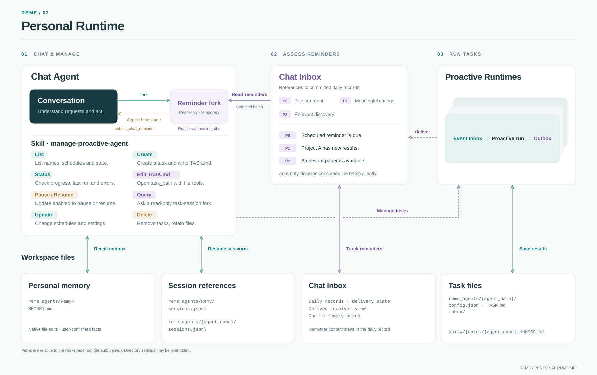

# ReMe：让 Agent 持续跟进你关心的事

实验还在跑，几个项目同时推进，关注的技术每天都有新消息。这些事情往往得跟进好几天。你得隔一会儿打开日志、翻一下对话、检查有没有变化，再想想接下来该做什么。

如果能把要求交代给一个 Agent，让它记住背景，持续看后续进展，遇到值得关注的变化再来告诉你，就能省下不少来回检查的时间。

ReMe 的 Proactive Runtime 用来支持这样的任务。它接收新信息，安排 Agent 分轮处理，把要求、进展和结果保存在本地文件里，再把需要告知的内容送回用户对话。Personal Runtime 则把主对话和多个后台任务连起来，让你通过聊天交办事情、追问进度和调整要求。

## 为什么需要持续跟进

一次回答可以帮你解决眼前的问题。持续跟进还要处理回答之后发生的事：实验什么时候结束，昨天卡住的问题有没有解决，新发布的论文和手头项目有没有关系。

你可以这样交代：

- **“帮我盯着这次实验，失败或者跑完了告诉我。”** 后台跟踪日志和运行状态，你可以去做别的事。
- **“跟进我这几个项目，需要我决定的时候提醒我。”** Agent 把分散的工作记录接起来，记下进展、难点和待讨论的问题。
- **“每天帮我看看 Agent 记忆方向有什么值得读的新东西。”** Agent 按你的研究方向整理资料，说明为什么相关，并保留原文链接。

这类任务需要记得住之前的要求，也需要分辨这次究竟有什么新变化。用户已经知道的事、刚刚取消的任务、没有实质进展的观察，都应当影响后续判断。用户收到提醒后，还能接着问：“为什么这么判断？”“上次试过什么？”“以后只在这种情况下告诉我。”

因此，ReMe 把每一轮的处理和长期保留的信息分开：Agent 负责理解与分析，运行框架负责接收输入、安排执行、保存状态和投递结果。任务可以跨多轮继续，用户也能随时检查和修改留下的文件。

## Proactive Runtime：一项任务如何持续运行

一项任务通常大部分时间都在等待。有新资料，或者到了约定时间，系统才启动一轮处理：读取任务要求和今昨总结，处理这次输入，记录新增信息，判断是否需要提醒，再将结果合并到当天总结，继续等待。等待期间不持续调用模型。

**新信息或定时触发 → 读取任务记忆和今昨总结 → 记录新变化 → 按需提醒 → 合并当天总结。**

下面以工作跟进为例，展示一轮任务与各个模块的关系。

图中从左到右是接收信息、处理一批输入和生成提醒；下方是这一轮会读取或更新的文件。两张图均按当前默认目录绘制：工作区根目录 `workspace_dir=.reme`，资源目录 `resource_dir=resource`，日记目录 `daily_dir=daily`，Agent 目录 `reme_agent_dir=reme_agents`；修改配置后，实际路径随之调整。Codex 对话和截图已有内置采集器，Claude Code 执行轨迹是通过事件接口扩展接入的示例。

### 数据采集：把新变化交给 Agent

Agent 需要先拿到资料，才能知道发生了什么。资料可以来自屏幕截图、工作对话、新闻和行情，也可以来自外部程序提交的日志或任务状态。

采集器把原始资料保存到工作区，再提交一条事件，说明时间、来源、简要内容和文件位置。例如，工作观察每五分钟采集多屏截图和 Codex 新增对话，将它们交给工作 Agent。采集本身不调用模型，分析留到任务执行时完成。

内置采集器按 `resource/{source}/{date}/{batch}/` 保存每批资料。`date` 为应用时区的日期，格式是 `YYYY-MM-DD`；`batch` 由采集时的 `HHMMSS` 和六位随机十六进制字符组成。批次内的 `metadata.json` 记录来源和文件清单，对话正文保存在 `dialogue.jsonl`，截图按屏幕 ID 保存为 PNG。清单完整发布后，才向 Agent 投递事件，并附上清单及其引用的资料路径。

采集进度也归各自来源管理：`resource/codex_dialogue/progress.jsonl` 保存初始基线和后续已提交的读取位置；`resource/codex_dialogue/pending.json`、`resource/screenshot/pending.json` 只在对应来源有未完成投递时保留。这些辅助状态供采集器恢复工作，不作为资料交给 Agent，也不再写入 `metadata/`。

外部程序也可以通过 `append_event` 接入。把要分析的资料放进工作区，再提交描述和文件路径，Agent 就能沿着这些路径读取原文。事件中的简要说明帮助它了解输入，完整依据仍然保留在来源文件里。

### 事件收件箱：先收好，再按顺序处理

资料可能连续到达，也可能几个来源同时更新。事件收件箱（Event Inbox）先保存这些输入，再交给对应的 Agent 处理。

每个任务有自己的收件箱。同一个 Agent 一次处理一批事件；执行期间到达的新信息留给后续轮次，不同任务则可以各自推进。事件 ID 用于识别重复投递，避免同一批资料因为重试被反复加入。

只有一轮成功完成并保存结果后，这批事件才会被记为已处理。执行失败时，输入仍然保留，可以继续重试。这样，资料送到了哪里、是否处理过，都有记录可查。

### 定时触发：到了时间，也能开始工作

有些任务由新资料触发，有些任务要按约定时间执行。ReMe 支持事件任务和定时任务：前者处理收到的观察，后者按配置的日程启动，例如每天早上整理一次科技动态。

定时触发到点后，会向任务收件箱加入一条事件，接下来仍然走同一套处理流程。时间由调度器按应用时区管理，Agent 在执行时会收到当前时间和本轮触发时间。

采集频率和任务日程也可以分别安排。例如，实验程序持续提交新日志，属于事件任务；每天早上主动搜索资料并生成简报，属于定时任务。

### Agent 执行：带着上次进展，处理这一轮

每次启动的这段工作称为一轮执行（run）。会话（session）保存与模型的消息和工具调用，可以被后续轮次继续使用。

一轮开始时，Agent 先读任务记忆，再分别读取今天和昨天已存在的总结；缺失的文件直接跳过。今天的总结帮助掌握当前状态，昨天的总结用于衔接跨天事项，包括已有进展、记录过的信息、生成过的提醒和待跟进问题。

接着读取本轮原始资料，对照总结，只把新增事实、实质变化和必要来源写进本轮日记。围绕这些增量信息，再用关键词或正则检索相关历史日记，总计不超过五次。找到相关记录时，补充必要背景、记录链接和事件时间线，区分已确认事实与推测，避免整段搬录旧内容。

例如，昨天记录的是“方案 A 已尝试，测试仍失败”。今天收到新的工作对话后，Agent 要分清用户提出了什么要求、执行过哪些操作、结果有没有得到验证，才能把进度更新为“问题已解决”或“仍待确认”。

会话变长时，执行环境可以按配置压缩上下文。后续还要依赖的要求和进展，应及时写入文件，供下一轮重新读取。

### 文件记忆：留下下一轮接着工作所需的信息

持续跟进会积累很多资料：用户改过的要求、已经验证的结果、还没解决的问题，以及发过的提醒。ReMe 将这些内容保存在用户拥有的工作区中。

以工作 Agent `work` 为例，下表中的路径均相对于工作区，默认根目录为 `.reme/`。`date` 为本轮执行日期，读取总结时同时查看今天和昨天的同名文件。

| 文件 | 保存什么 | 怎样用于后续执行 |
| --- | --- | --- |
| `resource/{source}/{date}/{batch}/metadata.json` 及其引用的文件 | 来源清单、截图、对话、新闻等资料 | 读取本轮输入，需要核实时查回原文 |
| `reme_agents/work/MEMORY.md` | 任务目标、提醒条件、稳定背景和用户纠正 | 每轮完整读取，按最新要求处理 |
| `daily/{date}/work.md` | 当天各项日记的要点、已有进展、待跟进事项和已生成的提醒 | 每轮读取今昨两份总结，将新内容合并到今天的文件 |
| `daily/{date}/work_HHMMSS.md` | 本轮增量信息、相关历史背景、时间线和证据链接 | 保存详细依据，也供后续历史检索使用 |
| `reme_agents/work/reminder/{date}/HHMMSS.md` | 一句话提醒，以及框架补充的关联路径和投递状态 | 按需生成，作为提醒内容和处理状态的正式记录 |

本轮日记和提醒使用同一时间戳：日记带任务名前缀，提醒文件只用时间命名。同一秒已有文件时，两者共同追加 `_1`、`_2` 等后缀，避免覆盖。

当天总结按事项合并今天所有日记和已生成提醒，供下一轮了解进展和检查重复；没有新增内容时，保留原总结。原始资料和每轮日记保留具体依据。对于已经保存在其他地方的信息，可以留下来源和链接，减少重复抄写。

用户可以查看、编辑和备份这些文件。需要更新 `MEMORY.md` 时，按路径使用原生文件工具，先阅读最新内容，保留仍有效的信息，保存后核对结果。

### 提醒与发件箱：保存结果，再安排投递

每轮处理后，Agent 可以只保存记录，也可以生成提醒。判断时，以任务记忆中的明确要求为先，再结合通用提醒规则，检查今昨总结和检索到的历史记录。已经提醒且没有实质变化的信息，以及用户明确不希望接收的内容，直接跳过；同一事项有新进展时，只提醒新增变化。

提醒采用以下级别；任务中明确约定的条件和打扰偏好优先。

| 级别 | 什么时候使用 | 示例 |
| --- | --- | --- |
| P0 | 约定的时间已到、提醒条件已满足，或需要立即处理 | “实验已结束，结果文件已生成。” |
| P1 | 正在关注的事项出现实质变化 | “之前卡住的问题有了新结果，还有一个选择需要讨论。” |
| P2 | 任务范围内发现与用户兴趣或目标相关的新信息 | “这篇新论文与当前研究方向相关，可以安排阅读。” |
| 保持安静 | 没有实质变化、内容重复，或用户要求只记录 | 保存进展，等待后续输入 |

需要提醒时，Agent 在提醒文件中设置 P0、P1 或 P2，正文只写一句自然、简洁的话，概括新变化及必要的行动或时间要求，不写文件路径。详细背景、来源和证据留在对应日记中。不需要提醒时，不创建提醒文件。

框架校验提醒、对应日记和当天总结后，补充提醒 ID、关联文件路径和状态，保存正式提醒，再确认本轮输入处理完成。发件箱（Outbox）随后向 Chat Inbox 投递一条指向提醒文件的事件；提醒正文和投递状态仍以任务目录中的提醒文件为准。

投递失败可以由 Outbox 继续重试。提醒生成、送达 Chat Inbox、Chat 已处理和用户阅读回执分别记录，便于查清一条消息走到了哪一步。缺少阅读回执只表示尚未确认。

## Personal Runtime：通过一个对话管理多个后台任务

有了单项任务的运行方式，还需要把这些任务接到日常使用中。Personal Runtime 将主对话、多个 Proactive Runtime、提醒收件箱和个人记忆连接起来。

你在同一个对话中交办事情，后台任务各自跟进；有需要关注的结果时，再结合当前对话决定怎样告诉你。收到提醒后，你可以直接继续追问。

### 主对话：交办、追问和调整要求

Chat Agent 是用户的对话入口。你可以说“创建一个每天早上的技术简报”，也可以问“实验监控上次什么时候运行”“项目 A 现在卡在哪里”，或者要求暂停、恢复和删除任务。

Chat 通过 `manage-proactive-agent` skill 按任务名称管理后台任务。任务管理覆盖创建、列表、状态查询、执行设置调整、删除和进展问答；创建时将任务要求写入 `MEMORY.md`，之后通过返回的记忆路径，用原生文件工具读取和修改。暂停或恢复通过修改任务的启用状态完成。

例如，“以后每天九点运行”会调整日程；“以后只在失败时提醒，正常进展记下来就好”会更新任务要求。后续执行据此继续。

查询运行状态可以查看上次完成时间、待处理输入和错误；追问任务进展则从最近已成功完成的一轮会话创建只读分支回答，因此需要任务至少完成过一轮。这类查询分支会记入该任务的 `sessions.jsonl`，不替换后续执行使用的主会话。

### 多个后台任务：分别记住各自的事

项目跟进、实验监控和技术简报可以分别交给不同的 Agent。每个 Agent 有自己的身份、收件箱、任务记忆和执行记录，可以单独查询、暂停或调整。

主对话中的个人记忆保存已确认的偏好和稳定背景，例如你关心的研究方向、希望怎样接收提醒。具体实验的路径、项目的当前难点和某项任务的提醒条件，保存在对应任务里。

主对话的文件位于 `reme_agents/chat/`：`MEMORY.md` 保存个人记忆，`sessions.jsonl` 保存会话引用，`inbox/inbox_unread.jsonl` 和 `inbox/inbox_read.jsonl` 分别记录待处理输入与已处理批次。任务同样有自己的会话索引和收件箱，执行设置保存在 `reme_agents/{agent_id}/config.json`，提醒保存在该目录的 `reminder/` 下；日记和每日总结统一位于 `daily/`。

临时任务的任务目录是 `reme_agents/tmp/{agent_id}/`，日记仍保存在 `daily/{date}/`。删除任务会停止对应任务，已有资料和历史文件仍然保留；另外部署的外部采集程序需要单独停止。

### 提醒分支：结合你正在聊的事，判断现在要不要说

后台 Agent 生成提醒后，内容先到 Chat Inbox。系统根据优先级、Chat 空闲时间和任务设置的提醒时间窗口，安排后续处理。紧急事项优先，普通消息可以等对话空闲时处理；正在进行的用户轮次不会被抢占。

处理时，系统从当前 Chat 会话创建一个临时分支。它先调用无参数的 `read_inbox`，取得框架为这一轮选中的提醒，包括任务名、生成时间、提醒正文和关联资料路径；再阅读这些路径对应的原始内容，结合当前对话检查消息是否重复、过时或已被用户取消。

例如，后台任务刚写好“实验已经结束”，而你已经在主对话里讨论过实验结果，这条提醒就可以跳过。如果仍然值得告知，分支通过 `send_chat_msg` 把选定内容加入主对话；没有需要关注的内容时保持安静。

这个分支只读、离线运行，分析过程留在分支中。发送提醒或明确提交空内容保持安静，都会由框架将这批输入标记为已处理。主对话只接收选中的提醒内容；如果判断期间用户又发来消息或切换了会话，框架会让提醒结合最新对话重新判断。

### 用户反馈：让后续跟进更合适

你可以随时改变主意：“这个项目先停一周。”“这条消息我知道了。”“以后只关注与当前方案直接相关的论文。”Chat 将确认后的要求写入任务记忆或执行设置，之后的轮次按新要求处理。

这样，一次交办可以延续成长期任务，也可以在需要时调整或结束。每轮留下的文件让你能看到它依据什么判断，并在它理解有偏差时直接纠正。

## 这些能力可以怎样用

当前 `proactive` 配置已有工作观察和财经信息采集。下面的实验、研究简报和生活事务等场景，可以通过定时任务或外部事件扩展；日志、邮件、日历、手机分享等来源需要按场景接入。以下提醒文案均为示例。

### 工作与项目跟进：减少来回翻记录

> “帮我跟进这几个项目。记下进展和难点，需要我讨论或决定时再提醒我。”

同时推进多个项目时，重要信息常散落在不同对话和窗口里。工作 Agent 可以结合截图和新增工作对话，按项目整理当前目标、已经尝试的方案、验证结果和未完成事项。

下一批资料到来时，它对照已有记录检查变化。例如，一个问题连续几轮仍未解决，或者代码修改完成但测试结果尚未确认，就把具体情况和相关记录整理出来，判断是否需要讨论。

你可能收到：“项目 A 的修改已完成，目前还缺一次验证；项目 B 的两种方案各有一个限制，需要你选一下方向。”之后可以继续问“把两种方案的依据列给我”，相关记录仍然可以查回。

当前内置工作观察每五分钟采集多屏截图，以及 Codex 新增的用户消息和最终回答。Claude Code 和更完整的工具执行轨迹需要额外接入；分析时要区分用户要求、尝试过的操作和已验证的结果。采集配置见[服务配置](./services.md#agent-运行时)。

### 实验与长任务监控：去做别的事，等关键结果

> “跟进这次训练。异常退出、指标满足约定条件，或者任务结束时告诉我，正常运行只留记录。”

给实验接一个采集程序，将新增日志、指标和进程状态保存到工作区，通过 `append_event` 交给监控 Agent。Agent 结合之前的阶段记录，跟踪当前进度、最近结果和需要继续核实的问题。

提醒可以概括关键变化：“这次训练因显存不足退出了，可以先检查批量大小。”最后一段日志、检查点和结果路径保存在对应日记中。任务正常完成时，日记记录关键指标和与上次实验的比较，提醒则用一句话概括结果。

如果暂时没有新日志，Agent 应先核对采集时间和进程状态，保留待确认的问题。你可以追问“上一次相同配置的结果怎样”，让它沿着历史记录继续分析。

### 科研与行业追踪：把新消息和正在做的事联系起来

> “每天早上九点整理 Agent 记忆方向的新进展，优先看和长期任务、上下文管理有关的工作，附上原文。”

这类任务适合定时执行。Agent 按研究方向搜索资料、读取来源，再结合任务记忆中的关注点和已经看过的内容进行筛选。

一份有用的简报要说清楚：这项工作解决什么问题，与当前项目有什么关系，有哪些值得进一步核实的结果。例如，“这篇工作讨论多轮任务中的进度保存，与你正在设计的后台 Agent 有关，可以先看它的状态恢复部分”，并附上来源链接。

简报正文和来源保存在日记中，后台提醒用一句话说明最值得关注的发现；回到主对话后，可以继续追问具体内容。

之后你可以收窄范围：“这周只关注有公开代码和评估结果的工作。”新要求会用于后续简报；读过的内容和已经讨论过的结论也可以留下，减少反复推荐。

### 新闻与行情跟踪：按关心的条件筛选变化

> “关注 AI 领域的重要新闻和这些标的的明显波动，达到约定条件时，告诉我发生了什么，并附来源。”

当前配置已有财联社新闻、港美股行情和 BTC/USDT 行情采集，并交给 `finance` Agent 处理。新闻按五分钟采集，行情按分钟采集；股票采集会检查相应市场的交易时段。

Agent 结合用户的关注范围和提醒条件，整理价格变化、相关消息和信息时间。当前示例要求仅在 AI 重大新闻或跟踪标的的日内振幅超过 5% 时生成提醒，其余内容保留记录。

日记记录采用的指标、报价时间、相关新闻和资料缺口，区分已确认事实与可能的解释。提醒用一句话概括：“跟踪标的的日内振幅已超过你设定的 5%，可以关注这次变化。”后续可以继续追问事件背景和历史记录，重复出现的同一条新闻则无需反复提醒。

### 日程与生活事务：在需要处理的时候带回来

> “帮我跟进下周的出行安排，临近出发时提醒准备材料，有变更时告诉我。”

接入日历、票据或用户分享的通知后，Agent 可以记下时间、待办和未确认事项。定时任务负责约定时间的检查，新通知作为事件补充进来，持续更新安排。

例如，收到改签通知后，它可以结合已有行程整理：“出发时间提前了，原来的接驳安排可能赶不上，需要重新确认。”临近出行时，再按你约定的时间提醒准备材料。订单、预约变更和订阅到期也可以采用类似方式。

手机可以作为分享截图、链接和通知的入口，也可以用于接收提醒和继续对话；这些采集与推送渠道需要另外接入。你在对话里确认的新安排，应同步到对应任务，供后续检查使用。

### 长期计划与复盘：把每天的小进展接起来

> “每周帮我回顾学习和项目记录，看看哪些事情有进展，哪些一直没有推进，一起确定下一步。”

将学习笔记、阶段总结和完成记录放进工作区，由定时任务按周整理。Agent 可以沿着日记和详情文件，归纳这一阶段完成了什么、遗留了什么、哪些问题反复出现。

复盘可以具体到行动：“上周计划的三个主题完成了两个，第三个停在环境准备；如果目标不变，下周可以先处理这个阻碍。”你可以据此调整计划，把新的目标和优先级留给下一周。

连续几周的记录还能帮助发现单次对话里不容易看出的情况，例如同一个难点持续存在，或投入方向已经偏离原定目标。保留下来的来源让每项判断都能回到具体记录中讨论。

配置和接口见[服务与部署](./services.md#agent-运行时)，内置任务见 [`proactive.yaml`](../../reme/config/proactive.yaml)，执行流程见 [Agent 实现与提示词](../../reme/steps/proactive/agent/)。关于长期运行 Agent 的通用设计，也可以阅读 Anthropic 的 [Building always-on agents](https://claude.com/resources/articles/building-always-on-agents)。
