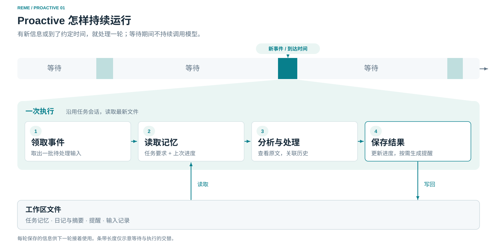
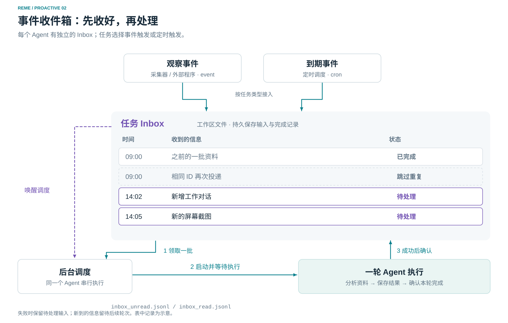
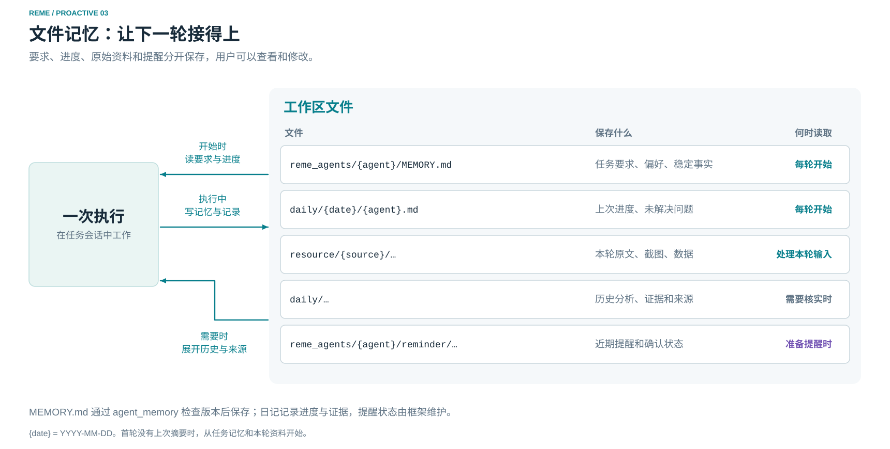
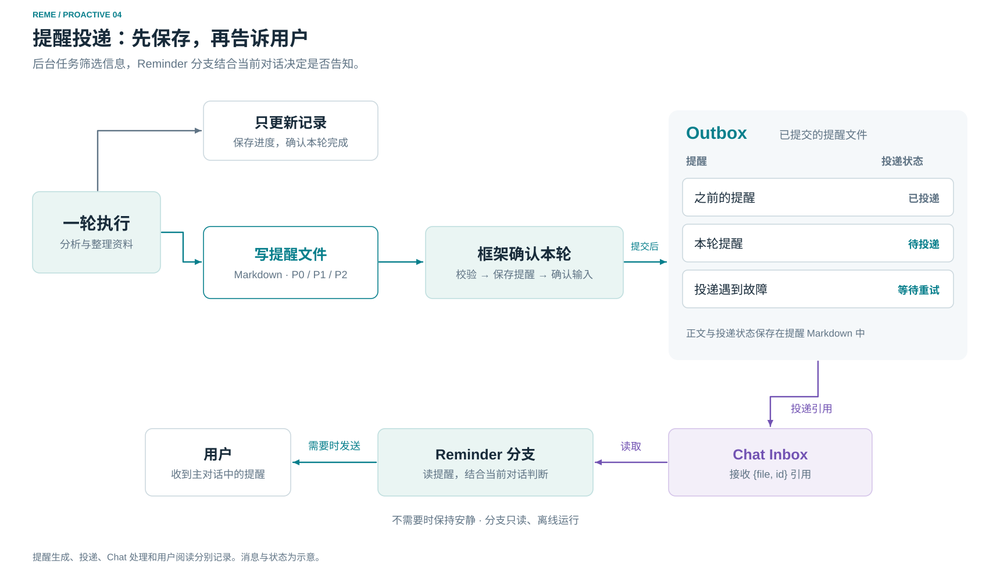
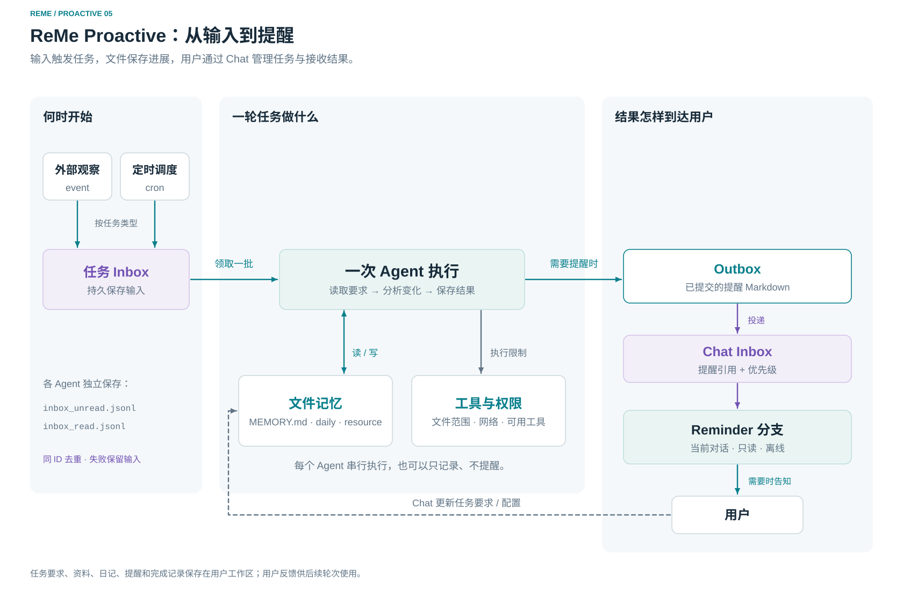

# ReMe Proactive：让 Agent 持续跟进用户关心的事

有些任务需要持续跟进。用户交代之后，新的信息还会不断出现，事情的进展也会变化。Agent 需要记住之前的要求和结果，接着处理后续信息，并在有必要时主动告诉用户。

ReMe 的 Proactive 方案就是为了支持这种工作方式。它把信息接收、任务执行、记忆保存和提醒发送连接起来，让 Agent 可以在本地长期跟进一件事。

下面先介绍一项后台任务如何持续运行，再介绍 Personal Runtime 如何把多个后台任务接到用户对话中。

## Proactive 如何持续工作

长期运行的 Agent 按一轮一轮的方式工作。收到新信息，或者到了约定时间，系统就启动一轮任务。Agent 读取之前的记录，处理这次输入，保存结果，然后等待下一次触发。等待期间不持续调用模型。

每一轮都是一次执行。会话则保存与模型的对话和工具调用，可以供后续执行继续使用。任务进展另外保存在文件中，下一轮可以读取这些文件，接着往下做。

整个过程可以写成：

**收到事件 → 读取记忆和进度 → 处理任务 → 保存结果 → 需要时生成提醒 → 等待下一次事件。**

用户感受到的持续跟进，就是这样一轮一轮完成的。要让这个过程稳定运行，需要处理好五件事：接收事件、定时启动、保存记忆、控制权限和发送结果。

## 支撑长期运行的五个部分

### 事件收件箱：先收好信息，再安排处理

新信息可以来自采集器、外部程序或后台任务。ReMe 先把原始资料保存到工作区，再把事件放入对应 Agent 的收件箱。事件记录时间、来源、简要说明和文件路径，Agent 可以沿着路径读取原文、图片和数据。

系统从收件箱取出一批未处理事件，交给 Agent 执行。同一个 Agent 每次只处理一批；执行期间到达的新信息留给后续轮次。不同 Agent 可以各自工作。

每条事件带有 ID，用来识别重复投递。任务完成后，系统才把这批事件记为已处理；执行失败时，输入仍然保留，可以重试。

### 定时触发：到了时间，也能开始工作

有些任务需要按时间执行。用户可以设置定时任务，到点后，系统向收件箱加入一条定时事件，再通过同一套流程执行。

ReMe 支持两种触发方式：事件任务收到新资料后开始分析；定时任务按配置的时间执行。采集器本身也可以定时运行，把采集结果作为事件交给 Agent。

时间由配置和调度器管理，Agent 每轮也会收到当前时间，按应用设置的时区理解任务。

### 记忆：把要求、进展和结果留给下一轮

持续跟进需要记住几类信息：

- **用户的要求和偏好。** 要关注什么，什么情况需要提醒，用户纠正过哪些认识。
- **任务的进展。** 已经做了什么，还剩哪些问题，下一步准备做什么。
- **过去的发现。** 有用的事实、分析、证据和来源。
- **已经发过的提醒。** 之前告诉过用户什么，避免反复发送相同内容。

这些信息保存在用户的工作区里。每项任务有自己的 `MEMORY.md`，保存当前要求和稳定事实；日记摘要保存进度和未解决问题；本轮详情保留分析与证据；提醒文件记录已经生成的消息及其状态。

每轮开始时，Agent 读取完整任务记忆和上次摘要。需要核实时，再查相关日记和原始资料。已有资料可以通过来源或文件链接查回，摘要只保留接着工作所需的信息。

任务会继续使用自己的会话。会话太长时，系统按配置压缩较早的内容；重要要求和进展及时写入文件，供之后的执行读取。用户可以查看、修改和保留这些文件；Agent 更新任务记忆时会检查版本，避免覆盖其他人的修改。

### 权限：事先明确能做什么

后台任务经常在用户没有盯着屏幕时执行，因此需要预先设置可用工具和操作范围。

ReMe 通过框架和 Harness，也就是模型使用的执行环境，控制文件访问、联网和工具调用。当前事件任务以离线方式分析收到的文件；定时任务可以按需搜索网络和读取网页。后面介绍的提醒分支以只读、离线方式运行。

模型负责理解资料、分析变化和整理结果，具体操作仍受工具和执行环境的限制。需要用户决定的问题，可以整理成提醒，带回对话中讨论。

### 发件箱：保存结果，再安排发送

一轮分析结束后，Agent 可以只更新记录，也可以生成提醒。需要提醒时，先把结论、原因和必要的下一步写入提醒文件，并设置 P0、P1 或 P2 优先级。详细证据保留在相关文件中，提醒里附上必要链接。

框架检查执行结果和文件是否有效。检查通过后，保存正式提醒，再将本轮输入记为已处理。Outbox，也就是发件箱，根据这些记录把提醒投递到 Chat Inbox。

完成确认前失败，输入保留用于重试；完成确认后投递失败，Outbox 继续重试。提醒已生成、已投递、Chat 已处理和用户已读分别记录，方便知道消息走到了哪一步。

发出多少提醒也需要控制。Agent 会先查看近期提醒，结合用户要求判断这次有没有值得说的新变化。没有需要关注的内容时，只保存结果，等待后续输入。

这五个部分组成了 Proactive Runtime：收件箱和定时任务决定何时开始，记忆让多次执行接得上，权限限定操作范围，发件箱负责把需要告知的结果送出去。

实现入口：[Agent 与 Prompt](../../reme/steps/proactive/agent/)、[数据采集器](../../reme/steps/proactive/data_connectors/)、[运行框架](../../reme/components/agent_runtime/)、[配置](../../reme/config/proactive.yaml)。

## Personal Runtime：把后台跟进接到用户对话中

有了单个任务的运行方式，还需要一个地方让用户交办任务、查看进展和接收提醒。Personal Runtime 将主对话、多个后台任务和提醒处理连接起来。

### 通过对话管理任务

Chat Agent 是用户的对话入口。用户可以直接说要持续关注什么，也可以查看进展、调整要求、暂停或结束任务。Chat 通过 `manage-proactive-agent` skill 管理对应的后台 Agent。

每个后台 Agent 有自己的身份、记忆和执行记录，可以分别管理。用户的稳定偏好保存在个人记忆中，具体任务的要求保存在对应任务的记忆中。

### 结合当前对话决定是否提醒

后台 Agent 判断一条信息值得提醒后，先通过 Outbox 投递到 Chat Inbox。系统再根据优先级、Chat 空闲时间和任务设置的提醒时间窗口，安排处理。

处理时，系统从当前 Chat 会话创建一个临时分支，由 Reminder Agent 读取本轮提醒和必要的关联文件。它能看到当前对话，按用户最新要求检查消息是否重复、过时或已经取消，再判断现在是否值得告知。

需要提醒时，它通过 `send_chat_msg` 将选定内容加入主对话；不需要时保持安静。这个分支只读、离线运行，分析过程留在分支中。用户收到提醒后，可以在主对话继续追问。

因此，后台 Agent 先按任务要求筛选信息，Reminder Agent 再结合当前对话决定怎样告诉用户。优先级影响处理时机：紧急消息尽快处理，普通消息可以等 Chat 空闲；正在进行的用户轮次不会被抢占。

### 把用户反馈用到后续执行

用户可以在对话中纠正判断、改变关注范围，或者取消某项任务。Chat 将确认后的要求写入对应记忆或配置，后续轮次按新要求执行。用户也可以直接编辑工作区文件。

例如，用户交代：“帮我跟进这几个项目，整理进展和难点，需要我决定时再提醒我。”接入屏幕截图和 Codex、Claude Code 的执行轨迹（trajectory）后，Agent 可以按项目整理任务对话、工具操作、代码修改和测试结果，结合历史记录判断进展。遇到反复失败的尝试、遗漏的待办或需要确认的选择时，附上相关记录提醒用户。

当前工作观察已采集截图，以及 Codex 的新增用户消息和最终回答。Claude Code 和更完整的工具执行轨迹需要扩展接入。分析时要分清用户提出的要求、Agent 尝试的操作和已经验证的结果。

配置和接口见[服务与部署](./services.md#agent-运行时)，截图与工作对话的接入方式见[工作观察](./work_observations.md)。

## 应用场景

当前配置已接入工作观察等信息源。其他场景可以通过增加采集器、接收外部事件或设置定时任务来扩展。手机也可以用于分享资料、接收提醒和继续对话，相关采集和推送需要另行接入。

| 场景 | 接入什么信息源 | 可以做什么主动智能服务 |
| --- | --- | --- |
| 工作与项目跟进 | 屏幕截图、Codex 对话；可扩展接入 Codex、Claude Code 执行轨迹、代码仓库和项目看板 | 整理项目进展、尝试过的方案和未解决问题，提醒需要讨论或决定的事项 |
| 实验与长任务监控 | 训练日志、评估指标、任务运行状态 | 跟踪结果，发现失败、停滞、重要指标变化或任务结束时提醒 |
| 服务与自动化运维 | 服务日志、监控告警、发布和定时作业记录 | 关联异常和近期发布，整理需要人工处理的问题 |
| 科研与行业追踪 | 论文订阅、技术博客、RSS、开源项目更新 | 按研究方向筛选新进展，说明与当前工作的关系，保留阅读链接 |
| 日程与情境提醒 | 日历、待办、预约通知、手机位置事件 | 在相关时间或地点提醒办理事项、准备物品，发现安排冲突时提示 |
| 长期计划与复盘 | 学习笔记、阶段总结、待办完成记录 | 整理阶段进展，找出长期未推进的事项，提示下一步或生成复盘 |
| 出行与通勤 | 行程票据、日历、交通、天气、航班动态、手机位置 | 提醒出发和准备材料，发现延误、天气影响或行程冲突时提示 |
| 重要消息跟进 | 授权接入的手机通知、邮件、用户分享的聊天记录 | 整理需要回复、确认或决定的事项，结合后续进展提醒跟进 |
| 订单与生活事务 | 订单、物流、预约、账单和订阅到期通知 | 跟踪物流异常、预约变更和到期事项，确认仍需处理时提醒 |
| 截图与随手收藏 | 手机分享的截图、照片、网页链接和文档 | 提取事项、时间和主题，关联已有计划，在需要处理时提醒 |
