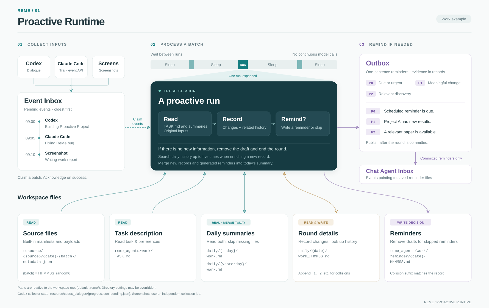
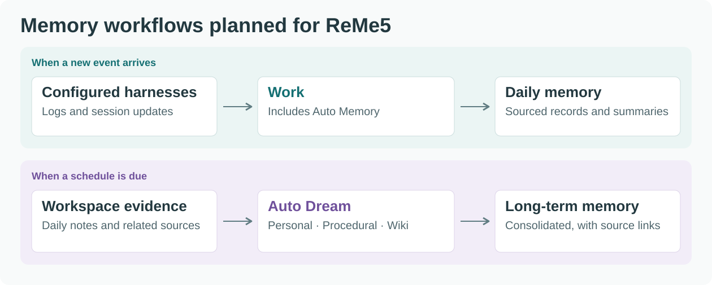
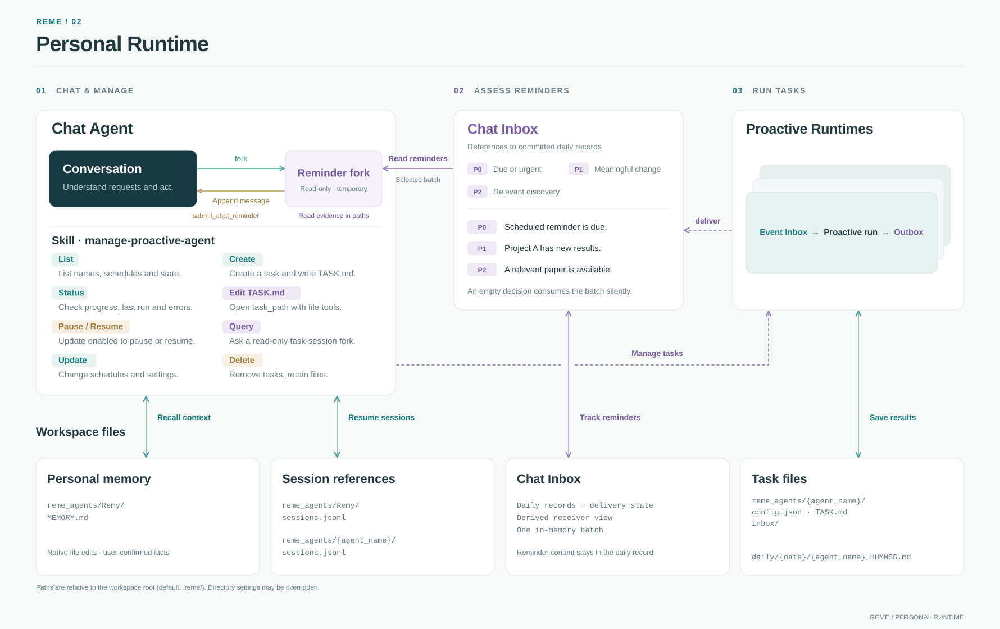

# ReMe5 前瞻 · Proactive Runtime

ReMe 从面向 Agent 的 Memory Kit 起步。**ReMe5** 是即将发布的 `0.5` 版，ReMe 将由此发展为一套**以记忆为核心、本地优先的 Proactive Runtime**。
你可以把一件需要持续跟进的事交给 Agent。收到新信息，或者到了约定时间，它就会运行一轮，记住你的要求，接着上次的进展往下做。
遇到重要变化时，它会把消息带回对话，你也可以随时追问发生了什么。

我们计划在 **2026 年底前**发布 ReMe5。运行时和桌面应用的早期原型已合入 `main`。目前我们正在用真实工作流测试原型，
继续改进 Agent 记什么、什么时候提醒，以及任务能否稳定地跨多轮推进。
[原型 PR](https://github.com/agentscope-ai/ReMe/pull/743) ·
[当前配置](https://github.com/agentscope-ai/ReMe/blob/main/reme/config/proactive.yaml) · [English](../en/reme5_preview.md)

## 为什么需要 Proactive Runtime

很多工作从一段对话开始，要在对话结束后继续跟进。你处理其他事情时，coding agent 可能跑完了一次实验。一个项目决策可能散落在
好几个会话里。一篇新论文可能改变你接下来要研究的问题。除了能回忆之前聊过什么，Agent 还需要知道你让它关注什么、哪些变化有意义、
什么已经记过，以及什么时候该来告诉你。

ReMe 现有的记忆流程是这个能力的基础。Auto Memory 把对话提炼为带有来源链接的每日记录，Auto Dream 将有长期价值的内容沉淀成知识。
在 ReMe5 中，Agent 可以用同样的文件化记忆持续跟进任务，每次收到事件或按日程运行时都能接着已有进展处理。
[文件即记忆](./memory_as_file.md) · [Auto Memory](./auto_memory.md) · [Auto Dream](./auto_dream.md)

例如，你可以让 Remy 跟进多个工具里的同一个项目，并在遇到需要你决定的阻塞时提醒你。一次会话可能记录了测试失败和初步判断，
之后另一段会话证实测试已经通过。Work Agent 可以把两次进展和来源都记下来，更新项目状态。如果还有需要你决定的事，它就会提醒你。
你可以沿着链接核对原始记录，也可以随时调整之后的提醒条件。

## 运行时如何工作

运行时按名称管理后台 Agent。**事件驱动的 Agent** 接收新的观察，例如一轮对话结束、一条日志更新，或者某个已配置的订阅源发布了论文。
**定时 Agent** 按 Cron 日程启动，例如每天整理一份简报，或在夜间整理长期记忆。两者共用一套接收输入、运行任务和保存结果的流程。
等待下一轮时无需持续调用模型。

图中是现有的 Work 原型。原型配置内置了 Codex 对话和截图采集。图中的 Claude Code 执行轨迹演示了其他来源如何通过事件接口接入。
[运行时指南](./proactive_runtime.md)

1. **采集与排队。** 采集器提交事件，并附上来源和相关文件。到了约定时间，Cron 也会提交一条定时事件。每个任务有独立的收件箱，
   一次处理一批输入。
2. **带着上下文执行。** Agent 读取任务说明、近期总结和相关原始资料，把收到的信息和已有进展对照，判断这次有什么实质变化。
3. **保存结果并按需提醒。** Agent 写下新的发现和来源链接，符合任务要求时提出提醒。运行时校验并保存结果，再确认输入已处理。
   执行失败的输入可以重试。已经保存的提醒可以独立投递。

任务要求、记录、总结和提醒都保存在用户自己的工作区中。任务每轮读取最新要求，用户也可以直接打开文件检查和修正后续执行要用的背景。
配置决定哪些来源会接入，记录里的链接可以追溯到原始对话、文档或观察结果。
[执行和存储细节](./proactive_runtime.md)

## ReMe5 的记忆工作流如何变化

### Auto Memory 成为 Work 的一部分

事件驱动的 **Work** Agent 会承担 Auto Memory 从对话中提取长期有用信息的工作。我们计划让 Work 监听用户配置并接入的
Agent Harness 的日志和会话记录，汇集多个来源的更新，持续跟进项目进展、决定、阻塞和下一步。后续会话仍可利用这些记录，
有进展符合你的提醒要求时，Work 也可以主动汇报。现在的原型已经用新增 Codex 对话和截图测试这套流程。

### Auto Dream 拆成三个定时 Agent

现在的 Auto Dream 会把每日记录沉淀为个人、流程经验和 Wiki 知识。我们计划把这三类整理工作交给各自独立的 Agent，分别指定使用哪些资料、
什么时候执行。

| 定时 Agent | 整理内容 | 示例 |
| --- | --- | --- |
| **Personal** | 稳定的偏好、长期目标和个人或项目背景 | 记住用户希望怎样审阅研究结果。 |
| **Procedural** | 可复用的工作流程、排查方法和实践经验 | 将一次验证有效的排查过程整理成下次能用的指南。 |
| **Wiki** | 值得长期查阅的主题知识及其来源 | 新实验或论文澄清某个问题后，更新相应的主题页。 |

现有 `daily/` 和 `digest/` 中的笔记是过渡时的重要背景。迁移里程碑会说明如何继续使用已有工作区和来源链接，
以及如何把现有的 Auto Memory 和 Auto Dream 配置迁移到新任务。
[当前 Auto Dream 的输入输出](./auto_dream.md#输入和输出)

### 预定义 Agent 和事件工作流

计划中的事件驱动 Agent 包括 **Work**、**Finance** 和 **Research**。Finance 可以跟进用户选定的话题、资产和相关资讯。
Research 可以跟进新论文、项目结果或其他已配置的研究来源，记下新发现和它与当前工作的关系。原型已有事件驱动的 Finance 示例和定时的
科技简报，可以用来测试哪些内容值得记下来，哪些需要及时告诉用户。

我们也计划为常见事件提供可复用的处理方式。**Todo** 可以从明确的后续行动中提取待办，并链接回相关决定。**Daily Summary** 可以汇总
当天有实质变化的事项，保留后续还需要跟进的内容。现有桌面原型里的 Todo 界面和后台任务总结可以作为这些工作流的基础。
[原型 Agent 配置](https://github.com/agentscope-ai/ReMe/blob/main/reme/config/proactive.yaml) ·
[桌面原型](https://github.com/agentscope-ai/ReMe/tree/main/reme_desktop)

## 通过 Remy 创建和管理 Agent

你可以直接使用预定义 Agent，也可以让自己的 **Personal Agent**（ReMe Desktop 中的 Remy）创建新的任务。例如，你可以说
「每周五总结这周的实验结果，附上报告链接」，也可以让 Remy 跟进已经接入的实验日志，完成或失败时告诉你。之后可以在同一个对话里
追问任务上次什么时候运行，修改关注条件、调整日程，或者暂停任务。事件驱动任务需要接入能提供相应信息的来源。

Personal Runtime 把聊天和后台任务连起来。后台 Agent 根据任务要求提出提醒，Remy 可以结合当前对话判断这条提醒是否还需要告诉你。
你可以在同一个地方交办事情、查看进展和调整提醒频率。
[Personal Runtime 指南](./proactive_runtime.md)

## 桌面预览、执行后端和宿主集成

- **ReMe Desktop** 计划发布 **macOS 和 Windows** 的概念验证预览。你可以体验从聊天交办任务到查看输入、进展、知识和提醒的完整流程。
  `main` 上的 Electron 原型已能连接 ReMe 服务，展示主对话和各个后台任务。
  [桌面源码和启动说明](https://github.com/agentscope-ai/ReMe/tree/main/reme_desktop)
- **执行后端** 计划支持 **AgentScope、Codex 和 Claude Code**。目前默认原型使用 Codex，也有独立的 Claude Code 配置。
  我们会验证每个后端的任务执行、会话处理和提醒行为，再在文档中列出各自支持的预览能力。
  [Codex 配置](https://github.com/agentscope-ai/ReMe/blob/main/reme/config/proactive.yaml) ·
  [Claude Code 配置](https://github.com/agentscope-ai/ReMe/blob/main/reme/config/proactive_cc.yaml)
- **宿主集成** 计划覆盖 **QwenPaw、Codex、Claude Code、Hermes Agent 和 OpenClaw**。宿主可以向 ReMe 提供事件，也可以在现有工作流中
  展示结果和提醒。我们会在已有记忆集成上继续推进，按各宿主的能力和开发进度逐步接入。
  [现有 Agent 集成](./integrations.md)

Codex 和 Claude Code 可以同时出现在两种角色中。作为执行后端，它们负责运行 ReMe Agent。作为宿主，ReMe 可以跟进用户在现有会话中
开展的工作，并把结果带回原有工作流。

## 里程碑

| 里程碑 | 状态 | 内容 |
| --- | --- | --- |
| **运行时和桌面原型** | 已合入 `main` | Remy 对话、事件驱动和定时任务、在工作区保存任务状态、提醒投递。 |
| **真实工作流测试** | 进行中 | 测试 Work、Finance 和定时任务，检查能否记录实质变化、来源链接是否有效，以及重试或重复事件下的提醒表现。 |
| **记忆工作流和预定义任务** | 计划纳入 ReMe5 | 将 Auto Memory 纳入 Work，实现三个定时 Auto Dream Agent，说明如何迁移现有工作区和配置，并开发首批 Research、Todo 和 Daily Summary 工作流。 |
| **ReMe5 和桌面预览** | 目标是 2026 年底前 | 发布运行时和 macOS、Windows 概念验证，提供安装指南和已支持的后端、工作流说明。 |
| **宿主集成** | 分阶段推进 | 接入各宿主可提供的事件来源，验证任务跟进和结果投递。 |

## 试用原型和分享反馈

源码中已经有桌面原型及配套服务配置。桌面 README 说明了如何在一个终端启动 ReMe 服务，再在另一个终端启动客户端。
[从源码运行原型](https://github.com/agentscope-ai/ReMe/tree/main/reme_desktop#start)

欢迎告诉我们，你希望 ReMe 跟进哪个 Harness，哪些变化值得记录，什么情况值得发一条提醒。如果你已经在用 Auto Memory 或 Auto Dream，
也欢迎分享对你最重要的数据来源、记忆文件或任务日程。
