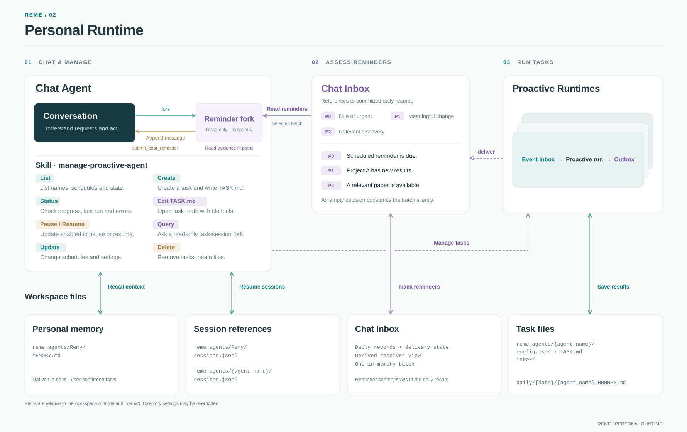
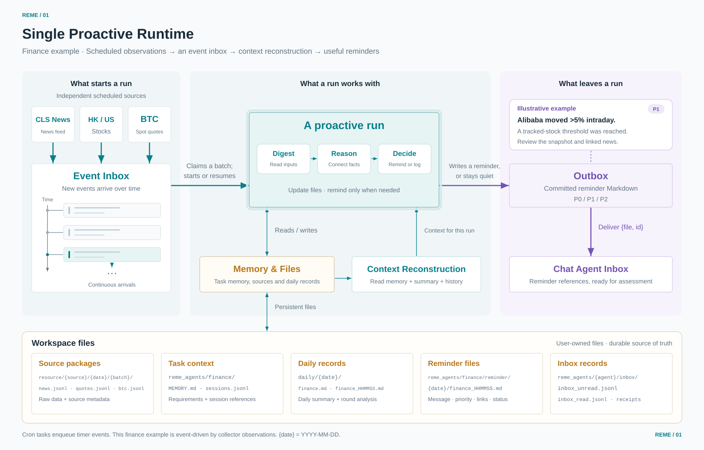

# 服务与部署

ReMe 可以作为本地 HTTP 服务、独立 MCP Server 或一次性 CLI Job 运行。默认 HTTP 服务监听
`127.0.0.1:2333`；同一进程提供 JSON API、SSE、MCP 与可选的 ReMe Studio。

## HTTP 服务

在一个终端启动服务并保持运行，以下启动命令任选一条：

```bash
reme start
reme start service.host=127.0.0.1 service.port=8181
```

主机地址也可以使用 `::1` 等 IPv6 字面量；HTTP 和 MCP client 会在连接时正确格式化该地址。
如果服务绑定到 IPv6 通配地址 `::`，ReMe 会向进程内 client 提供可连接的回环地址 `::1`。

在另一个终端通过 CLI client 调用 Job：

```bash
reme search query="用户偏好" limit=5
```

普通 Job 也暴露为 `POST /<job-name>`；以下 HTTP 示例使用默认端口 `2333`：

```bash
curl -s http://127.0.0.1:2333/search \
  -H 'Content-Type: application/json' \
  -d '{"query":"用户偏好","limit":5}'
```

请求体允许 Job 参数位于顶层。响应遵循 `Response`：

```json
{
  "success": true,
  "answer": "...",
  "metadata": {}
}
```

未被 Step 捕获的错误会转换成 `success: false` 的响应。

## Streaming 与 SSE

`backend: stream` 的 Job 仍使用 `POST /<job-name>`，但响应类型是 `text/event-stream`。每个 chunk 使用统一的 streaming schema；失败时会发出错误 chunk，并以终止事件结束。

默认 `chat` 是 Stream Job：

```bash
curl -N http://127.0.0.1:2333/chat \
  -H 'Content-Type: application/json' \
  -d '{"query":"总结我的长期偏好"}'
```

`proactive` 配置提供 `chat(query)`，使用固定 `chat` Agent 的当前原生会话。
`new_chat_session` 创建并选中新会话，历史由 `list_chat_sessions` 查询。MCP 不暴露 Stream Job，Studio 另行适配。

## Agent 运行时

`agent_runtime` 组件协调会话、统一 Inbox、输出和调度；`reme/steps/proactive/agent/` 下的 `ChatAgentStep` 与
`ProactiveAgentStep` 分别定义两种 Agent 行为。组件配置使用 `components.agent_runtime.default`，
工作区相对配置 `reme_agent_dir` 默认是 `reme_agents`。每个 Agent 拥有 `config.json`、`MEMORY.md` 和
`sessions.jsonl` 和 `inbox/`；事件与定时 Agent 另有 `reminder/YYYY-MM-DD/<agent_id>_HHMMSS.md`，临时 Agent 位于
`reme_agents/tmp/<agent_id>/`。不再维护全局定义索引或检查点文件，启动时从源文件恢复内存。
会话登记保留追加中断前的完整记录；读取时忽略不完整尾行，下次追加时清理尾行，完整记录损坏时明确报错。
先保存校验通过的提醒，再提交事件消费回执，Outbox 独立重试投递；未提交就中断的轮次允许重新执行。
消费回执关联提醒引用，在接收方完成交接前保留对应确认记录。

下图概览 Chat、临时 Reminder fork、共享 Inbox 与后台任务如何通过工作区协作；生活任务为接入示例。

<p align="center">
  
</p>

在一个终端配置 `LLM_API_KEY`、`LLM_BASE_URL` 和可选的 `CODEX_MODEL_NAME`，启动服务：

```bash
reme start config=proactive
```

另一个终端调用：

```bash
reme manage_proactive_agent action=list
reme manage_proactive_agent action=create \
  'config={"name":"experiment_monitor","trigger_type":"event","description":"分析实验日志，失败或结束时提醒我。"}'
reme agent_mailbox
```

`manage_proactive_agent` 支持 `list/create/status/update/delete/query`。创建名称即不可变的 `agent_id`，
`chat` 和 `tmp` 是保留名。删除停止调度和执行，保留文件、事件和原生会话历史；再次创建同名 Agent 会恢复它。
`query` 使用临时只读 fork 回答问题，不改变后续执行的主会话。

`config.description` 只用于创建时原样写入 Agent 的 `MEMORY.md`，不添加预设标题；
任务文本不再保存在 `config.json` 中，也不再每轮单独注入。`list/update` 返回配置、状态和工作区相对 `memory_path`；
`create/status` 还返回 `memory_content`（最多 2000 字符）和 `memory_truncated`，截断时继续读取完整文件，
不返回配置文件路径。修改或删除前先查看 `status`；用户可编辑原始 `memory_path`，Agent 使用私有
`agent_memory` 工具读取完整内容和 `revision`，保存时提交 `content` 与 `expected_revision`，冲突后重新读取合并。
Codex 对自身 MEMORY.md 的原生命令写入设为只读，避免绕过版本检查。替换失效要求并读回确认，
运行配置使用 `update`，停止并删除任务使用 `delete`。修改对后续轮次生效，正在执行的一轮可能已读取旧要求。
同名恢复保留已有记忆。旧 Agent 迁移时，将配置中的 `description` 移入 `MEMORY.md`，保留积累的知识，
再从 `config.json` 删除 `description`。
`reme_agent_dir` 默认值已改为 `reme_agents`；已有目录可显式设置 `reme_agent_dir=agents` 继续使用，
更改该目录配置本身不会移动工作区文件或改写其中的路径引用。

Chat 的初始记忆通过 `components.agent_runtime.default.chat.description` 配置，Runtime 启动时与任务 Agent
使用同一机制初始化 MEMORY；重启和切换会话保留已有记忆。Chat 的 `job_tools` 统一在 Step 配置中选择。

固定的对话 Agent 使用 `agent_id=chat`，旧配置中的 `components.agent_runtime.default.main` 需改为 `chat`。
升级已有工作区前，将固定对话 Agent 的 `reme_agents/main/` 移至 `reme_agents/chat/`，并将 `config.json` 的
`name` 改为 `chat`，保留记忆、原生会话 ID 和收件箱回执。运行时仅接受当前布局，不自动迁移工作区文件。

可在 `proactive.yaml` 的 `components.agent_runtime.default.agents` 中声明初始任务，字段与创建接口相同，
同样用 `description` 初始化 MEMORY。启动只创建缺失身份，重启不覆盖已修改的记忆或配置，也不恢复已删除任务；
默认启用两个事件任务：`finance` 分析采集的新闻和行情；`work` 根据新观察资料跟踪主人正在做的项目，
整理各项目的进度、进展、难点和待讨论问题。工作观察每五分钟采集截图和新增 Codex 对话；独立截图采集器默认关闭。

单个 Proactive Runtime 消费事件、基于工作区文件重建上下文，再将保存的提醒经 Outbox 投递到 Chat Inbox。
下图以金融任务为例，提醒消息仅作示意。

<p align="center">
  
</p>

任务配置使用 `trigger_type`（`cron` 或 `event`）。已有 Agent `config.json` 和 API 调用中的旧字段
`type` 需改为 `trigger_type`，旧字段不再接受。

`event` 通过 `append_event(agent_id, events)` 接收观察，每条包含 `event_ts`、`source`、`description`，
可附工作区相对 `paths`、`id` 和 `metadata`。`cron` 要求 cron 表达式，到点执行完整任务，不接收外部观察。
两类使用应用时区，每个 Agent 串行执行；事件任务可用 `max_batch_events` 限制每轮领取量（默认 20），进程内失败重试保持原批次，新输入留待后续轮次。`source=cron` 保留给框架。事件任务可设置 `min_trigger_interval_seconds`。

Chat 和 cron Agent 开启原生 `web_search`、`web_extract` 和命令网络访问，event Agent 保持离线。
已有任务配置和创建参数中的旧字段 `enable_web` 需要删除。
`web_extract` 将完整文本或 PDF 保存到 `resource_dir`，返回路径和有限文本预览，不执行 JavaScript，也不提取 PDF 文本。
临时 `query` fork 继续保持只读、离线。`notify_window={start,end}` 限制自动唤醒时段，
时段外仍可分析并保存消息。`temporary=true` 与触发类型独立，连续七天没有新接收输入后允许清理；
cron 触发也算输入，重复事件和重试不续期。有执行、待处理事件、未投递消息或保留的 Inbox 引用时暂缓删除，
日记和原始资源保持不变。消费回执保存累计的最新输入接收时间，优先处理和重启不会使临时 Agent 提前过期。
重启后从下一次未来时间恢复 cron，已入队事件继续处理，不补跑停机期间未入队的触发；
Chat 空闲计时和失败重试计时在内存中重新开始。
日记 `daily/YYYY-MM-DD/<agent_id>.md` 保存累计交接，`<agent_id>_HHMMSS.md` 保存本轮明细，
Agent 自己的 `reminder/YYYY-MM-DD/<agent_id>_HHMMSS.md` 以 Markdown 正文保存唯一的提醒内容，以 frontmatter 保存投递和已读时间，
由框架维护；同秒日记明细重名增加数字后缀。

`components.agent_inbox.default` 使用 `event` 后端（`AgentEventInbox`），继承通用的本地 Inbox 实现；
`components.agent_runtime.default.inbox` 引用该组件。每个 Agent 的待处理输入保存在
`inbox/inbox_unread.jsonl`，已处理批次保存在 `inbox/inbox_read.jsonl`，批次字段为 `items`、`consume_ts`、`metadata`。
领取可以指定消息 ID，领取本身不消费输入，执行成功后才提交消费回执。事件 Agent 接收观察与定时触发；
Chat 仅接收 `{file,id}` 提醒引用，已处理引用默认保留最近 1000 条。提醒 Markdown 仍是正文和确认状态的来源，
Chat 引用视图可重建；外部确认消息应修改提醒的 frontmatter。共用文件监听器与定期补扫协调源文件修改和中断交接。

单个提醒缺失或损坏时保留原文件和事件回执、
报告具体路径并隔离故障，不阻断其他提醒或应用启动；修复原文件后自动恢复。

P0 在 Chat 会话允许 fork 时立即处理，延迟由 `components.agent_runtime.default.notifications.p0_delay_seconds` 配置，默认 0。
P1 等待连续空闲 10 秒，P2 等待 1800 秒，分别由 `notifications.p1_idle_seconds`、`notifications.p2_idle_seconds` 配置，
继续遵守提醒时间窗口。只有前台 Chat 轮次重置空闲计时。
临时 fork 继承当前对话，只读、离线运行，执行结束、失败或取消后清理；hint 和工具过程留在 fork 中。

只有提醒 fork 绑定 `read_inbox(priority=...)` 和 `send_chat_msg(content=...)`，读取范围限定为本轮选中的消息。
非空内容作为标记 `source="proactive"` 的 assistant 消息注入主会话；空内容表示静默，不追加消息。
决定成功提交后，框架自动消费本轮读取的消息，独立于主人已读状态；失败保留重试，主会话切换或收到新用户轮次后拒绝旧 fork 的结果。
提醒判断默认限时 120 秒，主动执行默认限时 1200 秒，可在对应 Step 设置 `timeout_seconds`。
收件箱临时故障按指数退避重试（最长 300 秒），SDK 类型或导入错误停止重试，修复环境并重启后恢复。
`agent_list` 的 Chat 状态会显示收件箱故障，cron 返回的部分采集失败也会写入日志。
fork 的普通回复不会发送给主人。桌面端从这些已标记的消息生成提醒列表，`agent_mailbox` 按 `agent_id` 查询 Remy 收件箱或任务发件箱；用户已读不会消费消息。`agent_mailbox action=read agent_id=chat` 也接受合并后的 Chat 消息 ID，返回 `{id,items}` 并在 `mark_read=true` 时确认其全部保留的原始提醒；原始提醒已清理时返回空列表，重复确认仍然成功。对应关系保存在提醒 frontmatter 的 `chat_message_ids` 中；桌面仅将用户明确阅读产生的回执写回，历史消息初始化、静默抑制和仅显示弹窗不算用户已读。`agent_event_list agent_id=<name>` 分页浏览保留的输入事件，不获取消费租约。

`agent_session` 和 `agent_events` 对 Chat 返回完整对话，对事件与定时 Agent 仅返回最近一个原生轮次，
包含该轮输入及全部助手进度和最终消息。任务订阅每次通过 `snapshot` 整体替换视图，`heartbeat` 不含消息。
历史轮次仍保存在原生会话中，并继续用于模型上下文。主动任务的 `proactive_agent_step` 默认总超时为 1200 秒，`context_token_limit=128000` 控制原生上下文自动压缩阈值；Chat 保留独立设置。每日摘要用于交接当前状态，逐轮过程与完整证据保存在明细文件。

`proactive_run`、`proactive_query`、`inbox_chat` 为服务私有 Job。采集器默认关闭，配置 `jobs.screen_capture_cron.agent_id`
并启用任务后，完整资源包才会转成观察事件；本流程不使用资源 watcher 或自动 TTL 删除。

本次重构不保留旧收件箱和 PA 接口，工作区历史文件保留，不自动转换。当前后端使用 CodexAgentWrapper；
其他 Wrapper 需要提供对应的会话能力。

## MCP

ReMe 0.4.2.2 使用 FastMCP 4 与 MCP Python SDK 2。升级时请同步更新 ReMe 和宿主侧 MCP bridge；
独立 bridge 环境需要 `fastmcp>=4.1.4,<5`。CLI 工具列表统一使用 SDK 2 的 snake_case 字段，
包括 `input_schema`、`output_schema` 和 annotation hints；读取旧驼峰字段的调用方需要同步更新。

默认 HTTP 服务会在 `/mcp` 挂载 streamable HTTP MCP：

```yaml
service:
  backend: http
  mcp_enabled: true
  mcp_path: /mcp
  mcp_stateless_http: false
```

也可以改用独立 MCP Service：

```bash
reme start service.backend=mcp service.transport=stdio
reme start service.backend=mcp service.transport=sse service.port=2333
reme start service.backend=mcp service.transport=streamable-http service.port=2333
```

MCP tool 来自 `enable_serve: true` 的非流式 Job。`service.jobs` 可以设置允许列表；`injected_job_kwargs` 可以注入服务端管理、调用方不能覆盖的参数。

```yaml
service:
  backend: http
  jobs: [search, read, traverse, auto_memory]
  injected_job_kwargs:
    tenant_id: local-user
  tool_error_on_failure: true
```

## ReMe Studio

安装 `reme-ai[web]` 或 `reme-ai[core]` 后，默认 HTTP 地址同时提供 ReMe Studio：

```text
http://127.0.0.1:2333/
```

可通过配置关闭或指定自定义构建：

```yaml
service:
  web_enabled: false
  # web_static_dir: /absolute/path/to/static
```

静态资源缺失不会阻止 Job API 启动。

## 一次性 Job

需要脚本式执行而不常驻服务时：

```bash
reme start job=search query="用户偏好" limit=5
```

它会切换到一次性 CLI Service，但仍经过正常的 Application、Component 和 Job 生命周期。

## 服务发现

```bash
reme find_reme
```

ReMe 会记录本机运行服务的启动参数。普通 `reme <action>` 优先使用实际运行服务的 backend、host、port 和 transport；找不到运行服务时才回退到本地配置。

## 安全边界

ReMe 默认定位为本地服务：

- 默认绑定 `127.0.0.1`；
- HTTP CORS 配置允许任意 origin；
- Job 可进行文件写入、移动和删除；
- 当前服务层不提供通用用户认证。

远程访问必须通过 `reme start service.host=0.0.0.0` 显式启用。不要直接把服务暴露到公网。请在受控网络或带
身份认证、TLS、访问控制和请求大小限制的反向代理后部署，并通过 `service.jobs` 只开放必要 Job。

## OpenAPI

HTTP 服务使用 FastAPI。启用 HTTP 服务时，可以通过 `/docs`、`/redoc` 和 `/openapi.json` 查看当前配置实际注册的端点；Studio 的 SPA fallback 不会覆盖这些保留路径。
