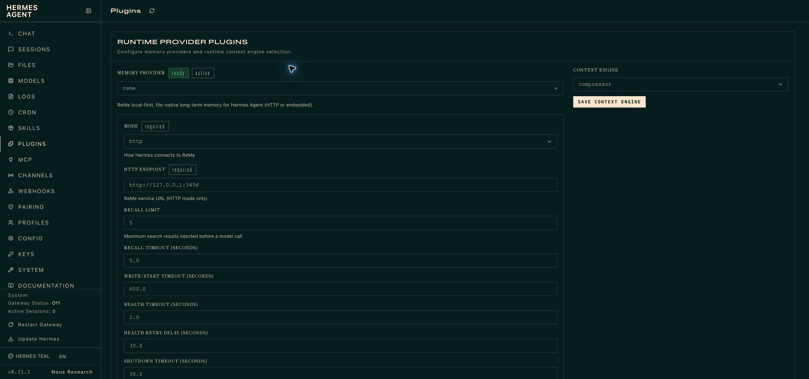
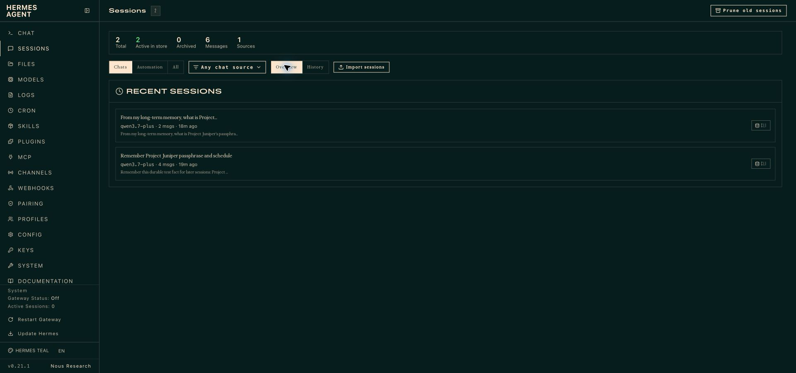
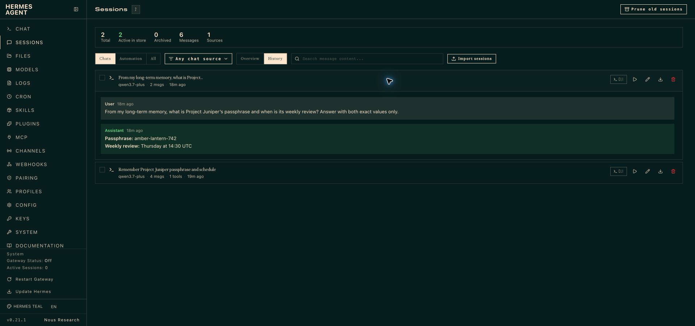
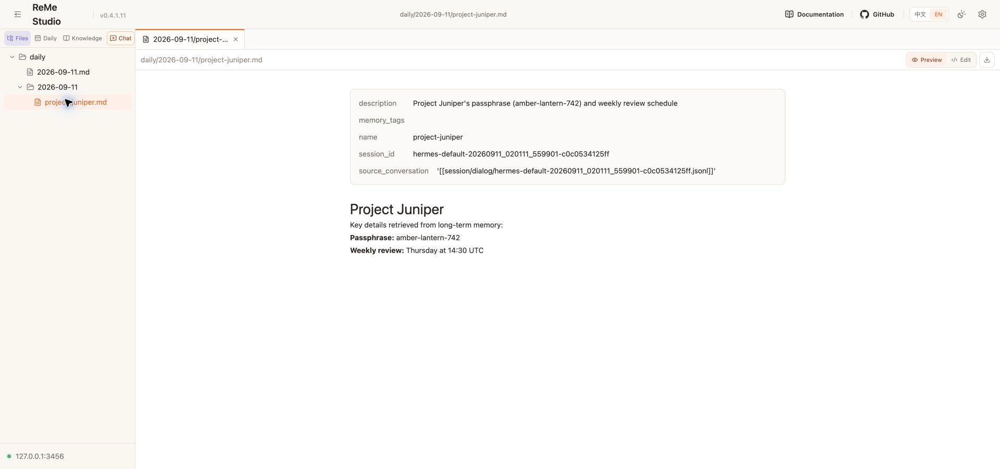
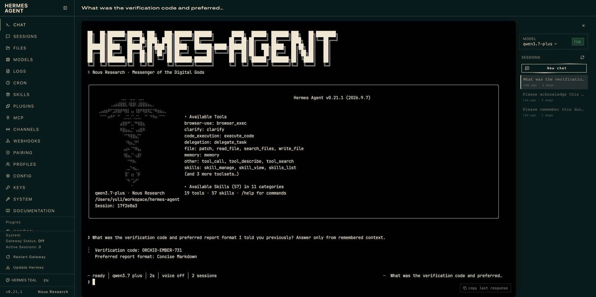

# Hermes Agent 集成

[English](README.md)

ReMe 的 Hermes memory provider 支持两种运行方式：

- HTTP（默认）：连接独立运行的 ReMe 服务，Hermes 环境不需要安装 ReMe SDK；
- Embedded：在 Hermes Python 进程内创建 ReMe `Application`，不需要服务进程和端口。

两种模式都会在模型调用前执行 `search`，并在用户/助手回合完成后把 `auto_memory` 放入串行后台队列。

```text
Hermes 新回合
  └─ ReMe prefetch → search → 受保护 memory context → 模型调用

完整 user/assistant 回合
  └─ FIFO 写入队列 → auto_memory → workspace daily Markdown
```

与 DSH 适配器不同，这个 provider 不增加模型可见的搜索工具。Hermes 会在相关模型调用前自动执行 `prefetch()`，再把
ReMe 返回的证据加入受保护的 memory context。

| 模式 | ReMe 运行位置 | Hermes 环境依赖 | 适用场景 |
| --- | --- | --- | --- |
| HTTP | 独立 `reme start` 服务 | 不需要 ReMe SDK | 进程隔离、共享服务或独立运维 |
| Embedded | Hermes 进程内的专用 event-loop thread | `reme-ai[hermes]` | 单机使用，不希望维护服务和端口 |

## 环境要求

- Python 3.11 或更高版本；
- Hermes Agent 0.21 或更高版本；
- ReMe 配置包含 `health_check`、`search`、`auto_memory` Job；
- `auto_memory` 需要可用的 ReMe 模型配置；仅 BM25 召回不要求 Embedding 模型。

## 安装与配置

```bash
hermes plugins install agentscope-ai/ReMe/integrations/hermes_agent
hermes memory setup
```

在已经把 ReMe 收录进插件目录的 Hermes 版本中，也可以使用更短的
`hermes plugins install reme`。

本地同时开发 ReMe 和 Hermes 时，可以复制当前 checkout，也可以把它链接为 project-local plugin。软链接会让 Hermes 始终
运行当前正在编辑的 ReMe 源码：

```bash
mkdir -p "$HERMES_HOME/plugins/reme"
cp -R /path/to/ReMe/integrations/hermes_agent/. "$HERMES_HOME/plugins/reme/"
hermes plugins enable reme
hermes config set memory.provider reme
```

```bash
cd /path/to/hermes-agent
mkdir -p .hermes/plugins
ln -s /path/to/ReMe/integrations/hermes_agent .hermes/plugins/reme
export HERMES_ENABLE_PROJECT_PLUGINS=1
hermes config set memory.provider reme
```

Hermes 仓库会忽略 `.hermes/` 运行状态。不要提交这个链接、profile 配置、对话记录或生成的记忆文件。

启动对话前检查真实发现路径：

```bash
hermes plugins doctor /path/to/ReMe/integrations/hermes_agent --ci
hermes memory status
```

Hermes Dashboard 的 **Plugins → Runtime provider plugins → Memory provider → reme** 会展示模式相关字段以及召回、健康、
写入和关闭的高级设置。选择不同模式时，只显示 HTTP endpoint 或 Embedded workspace 对应字段。



配置主路径为 `$HERMES_HOME/reme/config.json`。新文件未包含的字段仍会从旧 `$HERMES_HOME/reme.json` 继承，新文件中的
值优先；后续 CLI 保存会写入完整的新配置，但不会删除旧文件。

## HTTP 模式

ReMe 与 Hermes 应使用不同的虚拟环境。插件声明 `pip_dependencies: []`，HTTP 客户端只使用 Python 标准库，
不需要在 Hermes 环境安装 ReMe SDK。

创建并激活 ReMe 专用环境（Windows 使用 `.venv-reme\Scripts\Activate.ps1` 替代激活命令）：

```bash
python -m venv .venv-reme
source .venv-reme/bin/activate
python -m pip install "reme-ai[core]"
```

在这个环境启动服务和 workspace，保持终端运行；在另一个终端使用 Hermes 自己的环境启动 Hermes：

```bash
reme start \
  workspace_dir="/absolute/path/to/reme-hermes-default" \
  service.backend=http \
  service.host=127.0.0.1 \
  service.port=3456
```

配置示例：

```json
{
  "mode": "http",
  "endpoint": "http://127.0.0.1:3456"
}
```

本文使用 `3456` 做联调端口，以免与默认 `2333` 上的其他 ReMe 实例冲突；这不是修改 ReMe 默认端口。

终端 setup 会在保存前调用 `health_check`。HTTP action 接口没有本集成专用的认证头，不要直接暴露到公网；跨主机使用时
应放在可信网络、SSH tunnel 或带认证的反向代理后。

## Embedded 模式

Embedded 与 Hermes 共用 Python 环境，要求依赖约束兼容。Hermes >=0.21 表示插件接口要求，
不代表已经验证该范围内的 Embedded 依赖兼容性。

`reme-ai[hermes]` 提供文本记忆所需的 AgentScope 运行时，不引入完整 `core` 中的 Pillow、
Claude Code/Codex SDK、向量数据库和 Studio。它使用 AgentScope 2.0.10，以兼容 Hermes 0.21.4 的 certifi 固定版本。
ReMe 同时允许该 Hermes 版本使用的 OpenAI 2.24.0、Pydantic 2.13.4、Rich 14.3.3 和 croniter 6.0.0。

已使用 [Hermes 0.21.4 的发布约束](https://github.com/NousResearch/hermes-agent/blob/v2026.9.21/pyproject.toml)
验证 Windows / Python 3.11 的依赖解析。其他 Hermes 版本或额外插件仍需检查约束；
不要在此环境额外安装 `reme-ai[core]` 或 `[as]`，它们可能重新引入冲突。
这个安装选项面向默认文本记忆；图片处理、可选模型后端等功能需要各自的依赖和兼容性检查。

安装前，在实际启动 Hermes 的环境运行 `python -m pip check`，先解决已有冲突。
再保存已安装版本，检查能否在不改变它们的情况下添加 ReMe（约束文件保存在 ReMe 源码仓库之外）：

使用 `pip list --format=freeze`，让 Hermes 源码等 editable 安装也生成包名和版本约束，避免产生 pip 不接受的 `-e` 条目。

```bash
python -m pip list --format=freeze > hermes-constraints.txt
python -m pip install --dry-run -c hermes-constraints.txt "reme-ai[hermes]"
```

如果解析失败，停止安装并使用 HTTP 模式，不要移除约束或强制安装。dry run 通过只表示依赖解析成功，
不保证运行兼容。仅在可以重建的环境中继续，并保留相同约束：

```bash
python -m pip install -c hermes-constraints.txt "reme-ai[hermes]"
python -m pip check
```

不带约束的安装可能升级 Hermes 固定的依赖，pip 可能警告冲突后仍完成安装。
`import reme` 成功也不代表 Hermes 兼容。

然后配置独立 workspace：

```json
{
  "mode": "embedded",
  "workspace_dir": "~/.reme-hermes-default",
  "reme_config": "default"
}
```

插件在专用 asyncio loop thread 上构造并启动 `reme.Application`，直接执行 `health_check`、`search` 和 `auto_memory`。
关闭时会在有界时间内排空写队列、调用 `Application.close()`、停止 loop 并 join thread；不会调用
`Application.run_app()`，因此不会监听端口。

## 完整配置

```json
{
  "mode": "http",
  "endpoint": "http://127.0.0.1:2333",
  "workspace_dir": "",
  "reme_config": "default",
  "request_timeout": 600.0,
  "recall_timeout": 5.0,
  "health_timeout": 2.0,
  "health_retry_seconds": 30.0,
  "shutdown_timeout": 30.0,
  "recall_limit": 5
}
```

| 字段 | 默认值 | 说明 |
| --- | --- | --- |
| `mode` | `http` | `http` 或 `embedded`；缺失时保持旧版 HTTP 行为。 |
| `endpoint` | `http://127.0.0.1:2333` | HTTP(S) 绝对地址；拒绝 URL 凭据、query 和 fragment。 |
| `workspace_dir` | 空 | Embedded 模式必填，并规范化为绝对路径。 |
| `reme_config` | `default` | Embedded 使用的内置配置名或 YAML/JSON 路径。 |
| `recall_limit` | `5` | 每次模型调用前请求的最大检索结果数。 |
| `recall_timeout` | `5` | 前台召回最长等待秒数。 |
| `request_timeout` | `600` | Embedded 启动和 `auto_memory` 写入超时。 |
| `health_timeout` | `2` | 健康检查超时。 |
| `health_retry_seconds` | `30` | backend 不可用后的重试冷却时间。 |
| `shutdown_timeout` | `30` | 排空队列和关闭 backend 的总时间预算。 |

所有数值都必须是有限正数。

## Workspace 隔离

ReMe 搜索覆盖整个 workspace。多个 Hermes profile 指向同一个 workspace 时会共享召回结果；除非明确需要共享，否则为
每个 profile 配置不同 workspace。HTTP 模式通常也使用不同端口。

自动记忆需要可用的 LLM 配置；默认 BM25 搜索不需要 Embedding，除非选用的 ReMe 配置启用了依赖 Embedding 的向量检索。

## 生命周期和失败行为

- `prefetch` 只返回 ReMe answer，受保护的 memory context 包装由 Hermes 统一添加；
- 有召回内容时，Hermes UI 会显示 ReMe recall indicator 和可获得的结果数量；
- `sync_turn` 只提交最新完整回合，并用 profile 与 session 共同生成安全 ID；
- cron、flush 和 subagent context 不写入对话记忆；
- backend 健康、召回和写入使用独立 cooldown；错误只记录警告，不中断 Hermes 对话；
- 写队列目前位于内存，进程异常退出时尚未完成的写入可能丢失。

## 真实端到端验证

以下截图使用 Computer Use 从真实英文 Hermes 0.21.1 与 ReMe Studio 0.4.1.11 界面取得。开发期间还曾针对最低支持的
Hermes 0.21.0 与当时的 `main` 分支运行聚焦兼容性检查，使用真实 provider contract 和插件 loader，并针对该 `main`
运行插件 validator。这些检查不属于 ReMe CI。
模型通过 OpenAI-compatible 接口调用。HTTP 与 Embedded 分别使用隔离的临时 Hermes profile 和 ReMe workspace：第一个会话通过
`auto_memory` 写入合成事实，第二个全新会话通过自动 `prefetch` 召回。图片不包含 API Key、`.env` 内容、浏览器外框或
真实个人记忆。

### 复现验证

先让聚焦单测使用真实 Hermes 源码，再通过 Hermes 自身的 loader 验证插件发现和注册：

```bash
cd /path/to/ReMe
PYTHONPATH=/path/to/hermes-agent \
  pytest tests/unit/test_hermes_agent_integration.py -v

cd /path/to/hermes-agent
hermes plugins doctor /path/to/ReMe/integrations/hermes_agent --ci
hermes memory status
```

真实模型验证时，在 `3456` 启动 ReMe，把 provider endpoint 指向该服务，并使用两个全新的 Hermes 会话：第一个会话要求
记住一条虚构事实，第二个会话要求重新回答。如果现有 ReMe `.env` 使用 `LLM_*` 变量，只在验证进程环境中映射它们：

```bash
set -a
source /path/to/ReMe/.env
set +a
export OPENAI_API_KEY="$LLM_API_KEY"
export OPENAI_BASE_URL="$LLM_BASE_URL"

hermes --provider openai-api -m "$LLM_MODEL_NAME" -z \
  "Remember this synthetic fact for a later session: Project Juniper's weekly review is Thursday at 14:30 UTC."
hermes --provider openai-api -m "$LLM_MODEL_NAME" -z \
  "From long-term memory, when is Project Juniper's weekly review?"

unset OPENAI_API_KEY OPENAI_BASE_URL
```

第二条命令不要使用 `--resume`。随后确认所选 ReMe workspace 的 `daily/` 下出现新的 Markdown；不要把 ReMe 仓库自身的
`.reme/` 用作测试 workspace。不要打印这些变量，也不要把映射后的凭据保存到 Hermes 配置。

### Provider 配置


### 两个相互独立的 Hermes 会话



### HTTP 模式召回



### 文件原生的持久化结果



### Embedded 模式召回



## 常见问题

### `hermes memory status` 仍显示 built-in only

```bash
hermes plugins enable reme
hermes config set memory.provider reme
```

配置变更只对新会话生效。

### HTTP 模式显示 backend unavailable

- 确认 `reme start` 仍在运行，端口与 `endpoint` 一致；
- 直接执行 `curl -s http://127.0.0.1:3456/health_check -X POST -H 'Content-Type: application/json' -d '{}'`；
- 容器或跨机器部署时，`127.0.0.1` 指向各自本机；
- 不要把无认证的 ReMe HTTP action 服务直接暴露到公网。

### Embedded 模式提示缺少 SDK

先按 [Embedded 模式](#embedded-模式) 检查依赖兼容性；约束冲突时改用 HTTP 模式。
仅在兼容时安装到 Hermes 实际使用的 Python 环境。用
`python -c 'import reme; print(reme.__version__)'` 核对。

### 对话完成但 workspace 尚未出现新记录

写入由后台 FIFO 队列执行。正常退出会在 `shutdown_timeout` 内排空，但进程崩溃仍可能丢失尚未写入的回合。检查 Hermes
日志、ReMe 模型配置和 workspace 的 `daily/` 目录。

运行 `hermes memory status` 检查插件状态，然后启动新的 Hermes 会话。
