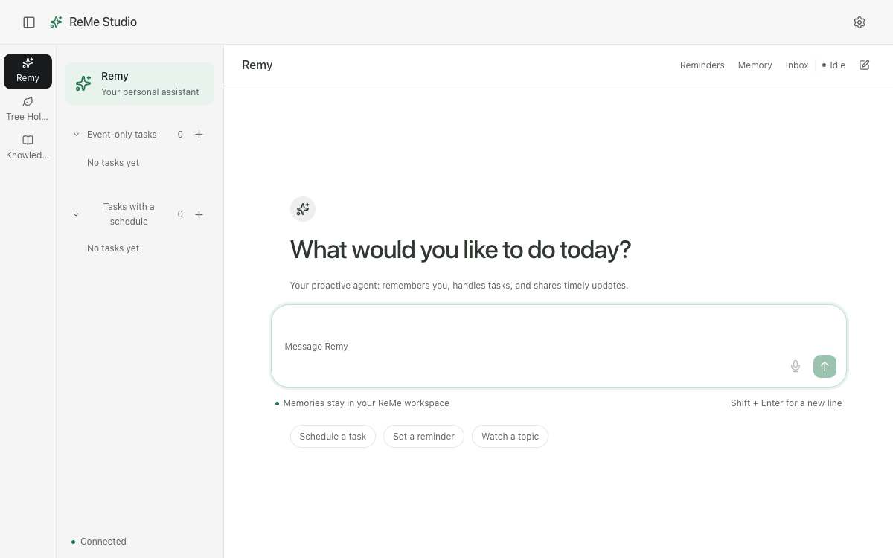

# ReMe Studio

[中文](https://github.com/agentscope-ai/ReMe/blob/main/reme_studio/README_ZH.md) ·
[Try in your browser](https://reme.agentscope.io/studio/?lang=en)

ReMe Studio shares one workbench across the web, desktop, Android and iOS, with Remy, Proactive AI, Notebook, and Knowledge.
Use Proactive AI to manage background tasks and Notebook to capture todos and ideas.
Desktop adds the Remy companion, tray, and native notifications. ReMe owns the sessions, task state, and workspace files.



## Run

Install `reme-ai[core]`, configure the model in the backend environment, and start ReMe in one terminal:

```bash
reme start config=proactive
```

Open <http://127.0.0.1:2333/> for Studio. Desktop connects to the same service at that address. The browser demo uses
sample data in the same interface.

## Develop

From the repository root with Node.js 22.13+:

```bash
npm ci --prefix reme_studio
npm run dev --prefix reme_studio
npm run dev:desktop --prefix reme_studio
```

The Web dev server proxies requests to ReMe at port 2333. Build with `npm run build:static --prefix reme_studio`
to serve directly from ReMe. Run `npm test --prefix reme_studio` to run the shared and app-specific tests.

- `client/` owns the HTTP/SSE contract, session state, and request handling.
- `workbench/` owns the shared React views and interactions.
- `desktop/` owns the Electron app, IPC, desktop integration and Remy animation for Windows, macOS and Linux.
- `web/` owns the browser entry point, demo data and static packaging.
- `mobile/` owns the shared mobile entry point and native bridge. Build and run the native hosts using their
  [Android](https://github.com/agentscope-ai/ReMe/tree/main/reme_studio/mobile/android) and [iOS](https://github.com/agentscope-ai/ReMe/tree/main/reme_studio/mobile/ios) guides.

Run `npm run build:mobile --prefix reme_studio` for the Android web assets and add `-- --mode ios` for iOS.

## Release

Run `python scripts/bump_version.py X.Y.Z` to update the shared version. Publishing a GitHub Release distributes
the PyPI packages, the npm package, the desktop installers, and the Docker image from the same tag.

To publish selected outputs, open **Actions → Release / ReMe → Run workflow** on `main`, enter an existing tag, and
select PyPI, npm, desktop, or Docker. All four are selected by default. Desktop uploads the Windows, macOS, and Linux
installers to the matching release and creates one if needed. Mark that release as **Latest** in GitHub when it is
ready for Desktop's update channel. Manual Docker runs publish the versioned tag. Android and iOS releases are disabled.

PyPI and npm Trusted Publishing use `release-python.yml`. The GitHub `pypi` and `npm` environments must allow
the `main` branch for manual runs and release tags such as `v*` for automatic releases.

In Desktop, **Check for updates** sits above Settings. It checks GitHub Releases, lets the user start the download,
and installs the update when the user chooses **Restart to install**. Local preview builds open the downloads page.
Upgrade the ReMe service separately if the new Desktop version requires it.

The release workflow enables in-app updates for Linux AppImage builds and for builds signed with the platform's
release credentials. For macOS, configure `MAC_CSC_LINK`, `MAC_CSC_KEY_PASSWORD`, `APPLE_ID`,
`APPLE_APP_SPECIFIC_PASSWORD`, and `APPLE_TEAM_ID`. For Windows, configure `WIN_CSC_LINK` and `WIN_CSC_KEY_PASSWORD`.
Release builds without the required credentials use the downloads page.
