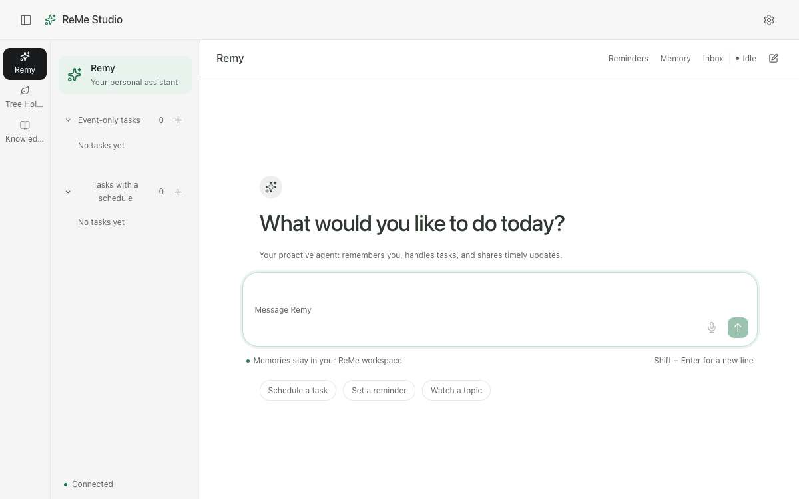

# ReMe Studio

[English](https://github.com/agentscope-ai/ReMe/blob/main/reme_studio/README.md) ·
[在线体验](https://reme.agentscope.io/studio/?lang=zh)

ReMe Studio 的网页端、桌面端、Android 和 iOS共用一套工作台，包含 Remy、主动智能、随记和知识库。
在主动智能里管理后台任务，在随记里记录待办和想法。
Desktop 还有桌宠、托盘和系统通知。会话、任务状态和工作区文件由 ReMe 服务管理。



## 启动

安装 `reme-ai[core]`，在后端环境配置模型，然后在一个终端启动服务：

```bash
reme start config=proactive
```

浏览器打开 <http://127.0.0.1:2333/> 即可使用 Studio。Desktop 默认连接同一个地址。在线体验使用同一套界面和示例数据。

## 开发

使用 Node.js 22.13+，在仓库根目录执行：

```bash
npm ci --prefix reme_studio
npm run dev --prefix reme_studio
npm run dev:desktop --prefix reme_studio
```

Web 开发服务器将请求转发到 ReMe 的 2333 端口。运行 `npm run build:static --prefix reme_studio` 后，
可以由 ReMe 直接提供网页。运行 `npm test --prefix reme_studio` 运行共享代码和各端的测试。

- `client/` 管理 HTTP/SSE 契约、会话状态和请求。
- `workbench/` 提供共用的 React 页面和交互。
- `desktop/` 提供 Windows、macOS 和 Linux 共用的 Electron 应用、IPC、桌面集成和桌宠动画。
- `web/` 提供浏览器入口、示例数据和静态打包。
- `mobile/` 提供共用的移动入口和原生桥接。原生工程的构建与联调见
  [Android](https://github.com/agentscope-ai/ReMe/tree/main/reme_studio/mobile/android) 和 [iOS](https://github.com/agentscope-ai/ReMe/tree/main/reme_studio/mobile/ios) 开发文档。

用 `npm run build:mobile --prefix reme_studio` 构建 Android 网页资源，加上 `-- --mode ios` 构建 iOS 网页资源。

## 发布

用 `python scripts/bump_version.py X.Y.Z` 更新共用版本。发布 GitHub Release 后，PyPI 包、npm 包、桌面安装包
和 Docker 镜像都从同一个标签构建并发布。

手动发布时，在 **Actions → Release / ReMe → Run workflow** 中选择 `main`，填入已有标签，再勾选 PyPI、npm、
桌面或 Docker。四项默认勾选。桌面选项将 Windows、macOS 和 Linux 安装包上传到对应的 Release，必要时会创建 Release。
准备好向桌面端推送更新后，在 GitHub 中将该 Release 标记为 **Latest**。手动发布 Docker 会推送指定版本的镜像。
Android 和 iOS 发布暂未启用。

PyPI 和 npm 的 Trusted Publishing 绑定到 `release-python.yml`。GitHub 的 `pypi` 和 `npm` 环境需要允许
`main` 运行手动发布，并允许 `v*` 等版本标签触发自动发布。

桌面端左侧「设置」上方的「检查更新」读取 GitHub Releases。用户可以下载新版，然后选择「重启安装」。
本地预览包通过下载页更新。桌面端和 ReMe 服务分别升级。

发布流程为 Linux AppImage 和完成签名的安装包启用应用内更新。macOS 正式包需要配置 `MAC_CSC_LINK`、
`MAC_CSC_KEY_PASSWORD`、`APPLE_ID`、`APPLE_APP_SPECIFIC_PASSWORD` 和 `APPLE_TEAM_ID`。
Windows 正式包需要配置 `WIN_CSC_LINK` 和 `WIN_CSC_KEY_PASSWORD`。缺少所需凭据的平台通过下载页更新。
